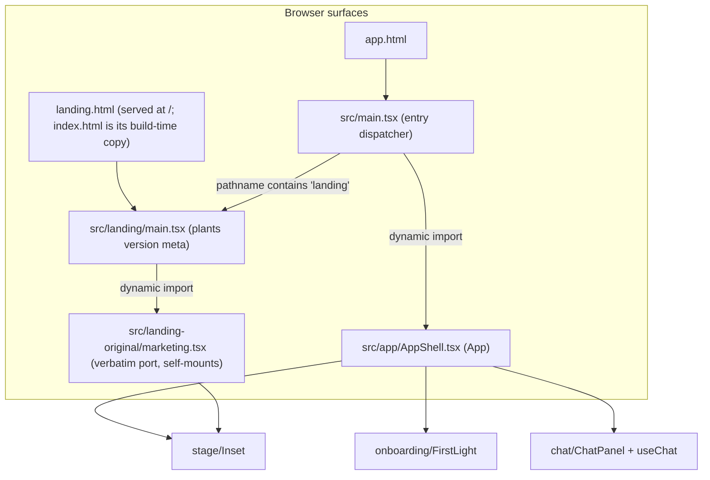
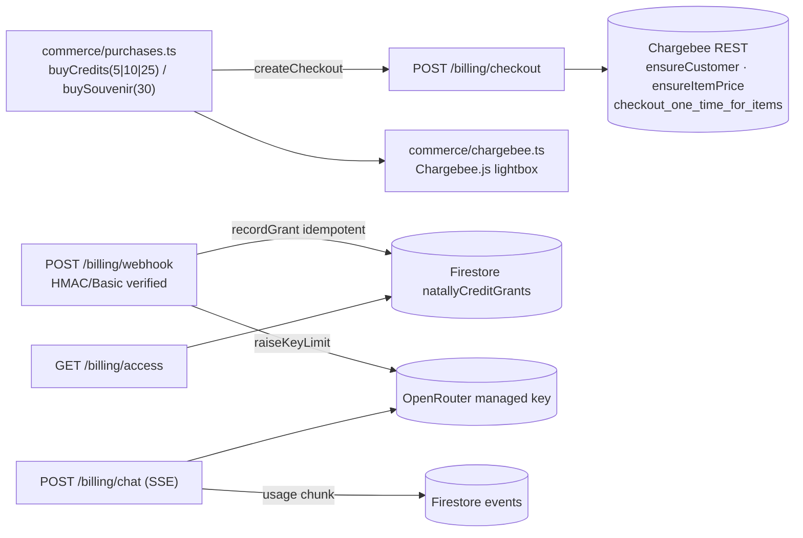

# Architecture — codebase snapshot (2026-11-09, commit `3f00f98`)

**This document describes what the code IS, not what it should be.** It is the
normalizing snapshot of the in-development codebase: every subsystem as found,
zoomed-in where the wiring is non-obvious, with diagrams
([Mermaid](CODEMAP/architecture-3f00f98.mmd) ·
[PlantUML](CODEMAP/architecture-3f00f98.puml)) and, at the end, the
**exhaustive entity registry** — the allow-list of names that may be realized
in code (§Registry convention).

- Superseded intent document (2026-11-08 clean-room one-shot): preserved at
  `DOCS/ARCHITECTURE.md.bak-2026-11-09`.
- Open items, divergences and their citations: [`DOCS/TODO-LEDGER.md`](TODO-LEDGER.md).
- Build identity at snapshot time: version `1.27.765`, builtAt
  `2026-11-08T21:50:08Z` (`version.json`). Note the deployed build predates
  commits `444e1bc`, `ebf1ed9`, `3f00f98`.
- Snapshot method: CodeGraph index + direct source reads on 2026-11-09; every
  entity row was verified against source, not inferred.

**Registry convention (the allow-list).** Only module-scope entities named in
§16 may be realized in code. Introducing any new module-scope function, class,
interface, type, constant, component or stored key first adds its row to §16
(this document), then the code. Renames are registry edits first. The three
preserved trees (`*-original/`) are frozen ports: changes there are copies of
upstream originals, and any deliberate local addition still adds a row.

---

## 1. Identity and census

| Fact | Value |
| --- | --- |
| Commit | `3f00f98` (master) |
| Version / builtAt | `1.27.765` / `2026-11-08T21:50:08Z` |
| Active source | ~27,500 lines across ~120 files under `src/`, `billing/`, `netlify/`, `scripts/` |
| Page entries | `landing.html`, `app.html` (Vite inputs); `index.html` in `dist-web/` is a build-time copy of `landing.html` (`build_all.sh:36`) |
| License | AGPL-3.0-only |
| Type gate | `npm run lint` → `tsc --noEmit` |

## 2. Surfaces and entry topology



- `src/main.tsx` is a **dispatcher**, not a page: any pathname containing
  `landing` dynamically imports the landing entry; everything else dynamically
  imports the app shell. Both dynamic imports keep the two trees in separate
  chunks and prevent double-mounting `#root`.
- `src/landing/main.tsx` exists to plant `meta[name="natally-version"]` from
  `version.json` (the port's badge reads that meta) and then import the port.
- `app.html` carries the first-paint atelier poster inline (dark `#171128`
  gradient + mascot ``), so the screen is never blank while chunks load.

## 3. Platform layer (`src/platform/`)

Typed, truthful accessors — empty means "not configured", and every caller is
required to surface that visibly rather than default silently.

| Module | Role |
| --- | --- |
| `env.ts` | `VITE_*` accessors: `billingApiUrl()` (default `https://natally-hosted-chat.netlify.app`), `chargebeeSite()` (empty = unconfigured), `firebaseConfig()`, `creditDisplayPerUsd()` (default 100) |
| `firebase.ts` | Google sign-in (popup, redirect fallback), `idToken()`, `onAuthChange()`, typed error classes (`AuthUnavailableError`, `NotSignedInError`, `SignInCancelledError`) and `describeSignInFailure()` that names the failure |
| `eventBus.ts` | Typed pub/sub with an empty `PlatformEventMap` that feature modules augment via `declare module` — the bus itself owns no event names |
| `pwa.ts` | `registerServiceWorker()` registers `/sw.js` only if actually served (HEAD probe); this repo ships none, so it truthfully installs nothing |
| `version.ts` | `version.json?raw` baked in at build; exports `version`, `builtAt` |

## 4. App shell and stage (`src/app/`)

`AppShell.tsx` (default export `App`, line 276) is the composition root: auth
state, the persisted chart (`loadStoredChart`, per-uid localStorage), the
presentation reducer, the voice controller (`getPreloadedVoice()`), the opening
reading reveal, click readings, and lazy `SouvenirDialog`. `StageHeader` (95)
and `AccountPanel` (185) implement the header/account surface (NAV-1: live
balance, Top up / Keepsake / Sign out from the avatar menu).

**The inset card** (`stage/Inset.tsx`) is the heart of the stage. Target
mechanics (INSET revision, 2026-11-09 — behaviour authority: Robin's rows in
`DOCS/TODO-LEDGER.md`; anchors: `DOCS/CODEMAP/inset-anchors-3f00f98.md`):

- **Two views, one stage.** The atelier (Natally) and her chart; one fills the
  stage, the other is the inset. `presentation.view` decides which; the chart
  is always rendered by `Astrolabe3D` inside `Inset`, Natally by the atelier
  pane, so a swap is a re-layout, never a remount.
- **Click acts on what hover has shown.** Pointer over a chart component
  (planet, sign, house, aspect line) highlights it; a click/tap on a
  highlighted component swaps the views (chart to the stage, Natally to the
  inset) and **Natally speaks** about that component, with lipsync, while the
  chart highlights every involved element (the planet, its house, its sign,
  its aspect lines) and the highlight moves with her words (§5). A click where
  nothing is highlighted swaps the views only. A drag moves the card and never
  swaps or selects. What she says, and how far (the unpaid/paid information
  levels), is a separate issue tracked in the ledger, not part of the inset.
- **Touch** (assumption Q6, overturnable): tap on a component = hover+click
  above; tap on empty inset = swap; press-and-hold (`LONG_PRESS_MS`) then
  move = drag.
- **Size floor** `insetFloorPx(bodyCount)`: the larger of the fingertip rim
  (`ceil(count·44/π) + CHROME_PX`) and the glyph-legibility floor
  (`GLYPH_MIN_PX` per house number and planet symbol at the wheel's symbol
  scale) — every house number and every planet symbol individually readable.
  Cap `INSET_MAX_W` 0.6 of stage width; square wheel.
- **Modes** `InsetMode = 'side' | 'stack' | 'floating'`: docked beside the
  scene or a floating card; `{mode, geometry}` persists per account through
  the caller's `storageKey`; a restored dock that no longer fits degrades to
  floating.
- **Auto placement until the customer moves it** (`userMovedRef`): on every
  stage resize, dock if `sideFits`/`stackFits`, else
  `computeAutoPlacement(stage, faceRectInStage(...), floorPx)` against the
  on-screen rect of Natally's head; too small for the floor to clear her face
  → `onAutoInvert` (chart takes the stage, Natally becomes the inset).
- **Drag, dock, resize — observed not working on `v1.27.765` and corrected
  here as contracts, not code presence:** the card moves from its chrome (bar,
  border, anywhere off the wheel) past `DRAG_THRESHOLD_PX`; grabbing the wheel
  itself tilts it in 3D and spins it with momentum, never moves the card
  (operator 2026-11-11); a docked card lifts to floating on drag; release
  within `DOCK_REACH` of an edge/corner docks there (right → `side`, bottom →
  `stack`, else corner snap at `DOCK_MARGIN`) and the scene re-zooms into the
  remaining space (`data-inset-dock` + `--inset-dock-size` on the stage;
  `inset.css` implements the fill). All four corners carry a resize grip
  (`.chart-inset__resizer`, aspect-locked, clamped to [floor, cap]). Alt+arrow
  keyboard move/resize retained. Acceptance is by observation on the deployed
  build, not by the presence of these handlers.
- **Acrylic surface** `.chart-inset`: translucent dark-purple pane —
  `backdrop-filter: blur(…)` plus a plum tint that darkens what lies behind —
  with the wheel, numbers and symbols fully legible on it; the docked and
  focused fills keep the same material.
- `stageMetrics.ts` `useStageVisualHeight` feeds the focused fill height.

`AtelierBackdrop.tsx` layers the real art (`/atelier/puppet-cleanplate.webp` +
pixel-registered `room.webp` mascot, poster fallback). `karaokeCaption.tsx`
renders the word currently being spoken (brass glow) from
`natally-karaoke` window events. `VersionBadge.tsx` mirrors `platform/version`.

**Onboarding** (`onboarding/FirstLight.tsx`, default export, 60): phases
`welcome → intake → casting`, wraps the preserved intake questionnaire, speaks
through the shared preloaded voice (gesture-gated: first pointerdown/keydown
admits audio), shows honest elapsed seconds while the ephemeris works, and
recovers a bfcache-resurrected `casting` state by falling back to the intake
(answers survive the restore). On completion it hands the `NatalChart` to the
shell at once — no second wheel is ever drawn over Natally.

`intake/BirthForm.tsx` is the clean-room intake: debounced pure gazetteer
search, place chip confirm/clear, date/time validation, then `natalChart()`.

## 5. Presentation pipeline (`src/app/presentation/`)

She drives the stage herself; the pipeline is cue parsing → speech-paced
playback → a reducer.

```mermaid
sequenceDiagram
  participant M as Model reply (SSE)
  participant P as parseReply (cues.ts)
  participant D as PlaybackDriver (playback.ts)
  participant V as Voice (voice/index.ts)
  participant S as presentationReducer (state.ts)
  M->>P: streamed fragment with [[view:chart]] [[chart:Sun;Moon]]
  P-->>D: cleaned text + Cue{offset, action}
  D->>V: speakStream(cleaned)
  V-->>D: word boundary (char offset advances)
  D->>S: apply crossed cues (focus / clear / view)
  Note over V,S: speech end → finish(): unapplied cues flush
```

- `cues.ts` — `parseReply(partial, knownTargets)` strips `[[chart:…]]` /
  `[[view:…]]` from (possibly partial) streamed text, keeping exact offsets so
  display, speech and cues never disagree; unknown targets drop; ≤6 targets per
  cue (`MAX_TARGETS`); an unterminated `[[…` holds as pending.
- `playback.ts` — `createPlayback(apply)` returns a `PlaybackDriver`
  (`begin/update/spoken/end/finish`): with audio, cues fire as spoken word
  boundaries cross their offsets; without audio, at text-stream offsets;
  `finish()` flushes whatever speech never reached.
- `state.ts` — `presentationReducer` over `PresentationState {chartKey,
  focusTargets, view, follow, sequence}`: `focus`/`clear` set highlights, `view`
  swaps chart⇄atelier, **a manual view choice sets `follow:false` and automatic
  view cues stop**; `chart` resets on a new chart key. **Target:** `focusTargets`
  reach the wheel as its highlight list (`Astrolabe3D` `highlightedComponents`),
  not only as one `selectedPlanetName`; targets include aspect lines
  (`"Sun trine Moon"`, `"now Mars square Venus"`) so she can highlight and
  explain relationship lines (natal↔natal and now↔natal only — now↔now is
  excluded by design: the current sky aspects itself continuously and would
  cover the wheel with lines carrying no personal information).
- `explain.ts` — **new** `explainTarget(target, chart, sky)`: composes her
  spoken passage for a tapped component (`content/lessons` +
  `chart/liveReading` placement statement) with cues for every involved
  element (`involvedElements(target, chart)`: the body, its house, its sign,
  its aspect lines), then hands it to the same driver as a reply so `view:
  chart`, highlights and speech move together. No inference. Used by the
  shell's tap handler and available to the opening.
- `opening.ts` — `openingReading(chart)`: her authored first message with cues
  (`[[view:chart]]`, Sun/Moon/Ascendant passages, first trine…), timed or
  untimed (`unknown time` variants).
- The shell re-renders the opening word-by-word using the same karaoke
  boundaries (`revealedOpening`), and the chat's replies flow through the same
  driver, so live replies and the opening behave identically.

## 6. Chat and inference (`src/app/chat/`)

- `useChat.ts` — the conversation hook: message state (mirror-ref pattern so
  streaming never reads stale state), `send()` (user turn → SSE reply → cue
  settle), the opening reading as a stable first message, idle spontaneous
  stories (`SPONTANEOUS_IDLE_MS` 60 s, never two without a user turn between),
  and `useAllowance()` (60 s poll of `/billing/access`, display via
  `formatCr`).
- `context.ts` — builds the OpenRouter wire messages: persona system prompt
  (`content/persona`), chart facts, target inventory + cue instructions
  (`presentationBlock`), backstory answers, last `MAX_CONTEXT_MESSAGES` (20)
  turns. **Target (inset):** `chartTargets` also enumerates aspect lines
  (`aspectTargetName`, natal↔natal and now↔natal) so her cues can address
  them; `presentationBlock` instructs her to bring the chart forward,
  highlight the involved elements and clear between emphases. The information
  levels (unpaid/paid) are a separate issue.
- `inference.ts` — `streamChat()`: SSE client over `POST /billing/chat` with
  Bearer Firebase ID token; typed failures `NoAllowanceError` (402),
  `ChatNetworkError`, `BillingNotConfiguredError`; frames parsed incrementally
  so partial text renders as it arrives.

## 7. Astrology engines and chart rendering

**Two pipelines by design** (see README §"How the two trees fit together"):

| Pipeline | Modules | Output | Consumers |
| --- | --- | --- | --- |
| Clean-room | `src/astro/{chart,ephemeris,gazetteer}.ts` | frozen `NatalChart` (`src/shared/types.ts`) | persistence, chat facts, souvenir, live readings, BirthForm |
| Original renderer rail | `src/atelier-original/services/ephemeris.ts` via `src/chart/astrolabeInput.ts` bridge | `NatalChartResult` (richer: sign info, aspect chords, current sky) | `Astrolabe3D` (app wheel), landing example chart |

- `astro/ephemeris.ts` wraps the vendored Swiss Ephemeris WASM:
  `julianDay`, `calcUt` (body positions with speed), `placidusHouses` (cusps +
  Asc/MC). `astro/chart.ts` `natalChart(input)` validates `BirthInput`, uses
  the place's **IANA zone** (historical DST correctness), defaults unknown time
  to noon with houses kept, computes bodies (`MOVING_BODIES`), signs
  (`signOf`), houses (`houseOf`), angles, and aspects (`aspectsBetween`).
  `astro/gazetteer.ts` is a pure offline search over the 108-place vendored
  JSON (`searchPlace` ranked exact/prefix/substring, `resolvePlace` unique).
- `chart/scene.ts` + `chart/AstroChart.tsx` — the clean-room canvas wheel
  (hover/zoom/active-body dim that **never dims wheel structure**); used by the
  souvenir viewer; Playfair-Display label refresh once the font loads.
- `chart/liveReading.ts` `composeLiveReading(planet, natal, sky)` — authored
  lesson + a truthful live check against today's sky (`sky: null` degrades to
  the lesson alone).
- `atelier-original/components/Astrolabe3D.tsx` — the original three.js wheel
  (117 symbols): tiered renderer (WebGL/SVG fallback), pointer picking with
  hover analytics episodes, inset-aware layout, callouts. **Target (deliberate
  local additions to the frozen port, registered in §16.12):** the focus-dim
  traverse exempts the whole wheel structure — house spokes, house numbers,
  sign ring and ticks, degree marks — by `userData.wheelStructure`, so only
  bodies, glyphs and aspect lines de-emphasise; `highlightedComponents` is
  driven from `presentation.focusTargets`; aspect lines keep their raycast
  selectability and callouts (natal↔natal solid, now↔natal dashed; no now↔now
  by design); a click on a hovered component reports the hit to the shell,
  which swaps the view and speaks (§4), instead of selection only.

## 8. Voice (`src/voice/` + TTS rail)

- `voice/index.ts` `createVoice()` — the app-facing controller: sentence
  buffering (`COMPLETE_SENTENCES`), one utterance at a time, `{flush:true}`
  speaks the remainder, `admit()` only inside a real gesture, `onState`
  (preparing/speaking/error), and **karaoke boundary events**
  (`natally-karaoke`) that drive captions, the opening reveal and cue
  playback. Emits `natally-voice-performance` on speech end.
- `services/supertonicTts.ts` — the preload seam: one shared controller
  (`getPreloadedVoice`, idempotent) and `scheduleSupertonicPreload()` that
  starts the model worker while the customer reads the first prompt.
- `atelier-original/services/supertonic{Tts,Download,worker}.ts` — the local
  Supertonic runtime (worker, WASM/graph progress, cache),
  `voiceMeasurements.ts` (voluntary telemetry store, schema
  `natally-voice-measurements/v1`), `voiceService.ts` (speech-owner
  arbitration, waiting sounds, external playback registration — 121 symbols).

### 8.1 Voice target (operator 2026-11-11 — FROZEN)

The voice is the original Supertonic local model (`onnx-community/Supertonic-TTS-ONNX`, ~262 MB, F4) — no hosted voice.
1. **Loading progress is always visible** — restore the original's
   `VoiceDownloadStatus` (reference: `LIBS/reference/VoiceDownloadStatus.natally-ai-studio.tsx`,
   from rebots-online/natally-ai-studio): a thin bar fixed at the bottom of
   every page (landing and app) while the model downloads or prepares, with
   "Downloading Natally's voice for this device…", `x / y MB` and the
   **percentage**; "Preparing Natally's voice…" while the runtime readies;
   errors shown and retryable. Mounted once in `src/main.tsx`.
2. **Preload from first load** — the model starts loading (idle-scheduled,
   Save-Data respected) as soon as any page loads, so it is ready before the
   first click; a click while it still loads speaks as soon as it is ready.
3. **Calibrate to the device's resources** — WebGPU where available, WASM
   otherwise; a failed GPU runtime falls back to WASM for the session.
4. **Pre-render in the background, play in the foreground** — a passage is
   split into chunks; the next chunk is synthesised in the worker while the
   current one plays, so playback is continuous with no gaps between chunks.

## 9. Commerce and the billing server



**Client** (`src/commerce/`): `purchases.ts` (`PACKS [5,10,25]`, `SOUVENIR 30`,
idempotency `requestId`, client-side gate: no `VITE_CHARGEBEE_SITE` →
`BillingNotConfiguredError`, never a dead lightbox) · `chargebee.ts`
(script+instance singletons, `openCheckout(url)` resolving on close/payment,
`CheckoutClosedError`) · `billingApi.ts` (Bearer JSON client, 503 →
`BillingNotConfiguredError` carrying the named missing setting). `TopUpSheet`
presents packs + souvenir and refreshes the server-signed envelope after
purchase; a 402 in chat opens it automatically.

**Server** (`netlify/functions/chargebee.mjs` + `billing/*.mjs`):

- Router (`handler`, 426): `access · checkout · redeem · webhook · history ·
  invoices/:id · chat`; CORS from `BILLING_ALLOWED_ORIGIN`; `BillingConfigError`
  → 503 `billing_not_configured` whose body **names the missing env var**.
- `verify.mjs` — RS256 Firebase ID-token verification against Google JWKS
  (rotation-aware refetch), no admin SDK.
- `ledger.mjs` — Firestore over REST (service-account JWT → OAuth token,
  cached): **allowance = Σ`natallyCreditGrants` − Σ`events` usage**
  (`allowance(uid)`, 188); `recordGrant` idempotent by
  `sha256("chargebee:"+eventId)`; `getManagedKey`/`saveManagedKey` with
  AES-256-GCM at rest, AAD-bound to `uid|generation`, generation++ on rotate.
- `chargebee.mjs` — REST client (HTTP Basic): customer cache keyed
  `natally-<uid>` (the webhook's foreign-customer filter relies on this
  prefix), `ensureItemPrice` (item price per kind+cents, duplicate-race
  tolerant), `createCheckout` (micros→cents must be exact), `verifyWebhook`
  (constant-time HMAC hex/base64/base64url + signed-payload `t=…,v1=…`, or
  HTTP Basic), `getInvoice`.
- `openrouter.mjs` — `createManagedKey` (limit-limited key; secret visible
  once), `patchKeyLimit`, `streamChat` with `usage.include` harvesting.
- `chatRoute` (356): Bearer-verified SSE passthrough on the customer's managed
  key over the **free-tier chain** `deepseek/deepseek-chat-v3-0324:free →
  meta-llama/llama-3.3-70b-instruct:free → google/gemma-3-27b-it:free`;
  forwards upstream bytes verbatim, mines the final usage chunk, posts actual
  spend as `recordUsage` (micros).
- `ephemeris.mjs` (separate function): swisseph-wasm server positions/houses
  (`health · positions · houses`), CDN-staged assets, P-256-signed request
  access (`EPHEMERIS_SIGNING_KEY`) with one-strike IP bans, deployment
  diagnostics in 500 detail (temporary).
- `billing/server.mjs` — `createBillingServer()`: local Node host of the same
  router (PORT, default 8788).

## 10. Souvenir (`src/souvenir/`)

`SouvenirDialog` (offer → checkout → prepare → done; sign-in required) →
`buildReport(chart)` (cover of birth facts, one section per body with its
authored lesson at the actual placement, aspects, closing) → `pdf.ts`
`downloadPdf` (jsPDF export) → `retain.ts` persists `{report, chart, at}` per
uid in localStorage with a boundary-guard read (`isRetainedSouvenir`);
`SouvenirViewer` re-renders the keepsake (clean-room `AstroChart` + sections)
and re-exports the PDF. The dialog is lazy-loaded to keep the entry chunk
light.

## 11. Authored content (`src/content/`)

`persona.ts` (`NATALLY_SYSTEM_PROMPT` — the robo-psychic persona — and
`NATALLY_EXAMPLES`) · `lessons.ts` (`Lesson {title, what, tradition,
question}` per body key + `'general'`, `getLesson`) · `closes.ts`
(`CLOSES` credits/souvenir/none with CTAs, `getClose`) · `backstory.ts`
(`SPONTANEOUS_STORIES` round-robin `nextSpontaneousStory`, backstory
Q&A). All authored text lives here, not in components.

## 12. Landing (`src/landing-original/`, verbatim port v1.42 — LIVE)

`marketing.tsx` self-mounts the full landing: site header, hero, example chart
(demo birth data 1988-08-31 14:30 Toronto — Sun–Moon–Neptune grand trine,
1.0° orb) inside the shared `Inset`, education session, account and checkout
surfaces, guest room. Its live services include: `ephemeris.ts` /
`transits.ts` (current-sky snapshots) · `authoredChartExplanations.ts` /
`authoredEducationSession.ts` / `authoredNudges.ts` (no-inference authored
teaching) · `soul.ts` (bounded character/user lore, `SoulState`, retained story
ids) · `billingAccess.ts` + `billingApi.ts` + `checkoutCatalog.ts` +
`revenueCatCheckout.ts` + `nativeRevenueCat.ts` (the original RevenueCat rail,
kept untouched; catalog maps packs/souvenir to platform products) ·
`inferenceAccess.ts` (personal/managed/development key install contract) ·
`natallyHistory.ts` + `historyLifecycle.ts` + `accountStorage.ts`
(owner-scoped storage keys, whole-history erasure with announcements) ·
`readingAudio.ts` (IndexedDB WAV retention) · `openingReading.ts` (legacy
opening prompts) · `firebase.ts` (its own Firebase app off
`src/firebase-applet-config.json`) · `onboarding.ts` (cloud intake fetch) ·
`presentation.ts` (the original cue/receipt reducer — the app's `state.ts` is
its clean-room sibling) · `chartTargets.ts` (target inventory +
`chartFocusKey` coordinate-identity guard) · voice/telemetry/theme/memories
services mirrored from `atelier-original`. Components:
`AccountBillingDialog`, `CreditActions` (quote → buyer details → paid
lifecycle), `CustomerValueExplanation`, `Astrolabe3D` (landing copy).

### 12.1 Landing target state (operator 2026-11-11 — FROZEN on Robin's order "assign to coders from checklist")

1. **The landing is the atelier — the app's own signed-out page.** Visitors
   land on the page that comes up today when you click Sign In: `AppShell`'s
   signed-out branch (`src/app/AppShell.tsx`), the big Natally in her atelier
   (`AtelierScene`) with the sign-in card. That page, not `landing.html` /
   `src/landing-original/marketing.tsx`, is the landing: astronatally.com `/`
   serves `app.html`. The marketing port is retired from the landing role.
2. **One click, one sign-in (hard rule).** Sign In launches Google's account
   chooser on that same click. No screen, card or button ever asks someone to
   click to sign in after they already clicked Sign In — offering sign-in and
   then presenting another "click here to sign in" taunts them. A blocked
   popup falls back to Google's redirect from that same click, never to a
   second prompt.
3. **All scrolling text is paginated onto cards.** Every piece of landing copy
   is divided into pages, each page its own small card with the dark purple
   background of the card that today carries the second "click here to sign
   in" (that card's look is kept; its second-click role is removed per item
   2). The cards scroll by; no landing copy remains as plain scrolling text.
4. **Entering the natal-chart content swaps the atelier for the focused
   chart** — when the cards talking about the chart scroll into view (or its
   menu item is chosen), the chart takes focus and fills the stage and the
   atelier becomes the inset (the existing swap, `swapInsetView`).
4a. **A tap focuses the chart** — primary inset behaviour (§4): a tap on the
   floating chart brings it to focus, filling the stage, with the atelier as
   the inset; scrolling and menu items drive the same swap.
4b. **Clicking an element on the chart makes Natally explain it** (§4): a
   click/tap on a hovered planet, sign, house or aspect line brings the chart
   forward and she speaks her passage about that element, highlighting it
   (and every element involved) as she goes — the same `explainTarget` →
   reply driver path the signed-in stage uses.
4c. **The swap is smooth and the atelier inset well placed.** Focusing and
   unfocusing glide — no broken or jarring zoom, no jump, no flash of an
   empty stage, never sudden: both panes animate together over ~450 ms
   (eased) — the chart grows from its floating card to the full stage while
   the room shrinks from the full stage into its corner card, and the reverse
   on the way back. While Natally explains, the view switches back and forth
   with her words — to the chart when she points at it, back to her when she
   speaks to you — driven by her passage's cues, as on the signed-in stage. When the atelier is the inset it shows Natally whole and
   readable (her face never cropped), in a corner that covers neither the
   chart's wheel nor the cards.
   Both insets — the chart and Natally's card — are movable and resizable
   (drag to move, corner grips to resize, same card behaviour as §4) so it can always be moved out of the way. The focused
   chart is sized to the visible window: the whole wheel fits, nothing cut
   off at the bottom. Behind the wheel is black space with stars and
   constellations floating by — never purple — focused or floating.
   Every inset — the floating chart and Natally's card — sits wholly inside
   the visible window, never cut off at the bottom or any edge.
   Every symbol on the wheel — planet glyphs, sign glyphs, house numbers,
   degree labels — is legible at every inset size, floating or focused: glyph
   sprites keep a minimum on-screen size (≥ 14 CSS px for glyphs, ≥ 11 px for
   degree text) with enough contrast, never shrinking with the canvas into
   illegibility (operator: "the symbols are illegible"). A component's callout
   never covers the component it describes or its neighbours: it sits clear
   of the hovered element with a visible gap, on the side with room, inside
   the inset (operator: "callout covers, too close").
   From first load, the floating chart is placed just as well: a corner on
   the side away from the cards, clear of Natally's face, at a size where
   every glyph reads (§4 face-aware placement, measured with the card column
   counted as occupied).
5. **Leaving the natal-chart content swaps back** — scrolling out of it or
   choosing a menu item outside it returns the big atelier to the stage and
   the chart to the inset.
5a. **Layout: big atelier, cards off to the side.** The atelier fills the
   stage, big, and fits inside the window: Natally and her crystal ball are
   always whole — never cut off by the bottom of the window (the atelier is
   sized to the visible window height, not taller), nor by the card column
   or the inset. The cards look like the sign-in card and sit off to the side —
   never in the middle over Natally — and neither the cards nor the chart
   cover her; the chart inset keeps its face-aware placement (§4). In both
   states — atelier on the stage or the focused chart on the stage — the cards
   stay off to the side and never obscure the main view.
5b. **Her ethos is present — she is a character, not a widget.** On the
   landing Natally is alive in her room exactly as the original landing had
   her (`src/landing-original/marketing.tsx`) and as `src/SOUL.md` defines
   her: her welcome ("Come in. You can explore my room…") spoken once voice is
   on; her authored stories and asides arriving when the room is quiet
   (`authoredNudges` / `content/backstory` `nextSpontaneousStory`), spoken
   with lipsync and shown as her words; her voice and register in every line.
   The scene, the swap and the cards never replace her presence.
6. **Roles by domain.** astronatally.com is the landing; the webapp lands on
   asknatally.online. Every way into the app from the landing — Sign In,
   create-your-chart, Top Up, open-my-atelier, the `?app=1` entry — routes to
   asknatally.online, and asknatally.online serves the app at `/`.
7. **Sign-in works on both domains.** Firebase authorized domains include
   astronatally.com, asknatally.online and their `www` hosts (added
   2026-11-11; snapshot in `DOCS/DOMAINS/`). Item 2 holds across the domain
   change: Sign In on astronatally.com runs the Google popup on that click
   (redirect fallback when blocked); on success the visitor continues on
   asknatally.online already signed in — the Google ID token travels in the
   URL fragment (`#gid=…`, never sent to a server), asknatally.online signs in
   with it (`signInWithCredential`) and strips the fragment at once. No second
   sign-in click anywhere.

## 13. Preserved trees (`*-original/`) — frozen ports

| Tree | Contents | Freeze rule |
| --- | --- | --- |
| `src/atelier-original/` | `components/Astrolabe3D.tsx`, `components/atelier/*` (Scene, Ambience, Character, Season, ThemeSelector, Trinkets, CrystalPool), `components/ReadingStage.tsx`, `components/chartCalloutPlacement.ts`, `services/*` (ephemeris, voice, themes, memories, analytics, presentation type-shim), `vendor/swisseph/*` | Verbatim copies of the deployed original; edits are re-copies. `services/presentation.ts` is a **type-only shim** — only the presentation types are carried; the reducer half is intentionally not |
| `src/landing-original/` | the live landing port (§12) | Operator-authorized port of v1.42; treat as upstream copy |
| `src/onboarding-original/` | `FirstLight.tsx` questionnaire, `BirthDateFields.tsx`, `CalendarPicker.tsx`, `first-light.css` | Verbatim; wrapped (not edited) by `src/app/onboarding` and fed by `src/services/{gazetteer,onboarding,transits,supertonicTts}` seams |

## 14. Build, release, native

`build_all.sh` (the only entry): re-execs itself through
`scripts/build-environment.mjs` (resolves `kstore://` pointers via the
installed KStore client into child-process env only; Admin-Manual checkout is
the fallback), takes a build lock, bumps MINOR + day-stamped BUILD into
`version.json`/`version.txt` (hands-off stamp, CC2 doctrine), commits the
shared identity, `tsc --noEmit`, `vite build --outDir dist-web` (inputs
`landing.html` + `app.html`; manual chunks `three`/`firebase`; copy
`landing.html → index.html`), **surge-deploys to both hosts before any native
compile**, then `scripts/build-native.mjs`: syncs version into
`package.json`, lockfile, `src-tauri/Cargo.{toml,lock}`,
`tauri.conf.json` (window `app.html`, `frontendDist ../dist-web`), runs the
Linux/Windows/Android matrix, stages artifacts + SHA-256 inventory under
`dist/natally-v<version>/`, non-zero exit on any failed target (Windows MSI
via `wixl` on Linux; identity `mba.robin.natally`). `src-tauri/` is packaging
identity + native bridges, not part of the web registry.

### Domains (operator-declared 2026-11-10 — registered, NOT yet wired)

`astronatally.com` → landing surface; `asknatally.online` → webapp surface.
Administration channel: **Namecheap API** (never the web dashboard for
changes). **Backup rule:** Namecheap's DNS write (`setHosts`) replaces the
entire host-records set at once — every write MUST be preceded by a `getHosts`
read whose full snapshot is saved (with timestamp) as the rollback before any
`setHosts` call; writes are serialized, never concurrent. Current deploys
are CI/CD (`build_all.sh`), not architecture.
Wiring, when ordered, touches: static root split (the bundle's `/` is the
landing copy and `src/main.tsx` dispatches on a pathname containing
`landing`, so the app domain needs `app.html` at root or a redirect),
Firebase authorized domains, `BILLING_ALLOWED_ORIGIN` CORS, and Chargebee
redirect origins. Recorded in KStore decision 2026-11-10; act only on go.

## 15. Known divergences (snapshot vs intent)

Recorded verbatim with citations in [`DOCS/TODO-LEDGER.md`](TODO-LEDGER.md):
billing purchase flow never exercised end-to-end; Chargebee REST removed by
operator order (MCP-only; `DOCS/ASSUMPTIONS/2026-11-09-chargebee-rest-key.md`
superseded); webhook not yet registered; landing one-click sign-in + working
menu items remaining. **Inset (target state written into §4, §5, §6, §7 on
2026-11-09; none of it observed working on `v1.27.765`):** click on a hovered
component does not swap or make her speak; docking and corner resize do not
work; `.chart-inset` has no acrylic (no backdrop-filter); focus-dim fades
house spokes, sign ticks and degree marks; `focusTargets` never reach the wheel
as a highlight list; aspect lines are not in the cue inventory. Touch mapping
is an assumption (Q6). **Native sign-in:** `src-tauri/src/native_auth.rs` opens
`https://asknatally.online/auth/native.html`, which no bundle contains — native
Google sign-in cannot complete until that page exists. **Separate issues, not inset:** information levels
(unpaid/paid) not in code; conversation not persisted (on-device target).

---

## 16. Exhaustive entity registry (allow-list)

**Only entities named below may be realized in code** (see Registry
convention, top of document). Kinds: `fn` function · `class` · `iface`
interface · `type` · `const` · `comp` React component · `css`/`asset` non-code.
`·priv` marks module-private (no export). Line numbers are as of commit
`3f00f98`. In the frozen trees, internal (non-exported) helpers are not
enumerated — those files are upstream copies; their exported surface is the
contract.

### 16.1 Libraries (`package.json`)

| Library | Version | Where it is used (verified) |
| --- | --- | --- |
| `react`, `react-dom` | ^19.0.1 | all UI trees |
| `three` | ^0.174.0 | `Astrolabe3D` (both trees), `chart/scene.ts` |
| `firebase` | ^12.19.0 | `platform/firebase.ts`, `landing-original/services/firebase.ts`, `souvenir/*` (auth types) |
| `@huggingface/transformers` | ^4.3.1 | supertonic voice runtime (`voiceMeasurements` schema names it) |
| `@revenuecat/purchases-js` | ^1.74.0 | `landing-original/services/revenueCatCheckout.ts` / `nativeRevenueCat.ts` (legacy rail) |
| `@tauri-apps/api` | ^2.12.4 | native host bridges |
| `jspdf` | ^4.2.1 | `souvenir/pdf.ts` |
| `swisseph-wasm` | ^0.1.0 | `netlify/functions/ephemeris.mjs` (server WASM) |
| dev: `typescript` ^7.0.2, `vite` ^8.3.0, `@vitejs/plugin-react` ^6.1.1, `@types/{react,react-dom,three}`, `@tauri-apps/cli` 2.11.4 | | build/type gate |
| platform: Node 24, Netlify functions (esbuild), `flock`, `surge`, `wixl`/msitools, Android SDK, Cargo/Tauri 2 | | release pipeline |

### 16.2 Entries and platform

| Entity | Kind | Where | Role |
| --- | --- | --- | --- |
| `rootElement`, `reportLoadFailure` | const ·priv, fn ·priv | `src/main.tsx:10,13` | entry dispatcher bodies |
| `existingMeta`, `meta` | const ·priv | `src/landing/main.tsx:17,21` | version meta plant |
| `DEFAULT_BILLING_API_URL`, `DEFAULT_CREDIT_DISPLAY_PER_USD`, `publicString` | const ·priv, fn ·priv | `platform/env.ts:6,7,9` | env defaults |
| `billingApiUrl`, `chargebeeSite`, `firebaseConfig`, `creditDisplayPerUsd` | fn | `platform/env.ts:14,22,30,35` | typed VITE accessors |
| `PlatformEventMap`, `Handler` ·priv, `handlersByType` ·priv, `on`, `emit` | iface, type ·priv, const ·priv, fn, fn | `platform/eventBus.ts:11,15,17,20,37` | owner-free typed bus |
| `AuthUnavailableError`, `NotSignedInError`, `SignInCancelledError` | class | `platform/firebase.ts:22,28,38` | typed auth failures |
| `parseFirebaseOptions` ·priv, `options` ·priv, `authUnavailable`, `auth` ·priv, `requireAuth` ·priv, `googleSignIn`, `redirectSignInFailure`, `onAuthChange`, `idToken`, `describeSignInFailure` | fn/const | `platform/firebase.ts:44,65,68,70,72,84,145,156,161` | auth surface |
| `registerServiceWorker` | fn | `platform/pwa.ts:12` | truthful SW registration |
| `stamp` ·priv, `version`, `builtAt` | const ·priv, const, const | `platform/version.ts:8,11,13` | build stamp |

### 16.3 Shared contracts (`src/shared/`)

| Entity | Kind | Where | Role |
| --- | --- | --- | --- |
| `ChartBodyKey`, `ZodiacSign`, `EclipticPoint`, `GeoPlace`, `BirthInput`, `ChartBody`, `HouseCusp`, `HouseCuspTable`, `Aspect`, `AspectKind`, `NatalChart`, `ChatMessage`, `PurchaseKind`, `AllowanceEnvelope`, `GrantRecord` | type/iface | `shared/types.ts:20,~,~,47,55,75,83,89,105,~,114,124,133,140,152` | frozen chart + billing vocabulary |
| `formatCr` | fn | `shared/credits.ts:12` | integer-micros → "12.35 Cr" |
| `tokens.css` | css | `shared/tokens.css` | design tokens |

### 16.4 App shell and stage

| Entity | Kind | Where | Role |
| --- | --- | --- | --- |
| `SouvenirDialog` lazy binding ·priv, `AuthState` ·priv, `StageHeader`, `AccountPanel`, `loadStoredChart`, `App` (default) | const ·priv, type ·priv, comp ·priv, comp ·priv, fn ·priv, comp | `app/AppShell.tsx:72,76,95,185,264,276` | composition root (internal: `onKaraoke`, `handleReplyEvent`, `explainPlanet`, `skyToday`, `admit`, chatStage, opening reveal refs) |
| `BODY_TARGET_PX`, `INSET_MAX_W`, `ASPECT` ·priv, `CHROME_PX` ·priv, `DEFAULT_BODY_COUNT` ·priv, `DRAG_THRESHOLD_PX` ·priv, `DOCK_GAP` ·priv, `DOCK_REACH` ·priv, `DOCK_MARGIN` ·priv, `FACE_COVERED_INVERT` ·priv, `KEY_STEP`/`KEY_RESIZE_STEP` ·priv, `InsetGeometry` ·priv, `InsetMode`, `InsetState` ·priv, `InsetProps`, `StageBox` ·priv, `Rect` ·priv, `insetFloorPx`, `loadState` ·priv, `storeState` ·priv, `clampGeometry` ·priv, `allowedWidthPx` ·priv, `sideFits` ·priv, `stackFits` ·priv, `dockedWidthPx` ·priv, `computeAutoPlacement` ·priv, `faceRectInStage` ·priv, `isFiniteNumber` ·priv, `Inset` | const/type/fn | `app/stage/Inset.tsx:58,60,62,~64,~,70,84,68,~,76,72–73,86,97,99,104,127,132,151,157,178,209,187,192,197,~,267,220,~,350` | the inset card (see §4) |
| **pending INSET** `GLYPH_MIN_PX` ·priv, `LONG_PRESS_MS` ·priv, `InsetProps.onSwap`, `InsetProps.onComponentTap` | const ·priv, const ·priv, props | `app/stage/Inset.tsx` | glyph-legibility floor; touch long-press-to-drag; tap-on-empty → swap; tap-on-hovered-component → shell (speak + swap) |
| **pending LANDING** `EXAMPLE_BIRTH` ·priv, `GID_FRAGMENT` ·priv, `PRODUCT_LANDING_HOSTS` ·priv | consts ·priv | `app/AppShell.tsx` | §12.1: the landing's chart (birth data 1988-08-31 14:30 Toronto, Whole Sign; carries no person's name — no "Aurelia", no "example" label anywhere on screen) on the signed-out landing; `#gid=` sign-in handoff; hosts on which the signed-out page acts as the landing |
| **pending LANDING** `LandingCards`, `LandingCardsProps`, `LANDING_SECTIONS` | comp, type, const | `app/landing/LandingCards.tsx` (+ `app/landing/landing.css`) | §12.1 items 3–5: paginated dark-purple copy cards with section ids; reports the active section (chart sections swap the stage) |
| **pending LANDING** `googleSignInForIdToken`, `signInWithGoogleIdToken` | fn, fn | `platform/firebase.ts` | §12.1 item 7: popup sign-in returning the Google ID token; credential sign-in from a handed-over token |
| **pending VOICE** `VoiceDownloadStatus`, `VoiceProgress` | comps | `app/VoiceDownloadStatus.tsx` | §8.1: bottom voice-loading bar with MB + percentage |
| `useStageVisualHeight` | fn | `app/stage/stageMetrics.ts:12` | focused fill height |
| `inset.css`, `app-shell.css`, `chat/chat.css`, `onboarding/onboarding.css` | css | `app/stage/`, `app/` | stage/shell/chat/onboarding styles |
| `AtelierBackdrop` (default), `CompanionCard` ·priv | comp | `app/AtelierBackdrop.tsx:11,48` | layered real art |
| `KaraokeCaption` (default), `KaraokeState` ·priv | comp, iface ·priv | `app/karaokeCaption.tsx:14,9` | spoken-word caption |
| `VersionBadge` (default) | comp | `app/VersionBadge.tsx:7` | build stamp display |
| `TopUpSheet` (default), `TopUpSheetProps`, `describeLoadError` ·priv | comp, iface, fn ·priv | `app/TopUpSheet.tsx:35,20,~25` | packs + souvenir sheet |
| `BirthForm` (default), `BirthFormProps`, `MIN_QUERY_CHARS`/`SEARCH_DEBOUNCE_MS`/`MAX_SUGGESTIONS`/`DATE_RE`/`TIME_RE` ·priv | comp, iface, const ·priv | `app/intake/BirthForm.tsx:23,20,20–21` | clean-room intake |
| `FirstLight` (default), `Phase` ·priv, `VoiceState` ·priv, `GREETING` ·priv, `onCreate` | comp, types ·priv, const ·priv | `app/onboarding/FirstLight.tsx:60,~,~,~,135` | reveal + casting |

### 16.5 Presentation pipeline

| Entity | Kind | Where | Role |
| --- | --- | --- | --- |
| `CueAction`, `Cue`, `ParsedReply`, `CUE` ·priv, `MAX_TARGETS` ·priv, `parseReply` | type, iface, iface, const ·priv, const ·priv, fn | `app/presentation/cues.ts:9,14,20,26,27,35` | cue stripping with offsets |
| `SpokenBoundary`, `PlaybackDriver`, `createPlayback` (+`applyThrough` ·priv) | iface, iface, fn | `app/presentation/playback.ts:~10,18,31` | speech-paced cue application |
| `PresentationView`, `PresentationState`, `PresentationAction`, `initialPresentation`, `presentationReducer` | type, iface, type, const, fn | `app/presentation/state.ts:~,~,~,~40,46` | stage reducer (manual view → follow off) |
| **pending INSET** `ExplainSource`, `explainTarget`, `involvedElements`, `aspectTargetName` | type, fn, fn, fn | `app/presentation/explain.ts` | tap → her spoken passage about the component + cues for every involved element (body, house, sign, aspect lines); aspect-line target naming shared with `chat/context.ts` |
| `openingReading`, `inHouse` ·priv, `ordinal` ·priv | fn | `app/presentation/opening.ts:10,22,~` | authored opening with cues |

### 16.6 Chat and inference

| Entity | Kind | Where | Role |
| --- | --- | --- | --- |
| `ChatError`, `ALLOWANCE_POLL_MS` ·priv, `SPONTANEOUS_IDLE_MS` ·priv, `AllowanceView`, `ReplyEvent`, `ChatStage`, `UseChat`, `newId` ·priv, `useChat`, `useAllowance` (+`send`, `fireIdleStory`, `armIdleStory`, `clearIdleStory`, `updateMessages` ·priv) | type, const ·priv, iface, iface, iface, fn ·priv, fn, fn | `app/chat/useChat.ts:36,44,47,49,56,62,77,87,92,294` | conversation + allowance hooks |
| `ChatPanel`, `ChatPanelProps` | comp, iface | `app/chat/ChatPanel.tsx:51,~44` | chat surface |
| `ContextRole`, `ContextMessage`, `MAX_CONTEXT_MESSAGES`, `SIGNS` ·priv, `HOUSE_ORDINALS` ·priv, `chartFacts`, `chartTargets`, `presentationBlock`, `buildMessages`, `backstoryAnswerFor` | type, iface, const, const ·priv, const ·priv, fn, fn, fn, fn, fn | `app/chat/context.ts:10,13,19,21,36,64,132,140,153,~` | wire-context builder |
| `NoAllowanceError`, `ChatNetworkError`, `BillingNotConfiguredError`, `StreamChatInput`, `StreamEvent`, `chatUrl` ·priv, `post` ·priv, `postConversation`, `errorDetail` ·priv, `parseFrame` ·priv, `streamChat` | class, class, class, iface, type, fn ·priv, fn ·priv, fn, fn ·priv, fn ·priv, fn | `app/chat/inference.ts:17,33,~,42,~50,53,57,76,91,121,173` | SSE client over /billing/chat |

### 16.7 Astrology and chart

| Entity | Kind | Where | Role |
| --- | --- | --- | --- |
| `DATE_RE`/`TIME_RE` ·priv, `MOVING_BODIES` ·priv, `signOf`, `houseOf`, `birthInstantUtcMs`, `aspectsBetween`, `natalChart`, `cuspEntry` ·priv | const ·priv, const ·priv, fn, fn, fn, fn, fn, fn ·priv | `astro/chart.ts:~,~,70,75,155,170,199,249` | clean-room chart |
| `_swe_houses` ·priv, `ephemerisModule` ·priv, `readDoubles` ·priv, `julianDay`, `calcUt`, `placidusHouses` | fn ·priv | `astro/ephemeris.ts:35,104,109,128,143,192` | swisseph WASM wrapper |
| `fold` ·priv, `IndexedPlace` ·priv, `INDEX` ·priv, `matchRank` ·priv, `searchPlace`, `resolvePlace` | fn/const/iface ·priv, fn, fn | `astro/gazetteer.ts:8,12,21,34,42,59` | offline gazetteer |
| `gazetteer-json.d.ts`, `src/gazetteer.json` | asset | `astro/`, `src/` | 108-place data + typing |
| `AstroChartProps`, `AstroChart` | iface, comp | `chart/AstroChart.tsx:10,21` | canvas wheel |
| `ChartScene`, `resize`/`setActiveBody`/`refreshLabels`/`dispose` (methods), `createChartScene` | iface, fn | `chart/scene.ts:10,14,25,31,33,225` | scene imperative API |
| `timezoneOffsetHours` ·priv, `toAstrolabeInput`, `computeAstrolabeChart`, `NatalChartResult` (re-export) | fn | `chart/astrolabeInput.ts:~20,39,55,59` | BirthInput ↔ original pipeline bridge |
| `SkyPlacement`, `dominantAspect` ·priv, `composeLiveReading` | type, fn ·priv, fn | `chart/liveReading.ts:~,~,69` | click readings |

### 16.8 Voice

| Entity | Kind | Where | Role |
| --- | --- | --- | --- |
| `VoiceState`, `SpeakOptions`, `KaraokeDetail`, `Voice`, `COMPLETE_SENTENCES` ·priv, `createVoice` | iface, iface, iface, iface, const ·priv, fn | `voice/index.ts:~,~,~,43,61,~` | sentence-buffered gesture-gated controller |
| `preloaded` ·priv, `getPreloadedVoice`, `scheduleSupertonicPreload` | const ·priv, fn, fn | `services/supertonicTts.ts:11,14,20` | shared controller + preload seam |
| `CurrentLocation`, `MAX_DISTANCE_KM` ·priv, `haversineKm` ·priv, `nearestPlace` ·priv, `requestCurrentLocation` | iface, const ·priv, fn ·priv, fn ·priv, fn | `services/transits.ts:12,21,24,35,48` | geolocation → nearest known place (≤150 km) |
| `GazetteerEntry`, `cache` ·priv, `loadGazetteer` | iface, const ·priv, fn | `services/gazetteer.ts:13,22,24` | typed gazetteer re-export |
| `ReadingStyle`, `IntakeDraft` | type, iface | `services/onboarding.ts:11,14` | intake draft contract |
| `getBirthDateParts`, `getBirthMonthDays`, `formatBirthDateInput`, `validateBirthDate`, `BirthDateParts` | fn, fn, fn, fn, iface | `services/birthDate.ts:12,17,~28,38,~9` | date parts/validation |

### 16.9 Commerce client

| Entity | Kind | Where | Role |
| --- | --- | --- | --- |
| `BillingNotConfiguredError`, `BillingApiError`, `BillingNetworkError`, `CheckoutRequest`, `CheckoutResult`, `endpoint` ·priv, `bearer` ·priv, `request` ·priv, `getAccess`, `createCheckout` | class, class, class, iface, iface, fn ·priv, fn ·priv, fn ·priv, fn, fn | `commerce/billingApi.ts:~10,34,~,47,~57,61,65,~72,~,~` | Bearer JSON client |
| `checkoutAvailable`, `CHARGEBEE_JS_SRC` ·priv, `CheckoutHandlers`, `ChargebeeInstance` ·priv, `ChargebeeStatic` ·priv, `scriptPromise` ·priv, `loadChargebeeScript` ·priv, `instancePromise` ·priv, `chargebeeInstance` ·priv, `CheckoutClosedError`, `openCheckout` | const, const ·priv, iface, iface ·priv, iface ·priv, const ·priv, fn ·priv, const ·priv, fn ·priv, class, fn | `commerce/chargebee.ts:~10,~,~30,35,39,49,51,78,81,~,91` | lightbox integration |
| `PACKS`, `SOUVENIR`, `toUsdMicros` ·priv, `purchase` ·priv, `buyCredits`, `buySouvenir` | const, const, fn ·priv, fn ·priv, fn, fn | `commerce/purchases.ts:10,13,16,29,49,58` | purchase surface |

### 16.10 Souvenir and content

| Entity | Kind | Where | Role |
| --- | --- | --- | --- |
| `SouvenirReport`, `ReportSection`, `MONTHS` ·priv, `ASPECT_VERB` ·priv, `formatIsoDate` ·priv, `formatLatitude` ·priv, `birthFacts` ·priv, `bodySection` ·priv, `aspectsSection` ·priv, `closingSection` ·priv, `buildReport` | iface, iface, const ·priv, const ·priv, fn ·priv, fn ·priv, fn ·priv, fn ·priv, fn ·priv, fn ·priv, fn | `souvenir/report.ts:20,~,25,41,~,~,~,86,100,118,135` | keepsake authoring |
| `PAGE` ·priv, `lines` ·priv, `drawCover` ·priv, `exportPdf` ·priv, `souvenirFileName` ·priv, `downloadPdf` | const ·priv, fn ·priv, fn ·priv, fn ·priv, fn ·priv, fn | `souvenir/pdf.ts:10,27,61,154,166,176` | jsPDF export |
| `RetainedSouvenir`, `isRetainedSouvenir` ·priv, `saveSouvenir`, `loadSouvenir` | iface, fn ·priv, fn, fn | `souvenir/retain.ts:10,18,~,73` | per-uid retention |
| `SouvenirDialog`, `Phase` ·priv, `buy` ·priv | comp, type ·priv, fn ·priv | `souvenir/SouvenirDialog.tsx:93,~,120` | purchase dialog |
| `SouvenirViewer` | comp | `souvenir/SouvenirViewer.tsx:92` | retained keepsake view |
| `PersonaExample`, `NATALLY_SYSTEM_PROMPT`, `NATALLY_EXAMPLES` | iface, const, const | `content/persona.ts:13,19,~` | persona spec |
| `Lesson`, `LESSONS` ·priv, `getLesson` | iface, const ·priv, fn | `content/lessons.ts:8,19,128` | authored lessons |
| `CloseKind`, `NatallyClose`, `CLOSES`, `getClose` | type, iface, const, fn | `content/closes.ts:7,10,19,38` | authored closes |
| `SpontaneousStory`, `SPONTANEOUS_STORIES`, `storyCursor` ·priv, `nextSpontaneousStory`, `BackstoryAnswer` | type, const, const ·priv, fn, iface | `content/backstory.ts:8,11,24,30,~37` | idle stories + backstory |

### 16.11 Billing server and scripts

| Entity | Kind | Where | Role |
| --- | --- | --- | --- |
| `FREE_MODEL_CHAIN` ·priv, `corsHeaders` ·priv, `json` ·priv, `badRequest` ·priv, `errorResponse` ·priv, `readJson` ·priv, `routeOf` ·priv, `maskKey` ·priv, `accessRoute` ·priv, `checkoutRoute` ·priv, `constantTimeEquals` ·priv, `redeemRoute` ·priv, `raiseKeyLimit` ·priv, `webhookRoute` ·priv, `historyRoute` ·priv, `invoiceRoute` ·priv, `validateChat` ·priv, `parseUsageLine` ·priv, `streamSse` ·priv, `chatRoute` ·priv, `handler` | const ·priv, fns ·priv, fn | `netlify/functions/chargebee.mjs:18,24,43,50,54,73,83,90,94,111,130,136,167,187,231,239,250,274,288,356,426` | billing router (sole export: `handler`) |
| `ChargebeeError` ·priv, `config` ·priv, `apiBase` ·priv, `authHeader` ·priv, `chargebeeFetch` ·priv, `itemPriceIdFor` ·priv, `listItemPrice` ·priv, `ensureItemPrice` ·priv, `customerIdFor`, `customerCache` ·priv, `ensureCustomer` ·priv, `createCheckout`, `getInvoice`, `verifyWebhook` | class ·priv, fns ·priv, fn, fn, fn | `billing/chargebee.mjs:5,14,20,24,29,~,~,~,~,~,~,168,192,214` | Chargebee REST client (exports: `customerIdFor`, `createCheckout`, `getInvoice`, `verifyWebhook`) |
| `TOKEN_URL`/`SCOPE`/`FIRESTORE_BASE` ·priv, `tokenCache` ·priv, `b64url` ·priv, `getAccessToken` ·priv, `fsRequest` ·priv, `fsFields` ·priv, `fromFsValue` ·priv, `mapFromFs` ·priv, `docUrl` ·priv, `sha256Id` ·priv, `webhookGrantId`, `encryptForUid` ·priv, `decryptForUid` ·priv, `allowance`, `docToRecord` ·priv, `getManagedKey`, `saveManagedKey`, `setManagedKeyLimit`, `recordGrant`, `recordUsage`, `history` | const ·priv, fns ·priv, fn | `billing/ledger.mjs:6–9,11,13,21,56,81,94,106,110,114,118,~,247,188,204,257,274,~,~,~,~` | Firestore REST ledger (exports: `webhookGrantId`, `allowance`, `getManagedKey`, `saveManagedKey`, `setManagedKeyLimit`, `recordGrant`, `recordUsage`, `history`) |
| `BillingConfigError`, `BillingAuthError`, `serviceAccount`, `firebaseProjectId`, `fetchJwks` ·priv, `findKey` ·priv, `jwkToPem` ·priv, `b64urlToBuffer` ·priv, `verifyIdToken` | class, class, fn, fn, fns ·priv, fn | `billing/verify.mjs:~,~,~,~,~,~,~,~,114` | token verification |
| `BASE` ·priv, `adminKey` ·priv, `orFetch` ·priv, `upstreamError` ·priv, `createManagedKey`, `patchKeyLimit`, `streamChat` | const ·priv, fns ·priv, fn, fn, fn | `billing/openrouter.mjs:~,~,~,32,42,58,70` | managed-key inference |
| `createBillingServer`, `invokedDirectly` ·priv, `port` ·priv | fn, const ·priv, const ·priv | `billing/server.mjs:8,51,54` | local router host |
| ephemeris function internals (`getEngine`, `stageCdnAssets`, `getKeyState`, `verifySignature`, `routeOf`, `handlePositions`, `handleHouses`, `HttpError`, `handler` …) | fns ·priv | `netlify/functions/ephemeris.mjs` | signed swisseph endpoint (sole export: default `handler`) |
| `credential`, `resolveValue`, `document`, driver ·priv etc. | fns ·priv | `scripts/build-environment.mjs:15,37,8,14` | KStore pointer resolution (CLI wrapper) |
| `prepare`, target builders, `main` | fns ·priv | `scripts/build-native.mjs:17,…` | native matrix coordinator (CLI) |
| `build_all.sh` | asset | repo root | canonical release entry |

### 16.12 Frozen trees — exported surface

**`src/atelier-original/`** (verbatim; internal helpers not enumerated):

| Entity | Kind | Where |
| --- | --- | --- |
| `Astrolabe3D`, `Astrolabe3DProps` | comp, iface | `components/Astrolabe3D.tsx:60,~42` |
| **pending INSET (deliberate local additions)** `userData.wheelStructure` marker on house spokes, sign ring/ticks, degree subtext; `Astrolabe3DProps.onComponentTap` | scene flag, prop | `components/Astrolabe3D.tsx` (focus-dim traverse ~1512–1548; click path ~641–679) |
| `AtelierScene`, `ConversationPhase` | comp, type | `components/atelier/AtelierScene.tsx:14,10` |
| `AtelierAmbience`, `AtelierCharacter`, `AtelierSeason`, `AtelierThemeSelector`, `AtelierTrinkets`, `CrystalPool` (+ css) | comps | `components/atelier/*` |
| `ReadingStage`, `ReadingStageProps` | comp, iface | `components/ReadingStage.tsx:20,~7` |
| `chartCalloutPlacement` | fn | `components/chartCalloutPlacement.ts` |
| `calculateNatalChart`, `NatalChartInput`, `NatalChartResult`, `ZODIAC_SIGNS`, `ZodiacSignInfo`, `formatLongitude`, `HouseCuspData`, `NatalBodyData`, `AspectChordData` (+swisseph init) | fn, ifaces, consts | `services/ephemeris.ts:223,~,105,15,5,154,…` |
| `PresentationView`, `PresentationPanel`, `PresentationAction`, `PresentationCue`, `PresentationReceipt`, `PresentationState` | types/ifaces (type-only shim) | `services/presentation.ts:8–13` |
| `supertonicTts`: `reportVoiceStatus`, `subscribeVoiceStatus`, `initSupertonic`, `supertonicSpeak`, … | fns | `services/supertonicTts.ts:27,31,…` |
| `supertonicDownload`, `supertonic.worker` | modules | `services/` |
| `voiceService`: `NatallySpeechOptions`, `registerExternalPlaybackStop`, speech-owner API, waiting sounds, … | fns/ifaces | `services/voiceService.ts:239,249,…` |
| `voiceMeasurements`, `VoiceMeasurementStore`, `VoiceMeasurement`, `VoiceSurvey`, `SURVEY_OPTIONS` | const, class, iface, type, const | `services/voiceMeasurements.ts:94,53,~,~,20` |
| `atelierTheme`: `ATELIER_THEMES`, `AtelierTheme`, `isAtelierThemeEnabled`, `getAtelierTheme`, `setAtelierTheme`, `getEffectiveAtelierTheme`, `getAvailableAtelierThemes`, `useAtelierTheme` | const, type, fns | `services/atelierTheme.ts:~,9,11,26,32,20,~,37` |
| `atelierMemories`: `ATELIER_ITEMS`, `TrinketId`, `AtelierPosition`, `AtelierMemory`, `isAtelierRehearsal`, `setAtelierRehearsal`, `getAtelierMemory`, `placeAtelierObjects`, `breakAtelierObject`, `nextRehearsalAppointment` | consts, types, fns | `services/atelierMemories.ts:2–5,10,11,~,56,61,~` |
| `atelierSound`: `unlockAtelierSound`, `playFoley`, `playAtelierBreak`, `playAtelierCrunch`, `playAtelierWobble` | fns | `services/atelierSound.ts:24,46,64,76,~` |
| `atelierMotion`, `readingStyle`, `interactionAnalytics`, `historyLifecycle` (`isNatallyHistoryErasing`), `torusGestures` (`bindTorusTouch`, `resetBaseline`) | modules | `services/*` |
| `vendor/swisseph/*` | asset | vendored WASM runtime |

**`src/landing-original/`** (live port; key exports):

| Entity | Kind | Where |
| --- | --- | --- |
| `MarketingExperience`, module self-mount, `appEntry`, `boundedInset`, `GUEST_ROOM`, `EXAMPLE_CHART_INPUT`, `loadExampleChart` | comp, consts/fns ·priv | `marketing.tsx:65,38,47,48,55,250` |
| `marketing.css` | css | landing styles |
| `AccountBillingDialog`, `CreditActions`, `CustomerValueExplanation`, `Astrolabe3D` (port copy) | comps | `components/*:40,14,3,~` |
| `ephemeris.ts` (mirror of atelier-original), `transits.ts` (`calculateCurrentSkySnapshot`, `currentObservationContext`, `buildCurrentSkyContext`), `presentation.ts` (reducer: `initialPresentation`, `validatePresentationAction`, `validatePresentationCues`, `presentationActionsAt`, `presentationFocusAt`, `presentationViewAt`, `reducePresentation`, `withReadingCamera`), `chartTargets.ts` (`chartTargets`, `chartFocusKey`, `chartFocusKeyMatches`, `resolveChartTarget`, `chartTargetLabel`, `isDatedSkyTarget`, `chartReferenceNames`), `soul.ts` (`SoulEntry`, `SoulState`, `normalizeLoreText`, `remember`, `rememberCharacterDevelopment`, `rememberUserDisclosure`, seeds), `authoredChartExplanations.ts` (`getAuthoredChartExplanation`, `getAuthoredUpsellClose`, `AuthoredExplanation`), `authoredEducationSession.ts` (`AuthoredEducationSession`, `createAuthoredEducationSession`), `authoredNudges.ts` (`AUTHORED_STORY_PREFIX`, `readNudgeSettings`, `nextAuthoredNudge`, `AuthoredNudge`), `checkoutCatalog.ts` (`CheckoutCadence`, `CheckoutTier`, `CheckoutPackBinding`, `CheckoutCatalogEntry`, catalog loaders), `revenueCatCheckout.ts` (`getCheckoutOffers`, `getCheckoutCustomer`, `restoreCheckoutCustomer`, `CheckoutCustomer`), `nativeRevenueCat.ts`, `billingAccess.ts` (`BillingAccess`, `reconcileBillingAccess`), `billingApi.ts` (`billingRequest`, `connectBillingResult`, `BillingResult`, `loadInferenceKeySource`), `inferenceAccess.ts` (`InferenceKeySource`, `loadInferenceKey`, `loadInferenceKeySource`, `installInferenceKey`, `removeInferenceKey`), `natallyHistory.ts` (`requiresFreshOnboarding`, `completeFreshOnboarding`, `eraseWholeNatallyHistory`), `historyLifecycle.ts` (`isNatallyHistoryErasing`, `announceHistoryErasure`, `finishHistoryErasure`), `accountStorage.ts` (`accountStorageKey`, `loadAccountValue`, `saveAccountValue`), `readingAudio.ts` (`loadReadingAudio`, `saveReadingAudio`, `clearAccountReadingAudio`, `ReadingAudioRecord`), `openingReading.ts` (`OpeningStage`, `openingPrompt`, `LEGACY_OPENING_PROMPT`, `isLegacyOpeningPrompt`), `onboarding.ts` (`loadNatalIntake`, `fetchUserIntake`), `firebase.ts` (`auth`, `db`, `googleProvider`, `testConnection`, re-exports), `gazetteer.ts`+json, `voiceService`/`supertonic*`/`voiceMeasurements`/`atelier*` mirrors, `purchaseIntent.ts` (`PurchaseKind`), `soul-adjacent seeds` | modules | `services/*` |
| `firebase-applet-config.json` (root + `src/`) | asset | the port's Firebase identity |

**`src/onboarding-original/`** (frozen): `FirstLight` (questionnaire), `BirthDateFields`, `CalendarPicker`, `first-light.css`.

### 16.13 Assets and configuration

`public/` (atelier art layers + manifest, mascot, marketing assets, vendor
swisseph, favicon, manifest.webmanifest, voice waiting WAVs) · `version.json` /
`version.txt` · `vite.config.ts` (inputs, manual chunks `three`/`firebase`) ·
`tsconfig.json` (strict) · `netlify.toml` (publish `dist-web`, functions dir,
ephemeris included_files, `/billing/*` redirect) · `src-tauri/**` (native
identity `mba.robin.natally`, capabilities, MSI source, generated Android
project) · `.env.example` (pointer skeleton) · `CHECKLIST.md`,
`DOCS/TODO-LEDGER.md`, `DOCS/ASSUMPTIONS/*`, `DOCS/RUBRIC-*`,
`DOCS/HANDOFF-*`, `DOCS/QUOTA-REQUEST-*`, `DOCS/CODEMAP/*` (this snapshot's
diagrams + the gitdiagram set), `src/SOUL.md`, `src/READING_RUBRIC.md`.

---

*Snapshot ends. To change the codebase's vocabulary, change §16 first.*
