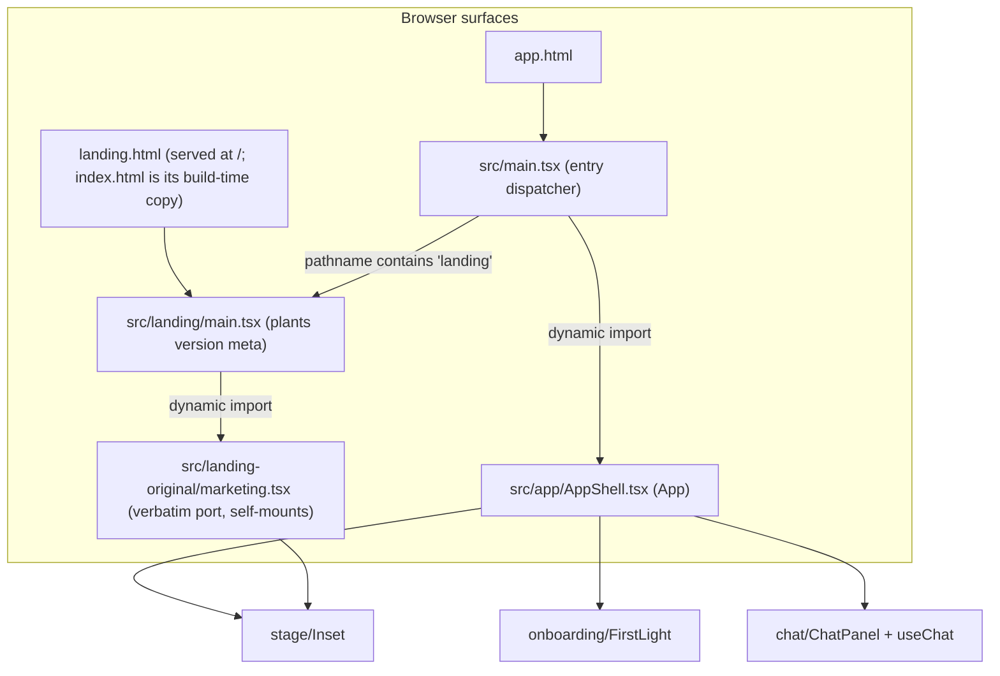
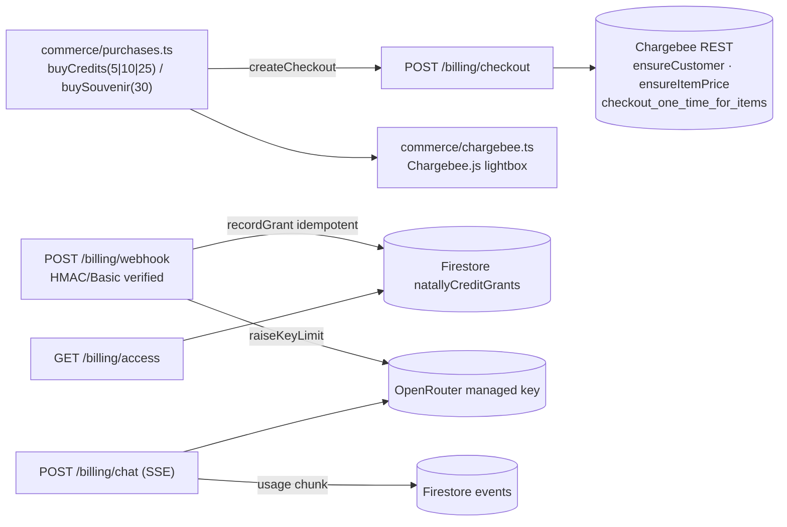

# Architecture — 2026-11-09 baseline; stage/lore reality aligned 2026-11-12

**This document describes what the code IS, not what it should be.** It is the
normalizing snapshot of the in-development codebase: every subsystem as found,
zoomed-in where the wiring is non-obvious, with diagrams
([Mermaid](CODEMAP/architecture-3f00f98.mmd) ·
[PlantUML](CODEMAP/architecture-3f00f98.puml)) and, at the end, the
**exhaustive entity registry** — the allow-list of names that may be realized
in code (§Registry convention).

- Superseded intent document (2026-11-08 clean-room one-shot): preserved at
  `DOCS/ARCHITECTURE.md.bak-2026-11-09`.
- Open items, divergences and their citations: [`DOCS/TODO-LEDGER.md`](TODO-LEDGER.md).
- Build identity at snapshot time: version `1.27.765`, builtAt
  `2026-11-08T21:50:08Z` (`version.json`). Note the deployed build predates
  commits `444e1bc`, `ebf1ed9`, `3f00f98`.
- Snapshot method: CodeGraph index + direct source reads on 2026-11-09; every
  entity row was verified against source, not inferred.

**Scope of the 2026-11-12 alignment.** The census, build identity and original
line references above remain the historical `3f00f98` baseline. The current
checkout identity and repository comparison are recorded in §1.1. Current
stage, presentation, conversation and lore wiring is distinguished from frozen
requirements in §§4–7, §12 and §15. This alignment used CodeGraph only for
implementation inspection, plus Git metadata/tree comparisons for repository
identity; no implementation files, earlier task transcripts or session memories
were read directly. CodeGraph reported an up-to-date index. It does not index
the relevant stylesheets: exact CSS stacking, clipping and viewport outcomes
are therefore unverified here. This is a documentation correction, not an
implemented repair or a new visual acceptance claim.

**Registry convention (the allow-list).** Only module-scope entities named in
§16 may be realized in code. Introducing any new module-scope function, class,
interface, type, constant, component or stored key first adds its row to §16
(this document), then the code. Renames are registry edits first. The three
preserved trees (`*-original/`) are frozen ports: changes there are copies of
upstream originals, and any deliberate local addition still adds a row.

---

## 1. Identity and census

| Fact | Value |
| --- | --- |
| Commit | `3f00f98` (master) |
| Version / builtAt | `1.27.765` / `2026-11-08T21:50:08Z` |
| Active source | ~27,500 lines across ~120 files under `src/`, `billing/`, `netlify/`, `scripts/` |
| Page entries | `landing.html`, `app.html` (Vite inputs); `index.html` in `dist-web/` is a build-time copy of `landing.html` (`build_all.sh:36`) |
| License | AGPL-3.0-only |
| Type gate | `npm run lint` → `tsc --noEmit` |

### 1.1 Current checkout and divergence from `rebots-online/astronatally`

Pinned comparison on 2026-11-12, before this documentation alignment:

| Fact | Observed value |
| --- | --- |
| Working checkout | `/home/robin/github/natally-8nov2026-09h02-yetanothercleanroomrestart` |
| Configured `origin` and `github` | `https://github.com/rebots-online/natally-8nov2026-09h02-one-shot-cleanroom.git` |
| Local branch / commit | `master` / `a47c807dcd083c42b35a25c88d61752feb11c275` |
| Published clean-room `master` | GitHub comparison reported identical to that local commit |
| Separate comparison repository | `https://github.com/rebots-online/astronatally` (repository id `1453956518`) |
| Comparison `master` | `04322e9a0647ab17cb20eb342f493f20c05bc1cb` |
| Relationship | Different repositories; full, non-shallow local history; no common ancestor found |
| Reachable commits at the pinned heads | 313 in this checkout's history; 25 in the comparison history; these are not ahead/behind counts on a shared branch |
| Committed tree difference | 86 tracked files; 10,432 insertions and 13,036 deletions when transforming this checkout's pinned tree into the comparison tree |

The source differences include the `App` composition, `Inset`, `LandingCards`,
app styling, Firebase/native authentication, shared styling tokens, and the
legacy marketing renderer wrapper/styles. The comparison tree additionally has
a `SignInPanel` and its styling. These are path/blob differences, not a review
of those changed implementations. No merge or source transfer was performed.

The active chat subtree, presentation subtree, `KaraokeCaption`, clean-room
chart subtree, entire atelier-original subtree and legacy `soul` module are
byte-identical between the two pinned committed trees. Consequently the
specific conversation/lore and presentation-policy findings below concern
shared content, while the different integration and styling prevent assuming
the two complete UIs behave identically. The comparison excludes uncommitted
and untracked work. A repair for one repository is not evidence that the other
repository has received it.

## 2. Surfaces and entry topology



- `src/main.tsx` is a **dispatcher**, not a page: any pathname containing
  `landing` dynamically imports the landing entry; everything else dynamically
  imports the app shell. Both dynamic imports keep the two trees in separate
  chunks and prevent double-mounting `#root`.
- `src/landing/main.tsx` exists to plant `meta[name="natally-version"]` from
  `version.json` (the port's badge reads that meta) and then import the port.
- `app.html` carries the first-paint atelier poster inline (dark `#171128`
  gradient + mascot ``), so the screen is never blank while chunks load.

## 3. Platform layer (`src/platform/`)

Typed, truthful accessors — empty means "not configured", and every caller is
required to surface that visibly rather than default silently.

| Module | Role |
| --- | --- |
| `env.ts` | `VITE_*` accessors: `billingApiUrl()` (default `https://natally-hosted-chat.netlify.app`), `chargebeeSite()` (empty = unconfigured), `firebaseConfig()`, `creditDisplayPerUsd()` (default 100) |
| `firebase.ts` | Google sign-in (popup, redirect fallback), `idToken()`, `onAuthChange()`, typed error classes (`AuthUnavailableError`, `NotSignedInError`, `SignInCancelledError`) and `describeSignInFailure()` that names the failure |
| `eventBus.ts` | Typed pub/sub with an empty `PlatformEventMap` that feature modules augment via `declare module` — the bus itself owns no event names |
| `pwa.ts` | `registerServiceWorker()` registers `/sw.js` only if actually served (HEAD probe); this repo ships none, so it truthfully installs nothing |
| `version.ts` | `version.json?raw` baked in at build; exports `version`, `builtAt` |

## 4. App shell and stage (`src/app/`)

`AppShell.tsx` (default export `App`, current CodeGraph line 380) is the composition root: auth
state, the persisted chart (`loadStoredChart`, per-uid localStorage), the
presentation reducer, the voice controller (`getPreloadedVoice()`), the opening
reading reveal, click readings, and lazy `SouvenirDialog`. `StageHeader` (105)
and `AccountPanel` (195) implement the header/account surface (NAV-1: live
balance, Top up / Keepsake / Sign out from the avatar menu).

**Current stage composition — CodeGraph, 2026-11-12.** There are two distinct
compositions, not one controller managing both panes and the conversation:

- **Signed-out landing:** `App` renders `AtelierScene` in its own absolutely
  positioned wrapper and the chart in a separate `Inset`. Chart focus changes
  the room wrapper from full size to a formula-sized bottom-left rectangle
  (wide width `min(22vw, 34vh * 1.6, 320px)`, narrow width
  `min(42vw, 200px)`, aspect 1.6). That room wrapper has a click handler and
  “Back to the atelier” title, but no drag/resize controller, resize grips,
  persisted room geometry or dedicated return button. A seeded legacy room
  position key is not consumed by this room wrapper. The chart uses the
  separate compact key `natally.inset.v1:landing:compact-v1`.
- **Signed-in reading:** `ReadingStage` contains the room, view/motion
  buttons and conversation slot; its chart slot receives `null`. The actual
  chart is a sibling overlay rendered through `Inset`. `ReadingStage` retains
  a room-inset move handle, a bring-into-focus button and account-scoped
  `{x,y}` persistence, but no room-inset size state or resize grips. Those
  underlying controls existing in JSX does not establish that the sibling
  focused chart leaves them visible or reachable.
- **Chart card:** `Inset` currently implements floating/side/stack modes,
  compact sizing, pointer dragging, four corner resize grips, keyboard
  geometry changes, persistence and visible-window clamping. Its own
  pointer-drag, tap-swap and keyboard-geometry paths stand down while it is
  focused. It does not supply a separate always-reachable return button.
  Chart gestures, a room inset and stage navigation are different controls.
- **Focused-height measurement:** `useStageVisualHeight` searches for a
  `.reading-stage__visual` descendant, which the signed-out landing's custom
  stage does not render. Its effect also returns when the supplied root is
  absent and depends only on the stable ref object, so a later auth/chart
  branch mounting that root does not itself re-arm the measurement. A
  measured `fillHeight` cannot be assumed; the chart can use its fallback
  fill geometry. This is a structural measurement gap, not proof of the
  exact reported clipping/occlusion outcome.
- **Caption and composer:** the signed-out branch mounts `KaraokeCaption`
  separately from the stage and has no conversation composer. The signed-in
  branch supplies `ChatPanel` through the reading-stage conversation slot,
  but does not mount `KaraokeCaption` there. Its opening-reading text reveal
  is not the same thing as a persistent bottom karaoke surface.
- **Identity text:** both header branches currently render “Natally · the
  atelier”. The implementation does not yet satisfy the operator's corrected
  identity wording or the requirement that branding leave the initial inset
  space available.
- **Evidence limit:** CodeGraph establishes this composition and these
  capability gaps. The operator reports a focused chart with no visible
  Natally inset or usable return controls. The precise CSS occlusion trigger
  is not established by this review; no runtime or screenshot acceptance has
  been performed under the architecture/CodeGraph-only inspection boundary.

**Existing frozen stage contract — not a completion claim.** The inset card
(`stage/Inset.tsx`) supplies the chart-card mechanics. Target
mechanics (INSET revision, 2026-11-09 — behaviour authority: Robin's rows in
`DOCS/TODO-LEDGER.md`; anchors: `DOCS/CODEMAP/inset-anchors-3f00f98.md`):

- **Two views, one stage.** The atelier (Natally) and her chart; one fills the
  stage, the other is the inset. `presentation.view` decides which; the chart
  is always rendered by `Astrolabe3D` inside `Inset`, Natally by the atelier
  pane, so a swap is a re-layout, never a remount.
- **Click acts on what hover has shown.** Pointer over a chart component
  (planet, sign, house, aspect line) highlights it; a click/tap on a
  highlighted component swaps the views (chart to the stage, Natally to the
  inset) and **Natally speaks** about that component, with lipsync, while the
  chart highlights every involved element (the planet, its house, its sign,
  its aspect lines) and the highlight moves with her words (§5). A click where
  nothing is highlighted swaps the views only. A drag moves the card and never
  swaps or selects. What she says, and how far (the unpaid/paid information
  levels), is a separate issue tracked in the ledger, not part of the inset.
- **Touch** (assumption Q6, overturnable): tap on a component = hover+click
  above; tap on empty inset = swap; press-and-hold (`LONG_PRESS_MS`) then
  move = drag.
- **Size floor** `insetFloorPx(bodyCount)`: the larger of the fingertip rim
  (`ceil(count·44/π) + CHROME_PX`) and the glyph-legibility floor
  (`GLYPH_MIN_PX` per house number and planet symbol at the wheel's symbol
  scale) — every house number and every planet symbol individually readable.
  Cap `INSET_MAX_W` 0.6 of stage width; square wheel.
- **Modes** `InsetMode = 'side' | 'stack' | 'floating'`: docked beside the
  scene or a floating card; `{mode, geometry}` persists per account through
  the caller's `storageKey`; a restored dock that no longer fits degrades to
  floating.
- **Auto placement until the customer moves it** (`userMovedRef`): on every
  stage resize, dock if `sideFits`/`stackFits`, else
  `computeAutoPlacement(stage, faceRectInStage(...), floorPx)` against the
  on-screen rect of Natally's head; too small for the floor to clear her face
  → `onAutoInvert` (chart takes the stage, Natally becomes the inset).
- **Drag, dock, resize — observed not working on `v1.27.765` and corrected
  here as contracts, not code presence:** the card moves from its chrome (bar,
  border, anywhere off the wheel) past `DRAG_THRESHOLD_PX`; grabbing the wheel
  itself tilts it in 3D and spins it with momentum, never moves the card
  (operator 2026-11-11); a docked card lifts to floating on drag; release
  within `DOCK_REACH` of an edge/corner docks there (right → `side`, bottom →
  `stack`, else corner snap at `DOCK_MARGIN`) and the scene re-zooms into the
  remaining space (`data-inset-dock` + `--inset-dock-size` on the stage;
  `inset.css` implements the fill). All four corners carry a resize grip
  (`.chart-inset__resizer`, aspect-locked, clamped to [floor, cap]). Alt+arrow
  keyboard move/resize retained. Acceptance is by observation on the deployed
  build, not by the presence of these handlers.
- **Acrylic surface** `.chart-inset`: translucent dark-purple pane —
  `backdrop-filter: blur(…)` plus a plum tint that darkens what lies behind —
  with the wheel, numbers and symbols fully legible on it; the docked and
  focused fills keep the same material.
- `stageMetrics.ts` `useStageVisualHeight` feeds the focused fill height.

`AtelierBackdrop.tsx` layers the real art (`/atelier/puppet-cleanplate.webp` +
pixel-registered `room.webp` mascot, poster fallback). `karaokeCaption.tsx`
renders the word currently being spoken (brass glow) from
`natally-karaoke` window events. `VersionBadge.tsx` mirrors `platform/version`.

**Onboarding** (`onboarding/FirstLight.tsx`, default export, 60): phases
`welcome → intake → casting`, wraps the preserved intake questionnaire, speaks
through the shared preloaded voice (gesture-gated: first pointerdown/keydown
admits audio), shows honest elapsed seconds while the ephemeris works, and
recovers a bfcache-resurrected `casting` state by falling back to the intake
(answers survive the restore). On completion it hands the `NatalChart` to the
shell at once — no second wheel is ever drawn over Natally.

`intake/BirthForm.tsx` is the clean-room intake: debounced pure gazetteer
search, place chip confirm/clear, date/time validation, then `natalChart()`.

## 5. Presentation pipeline (`src/app/presentation/`)

She drives the stage herself; the pipeline is cue parsing → speech-paced
playback → a reducer.

```mermaid
sequenceDiagram
  participant M as Model reply (SSE)
  participant P as parseReply (cues.ts)
  participant D as PlaybackDriver (playback.ts)
  participant V as Voice (voice/index.ts)
  participant S as presentationReducer (state.ts)
  M->>P: streamed fragment with [[view:chart]] [[chart:Sun;Moon]]
  P-->>D: cleaned text + Cue{offset, action}
  D->>V: speakStream(cleaned)
  V-->>D: word boundary (char offset advances)
  D->>S: apply crossed cues (focus / clear / view)
  Note over V,S: speech end → finish(): unapplied cues flush
```

- `cues.ts` — `parseReply(partial, knownTargets)` strips `[[chart:…]]` /
  `[[view:…]]` from (possibly partial) streamed text, keeping exact offsets so
  display, speech and cues never disagree; unknown targets drop; ≤6 targets per
  cue (`MAX_TARGETS`); an unterminated `[[…` holds as pending.
- `playback.ts` — `createPlayback(apply)` returns a `PlaybackDriver`
  (`begin/update/spoken/end/finish`): with audio, cues fire as spoken word
  boundaries cross their offsets; without audio, at text-stream offsets;
  `finish()` flushes whatever speech never reached.
- `state.ts` — `presentationReducer` over `PresentationState {chartKey,
  selectedTargets, focusTargets, view, panel:'conversation', follow, sequence,
  lastReceipt:null}`: `focus`/`clear` set highlights, `view`
  swaps chart⇄atelier, **a manual view choice sets `follow:false` and automatic
  view cues stop** until a new chart key resets the state; there is no
  follow-resume action in the current action set. **Current wiring:** both
  active stages pass `focusTargets` to `Astrolabe3D.highlightedComponents`,
  not only as one `selectedPlanetName`; targets include aspect lines
  (`"Sun trine Moon"`, `"now Mars square Venus"`) so she can highlight and
  explain relationship lines (natal↔natal and now↔natal only — now↔now is
  excluded by design: the current sky aspects itself continuously and would
  cover the wheel with lines carrying no personal information).
- `explain.ts` — **present** `explainTarget(target, chart, sky)`: composes her
  spoken passage for a tapped component (`content/lessons` +
  `chart/liveReading` placement statement) with cues for every involved
  element (`involvedElements(target, chart)`: the body, its house, its sign,
  its aspect lines), then hands it to the same driver as a reply so `view:
  chart`, highlights and speech move together. No inference. Used by the
  shell's tap handler and available to the opening.
- `opening.ts` — `openingReading(chart)`: her authored first message with cues
  (`[[view:chart]]`, Sun/Moon/Ascendant passages, first trine…), timed or
  untimed (`unknown time` variants).
- The shell re-renders the opening word-by-word using the same karaoke
  boundaries (`revealedOpening`), and the chat's replies flow through the same
  driver, so live replies and the opening behave identically.

**Current policy divergence, 2026-11-12.** Signed-in speech dispatches view
cues without a manual override, so any earlier manual view choice can suppress
Natally's subsequent focus swaps for the life of that chart. Landing section
reports and user view changes are dispatched as manual; its authored-explanation
driver also dispatches speech view cues as manual to bypass that suppression.
The two stages therefore do not share a consistent user-versus-narration
ownership policy. Available model controls are `view`, chart `focus` and
`clear`; the active prompt has target names but no measured pane rectangles,
protected control regions, move/resize actions or general DOM-control protocol.

## 6. Chat and inference (`src/app/chat/`)

- `useChat.ts` — the conversation hook: message state (mirror-ref pattern so
  streaming never reads stale state), `send()` (user turn → SSE reply → cue
  settle), the opening reading as a stable first message, idle spontaneous
  stories (`SPONTANEOUS_IDLE_MS` 60 s, never two without a user turn between),
  and `useAllowance()` (60 s poll of `/billing/access`, display via
  `formatCr`).
- `context.ts` — builds the OpenRouter wire messages: persona system prompt
  (`content/persona`), chart facts, target inventory + cue instructions
  (`presentationBlock`), backstory answers, last `MAX_CONTEXT_MESSAGES` (20)
  turns. **Target (inset):** `chartTargets` also enumerates aspect lines
  (`aspectTargetName`, natal↔natal and now↔natal) so her cues can address
  them; `presentationBlock` instructs her to bring the chart forward,
  highlight the involved elements and clear between emphases. The information
  levels (unpaid/paid) are a separate issue.
- `inference.ts` — `streamChat()`: SSE client over `POST /billing/chat` with
  Bearer Firebase ID token; typed failures `NoAllowanceError` (402),
  `ChatNetworkError`, `BillingNotConfiguredError`; frames parsed incrementally
  so partial text renders as it arrives.

**Current input surface, 2026-11-12.** `ChatPanel` renders one text input and a
Send button. It has no microphone control, device-transcription flow, file
picker, attachment preview or attachment-bearing message contract. Its
`send(text)` and wire context are text-only. On the signed-out landing no
`ChatPanel` is mounted. Neither the missing microphone/attachment flow nor a
shared bottom caption/composer rail can be described as implemented.

### 6.1 Conversation and lore storage — current implementation

The active flow is:

```text
typed user text -> useChat in-memory messages/ref
                -> buildMessages(persona + chart facts + stage cues
                                 + authored backstory + last 20 messages)
                -> authenticated text-only SSE request
                -> parseReply -> speech, presentation and in-memory messages
```

There is no durable transcript load/save, lore load/save or lore-metadata
extraction in this active path. Persisting the natal chart in per-uid
localStorage does not persist a conversation or character continuity.

| Capability | CodeGraph-observed reality |
| --- | --- |
| Active conversation across reloads | `useChat` starts with empty React state and a mirror ref; no transcript persistence |
| Active inference context | Persona, chart facts, target/cue instructions, authored backstory and the last 20 message texts; no stored character/user lore |
| Retained legacy lore | `SoulState` separates account-owned fictional character lore from quoted user disclosures, in two localStorage stores; a deterministic per-account character seed and six retained story ids exist |
| Legacy bounds | At most 80 entries per store; newly remembered character text is capped at 600 characters and user disclosure text at 1,800; stored entries carry `id`, `text`, `at` |
| Legacy write safety | Reload/merge before writing, duplicate suppression, current-session and erasure guards, and truthful storage-failure notices; authored story resolution additionally uses a per-account browser lock and readback |
| Reachable legacy writer | `rememberCharacterDevelopment` is called by retained authored nudges; this is not the active shell's round-robin story path |
| User-disclosure and model-lore helpers | `rememberUserDisclosure`, `extractSoulDevelopments` and `buildSoulPrompt` exist in the retained module; the active conversation does not use them, and CodeGraph reports no callers for `rememberUserDisclosure` or `buildSoulPrompt` |
| Cross-device or account-server lore continuity | Not provided by the observed active flow; the retained stores described here are local to the browser/device |

The frozen document names bounded legacy lore in §12 and explicitly leaves
“diverse continuing lore” queued for a detailed contract (§9.1). It does not
specify a complete active replacement flow for the months-long lore requirement
mentioned by the operator. This review has not retrieved prior conversations
to fill that gap and makes no claim that current lore satisfies that agreement.

## 7. Astrology engines and chart rendering

**Two pipelines by design** (see README §"How the two trees fit together"):

| Pipeline | Modules | Output | Consumers |
| --- | --- | --- | --- |
| Clean-room | `src/astro/{chart,ephemeris,gazetteer}.ts` | frozen `NatalChart` (`src/shared/types.ts`) | persistence, chat facts, souvenir, live readings, BirthForm |
| Original renderer rail | `src/atelier-original/services/ephemeris.ts` via `src/chart/astrolabeInput.ts` bridge | `NatalChartResult` (richer: sign info, aspect chords, current sky) | `Astrolabe3D` (app wheel), landing example chart |

- `astro/ephemeris.ts` wraps the vendored Swiss Ephemeris WASM:
  `julianDay`, `calcUt` (body positions with speed), `placidusHouses` (cusps +
  Asc/MC). `astro/chart.ts` `natalChart(input)` validates `BirthInput`, uses
  the place's **IANA zone** (historical DST correctness), defaults unknown time
  to noon with houses kept, computes bodies (`MOVING_BODIES`), signs
  (`signOf`), houses (`houseOf`), angles, and aspects (`aspectsBetween`).
  `astro/gazetteer.ts` is a pure offline search over the 108-place vendored
  JSON (`searchPlace` ranked exact/prefix/substring, `resolvePlace` unique).
- `chart/scene.ts` + `chart/AstroChart.tsx` — the clean-room canvas wheel
  (hover/zoom/active-body dim that **never dims wheel structure**); used by the
  souvenir viewer; Playfair-Display label refresh once the font loads.
- `chart/liveReading.ts` `composeLiveReading(planet, natal, sky)` — authored
  lesson + a truthful live check against today's sky (`sky: null` degrades to
  the lesson alone).
- `atelier-original/components/Astrolabe3D.tsx` — the original three.js wheel
  (117 symbols): tiered renderer (WebGL/SVG fallback), pointer picking with
  hover analytics episodes, inset-aware layout, callouts. **Target (deliberate
  local additions to the frozen port, registered in §16.12):** the focus-dim
  traverse exempts the whole wheel structure — house spokes, house numbers,
  sign ring and ticks, degree marks — by `userData.wheelStructure`, so only
  bodies, glyphs and aspect lines de-emphasise; `highlightedComponents` is
  driven from `presentation.focusTargets` (this prop wiring is present);
  the renderer's current opacity traversal explicitly exempts
  `wheelStructure`, `structureFrame` and crisp labels from focus dimming.
  This is implementation evidence, not visual proof. The frozen requirement
  remains that aspect lines keep their raycast
  selectability and callouts (natal↔natal solid, now↔natal dashed; no now↔now
  by design); a click on a hovered component reports the hit to the shell,
  which swaps the view and speaks (§4), instead of selection only.

## 8. Voice (`src/voice/` + TTS rail)

- `voice/index.ts` `createVoice()` — the app-facing controller: sentence
  buffering (`COMPLETE_SENTENCES`), one utterance at a time, `{flush:true}`
  speaks the remainder, `admit()` only inside a real gesture, `onState`
  (preparing/speaking/error), and **karaoke boundary events**
  (`natally-karaoke`) that drive captions, the opening reveal and cue
  playback. Emits `natally-voice-performance` on speech end.
- `services/supertonicTts.ts` — the preload seam: one shared controller
  (`getPreloadedVoice`, idempotent) and `scheduleSupertonicPreload()` that
  starts the model worker while the customer reads the first prompt.
- `atelier-original/services/supertonic{Tts,Download,worker}.ts` — the local
  Supertonic runtime (worker, WASM/graph progress, cache),
  `voiceMeasurements.ts` (voluntary telemetry store, schema
  `natally-voice-measurements/v1`), `voiceService.ts` (speech-owner
  arbitration, waiting sounds, external playback registration — 121 symbols).

### 8.1 Voice target (operator 2026-11-11 — FROZEN)

The voice is the original Supertonic local model (`onnx-community/Supertonic-TTS-ONNX`, ~262 MB, F4) — no hosted voice.
1. **Loading progress is always visible** — restore the original's
   `VoiceDownloadStatus` (reference: `LIBS/reference/VoiceDownloadStatus.natally-ai-studio.tsx`,
   from rebots-online/natally-ai-studio): a thin bar fixed at the bottom of
   every page (landing and app) while the model downloads or prepares, with
   "Downloading Natally's voice for this device…", `x / y MB` and the
   **percentage**; "Preparing Natally's voice…" while the runtime readies;
   errors shown and retryable. Mounted once in `src/main.tsx`.
2. **Preload from first load** — the model starts loading (idle-scheduled,
   Save-Data respected) as soon as any page loads, so it is ready before the
   first click; a click while it still loads speaks as soon as it is ready.
3. **Calibrate to the device's resources** — WebGPU where available, WASM
   otherwise; a failed GPU runtime falls back to WASM for the session.
4. **Pre-render in the background, play in the foreground** — a passage is
   split into chunks; the next chunk is synthesised in the worker while the
   current one plays, so playback is continuous with no gaps between chunks.

## 9. Commerce and the billing server



**Client** (`src/commerce/`): `purchases.ts` (`PACKS [5,10,25]`, `SOUVENIR 30`,
idempotency `requestId`, client-side gate: no `VITE_CHARGEBEE_SITE` →
`BillingNotConfiguredError`, never a dead lightbox) · `chargebee.ts`
(script+instance singletons, `openCheckout(url)` resolving on close/payment,
`CheckoutClosedError`) · `billingApi.ts` (Bearer JSON client, 503 →
`BillingNotConfiguredError` carrying the named missing setting). `TopUpSheet`
presents packs + souvenir and refreshes the server-signed envelope after
purchase; a 402 in chat opens it automatically.

**Server** (`netlify/functions/chargebee.mjs` + `billing/*.mjs`):

- Router (`handler`, 426): `access · checkout · redeem · webhook · history ·
  invoices/:id · chat`; CORS from `BILLING_ALLOWED_ORIGIN`; `BillingConfigError`
  → 503 `billing_not_configured` whose body **names the missing env var**.
- `verify.mjs` — RS256 Firebase ID-token verification against Google JWKS
  (rotation-aware refetch), no admin SDK.
- `ledger.mjs` — Firestore over REST (service-account JWT → OAuth token,
  cached): **allowance = Σ`natallyCreditGrants` − Σ`events` usage**
  (`allowance(uid)`, 188); `recordGrant` idempotent by
  `sha256("chargebee:"+eventId)`; `getManagedKey`/`saveManagedKey` with
  AES-256-GCM at rest, AAD-bound to `uid|generation`, generation++ on rotate.
- `chargebee.mjs` — REST client (HTTP Basic): customer cache keyed
  `natally-<uid>` (the webhook's foreign-customer filter relies on this
  prefix), `ensureItemPrice` (item price per kind+cents, duplicate-race
  tolerant), `createCheckout` (micros→cents must be exact), `verifyWebhook`
  (constant-time HMAC hex/base64/base64url + signed-payload `t=…,v1=…`, or
  HTTP Basic), `getInvoice`.
- `openrouter.mjs` — `createManagedKey` (limit-limited key; secret visible
  once), `patchKeyLimit`, `streamChat` with `usage.include` harvesting.
- `chatRoute` (356): Bearer-verified SSE passthrough on the customer's managed
  key using exactly **`openrouter/free`** (operator reaffirmed 2026-11-11);
  forwards upstream bytes verbatim, mines the final usage chunk, posts actual
  spend as `recordUsage` (micros).
- `ephemeris.mjs` (separate function): swisseph-wasm server positions/houses
  (`health · positions · houses`), CDN-staged assets, P-256-signed request
  access (`EPHEMERIS_SIGNING_KEY`) with one-strike IP bans, deployment
  diagnostics in 500 detail (temporary).
- `billing/server.mjs` — `createBillingServer()`: local Node host of the same
  router (PORT, default 8788).

### 9.1 Login, redemption and reading checkpoint — SUPERSEDED Netlify proposal

**Operator correction 2026-11-11:** Netlify dependence was deprecated when
per-user OpenRouter inference keys were issued. The Netlify server/deploy
instructions below are historical rejected preparation, not executable work.
No Netlify changes were deployed. Inference must use the signed-in user's
provisioned key directly at OpenRouter with model `openrouter/free`; secure
issuance and the paid-or-admin-redemption allowance policy remain distinct
from inference. Recover the issuance contract before replacement coder work.
No management key or admin redemption secret may enter a client build.


This checkpoint precedes connecting Chargebee. It changes neither the rule
for receiving allowance nor the ledger's meaning: only actual paid grants or
a successful redemption of the operator's deployed admin code grant access.
No automatic preview, sponsored, seeded or invented allowance. A positive
OpenRouter account balance is separate from Natally's allowance. Requested
model is exactly `openrouter/free`, with no paid-model fallback. The old three
model IDs are retired; current catalog verification found them absent.

The existing path is retained: Google/Firebase sign-in → authenticated
`POST /billing/redeem` → positive real `natallyCreditGrants` entry →
authenticated `POST /billing/chat` checks allowance before lazy per-UID key
provisioning → real streamed reading. The existing deployed
`BILLING_REDEMPTION_CODE` and positive `BILLING_REDEMPTION_ALLOWANCE_USD` remain
private and authoritative. The client never contains the admin code, decides
the grant amount or directly grants credit. Use its existing
`redeem(idToken, code, requestId)` API, retaining the request ID for a retry of
the same submission and renewing it for a different attempt.

`TopUpSheet` exposes an accessible “Redeem admin code” form independently of
Chargebee configuration. It calls the real redemption API, reports the actual
result/error, clears the entered code on success and signals
`natally-allowance-changed`. `useAllowance` listens and refreshes immediately.
`balanceCr` formats `allowanceUsdMicros` with
`formatCr(envelope.allowanceUsdMicros, creditDisplayPerUsd())`, even when key
state is `none`; a missing key does not erase a real grant. Zero allowance
displays `0 Cr` after a valid response. Fetch failures remain distinguishable
from loading/zero; `AllowanceView` gains `loading:boolean` and `error:string|null`,
displayed in the existing header/account surface. No invented customer data.

All provisioned managed keys use a provider spend limit of **0 USD** while
the server requests `openrouter/free`. `createManagedKey` and `patchKeyLimit`
enforce this consistently; stored `limitUsdMicros` reflects 0, rather than
substituting it for the customer's real Natally grant. No allowance is
inferred from a provider key limit. A live isolated probe on 2026-11-11
confirmed positive provider balance + zero-limit key + `openrouter/free`
returns 200 at usage.cost 0; the diagnostic key was disabled afterward.
That tiny probe is not a complete-reading acceptance.

`BILLING_ALLOWED_ORIGIN` permits the four purchased HTTPS hosts and current
local development origins (localhost/127.0.0.1 on 5180, 5192, 5194, 5195), plus
the existing native Tauri origins. Retire old product personal-domain entries.
Snapshot the private deployed configuration before updating the existing
Netlify project. Do not change Firebase provider credentials: live admin reads
confirmed purchased hosts + localhost authorized and Google enabled. Google
refusal of an automation-controlled browser is not an unauthorized-domain
failure and must never be worked around by bypassing Google's checks.

Backend publication uses the supported Netlify deploy command with `--no-build`
and `--functions netlify/functions`. Because that command also deploys static
files, first read the actual currently published deploy ID and its file
manifest, download its immutable static files byte-for-byte into
`/home/robin/Admin-Manual/.staging/natally-hosted-chat-precheckpoint-static-2026-11-11/`,
and verify their manifest hashes. Pass that preserved directory as `--dir`
with `--prod`; record old/new deploy IDs and retained static hashes. This
publishes the existing API functions without an alternate web/native build or
silently replacing its static content. Retain the rollback snapshot.

Temporary upstream 429 is distinct from allowance denial. Preserve 429 and
Retry-After through the backend, expose a typed `RateLimitedError` in the
client, retain the unanswered question, speak/display one short authored
acknowledgement, and offer retry after the deadline. Do not loop immediately,
switch to a paid model, invent chart analysis, or post usage for a completion
that never occurred. Mid-stream rate-limit errors preserve any text actually
received and identify the incomplete reply honestly.

An explanation's spoken completion clears its old highlights, selection and
dimming, including the renderer's local aspect latch via an incremented
`focusSequence` with empty selection props. A completion belonging to an older
utterance cannot clear a newer selection. `SpeakOptions.onComplete?:()=>void`
fires exactly once only when the flushed utterance's full queued playback
finishes successfully; stop, supersession and errors invalidate it. The same
utterance epoch guards the shell's completion cleanup. Actual speech still
drives mouth/word events. Speech pronunciation normalizes whole-word
“atelier” to “ah-tell-yay” only in the TTS input, preserving the original
display text and the text-offset map used for karaoke.

Once login → actual admin redemption → real key → complete readable and spoken
`openrouter/free` reading works, run `build_all.sh` for one provisional complete
platform set BEFORE connecting Chargebee. Its automatic shared version stamp,
dual purchased-domain web publish first, native matrix and artifact inventory
remain mandatory. Do not describe incomplete platform output as complete.
Chargebee API-key reconciliation and checkout activation follow this checkpoint;
they are not prerequisites for the existing admin-redemption path.

The subsequent requested card narration, adaptive half-speed presence,
pointer/sensor seeding, diverse continuing lore and brief table marquee remain
queued under rubric15–19; they must receive their detailed frozen contracts
before implementation and must not silently delay this checkpoint frontier.

## 10. Souvenir (`src/souvenir/`)

`SouvenirDialog` (offer → checkout → prepare → done; sign-in required) →
`buildReport(chart)` (cover of birth facts, one section per body with its
authored lesson at the actual placement, aspects, closing) → `pdf.ts`
`downloadPdf` (jsPDF export) → `retain.ts` persists `{report, chart, at}` per
uid in localStorage with a boundary-guard read (`isRetainedSouvenir`);
`SouvenirViewer` re-renders the keepsake (clean-room `AstroChart` + sections)
and re-exports the PDF. The dialog is lazy-loaded to keep the entry chunk
light.

## 11. Authored content (`src/content/`)

`persona.ts` (`NATALLY_SYSTEM_PROMPT` — the robo-psychic persona — and
`NATALLY_EXAMPLES`) · `lessons.ts` (`Lesson {title, what, tradition,
question}` per body key + `'general'`, `getLesson`) · `closes.ts`
(`CLOSES` credits/souvenir/none with CTAs, `getClose`) · `backstory.ts`
(`SPONTANEOUS_STORIES` round-robin `nextSpontaneousStory`, backstory
Q&A). All authored text lives here, not in components.

## 12. Retained marketing port and current landing

The default app entry currently renders `App`; its signed-out branch composes
the landing described in §4. A pathname containing `landing` still imports the
separate landing entry, which imports the retained marketing port. Publication
and domain routing are not re-verified by CodeGraph. The frozen domain/landing
requirements remain in §12.1.

In the retained port, `marketing.tsx` self-mounts the older full landing: site header, hero, example chart
(demo birth data 1988-08-31 14:30 Toronto — Sun–Moon–Neptune grand trine,
1.0° orb) inside the shared `Inset`, education session, account and checkout
surfaces, guest room. Its retained services include: `ephemeris.ts` /
`transits.ts` (current-sky snapshots) · `authoredChartExplanations.ts` /
`authoredEducationSession.ts` / `authoredNudges.ts` (no-inference authored
teaching) · `soul.ts` (bounded character/user lore, `SoulState`, retained story
ids) · `billingAccess.ts` + `billingApi.ts` + `checkoutCatalog.ts` +
`revenueCatCheckout.ts` + `nativeRevenueCat.ts` (the original RevenueCat rail,
kept untouched; catalog maps packs/souvenir to platform products) ·
`inferenceAccess.ts` (personal/managed/development key install contract) ·
`natallyHistory.ts` + `historyLifecycle.ts` + `accountStorage.ts`
(owner-scoped storage keys, whole-history erasure with announcements) ·
`readingAudio.ts` (IndexedDB WAV retention) · `openingReading.ts` (legacy
opening prompts) · `firebase.ts` (its own Firebase app off
`src/firebase-applet-config.json`) · `onboarding.ts` (cloud intake fetch) ·
`presentation.ts` (the original cue/receipt reducer — the app's `state.ts` is
its clean-room sibling) · `chartTargets.ts` (target inventory +
`chartFocusKey` coordinate-identity guard) · voice/telemetry/theme/memories
services mirrored from `atelier-original`. Components:
`AccountBillingDialog`, `CreditActions` (quote → buyer details → paid
lifecycle), `CustomerValueExplanation`, `Astrolabe3D` (landing copy).

Presence in this retained port does not establish use by the current landing
or signed-in conversation. In particular its lore APIs must not be credited
to the active conversation; see §6.1. The current landing's fixed-formula room
pane falls short of the movable/resizable room required by §12.1 item 4c.

### 12.1 Landing target state (operator 2026-11-11 — FROZEN on Robin's order "assign to coders from checklist")

1. **The landing is the atelier — the app's own signed-out page.** Visitors
   land on the page that comes up today when you click Sign In: `AppShell`'s
   signed-out branch (`src/app/AppShell.tsx`), the big Natally in her atelier
   (`AtelierScene`) with the sign-in card. That page, not `landing.html` /
   `src/landing-original/marketing.tsx`, is the landing: astronatally.com `/`
   serves `app.html`. The marketing port is retired from the landing role.
2. **One click, one sign-in (hard rule).** Sign In launches Google's account
   chooser on that same click. No screen, card or button ever asks someone to
   click to sign in after they already clicked Sign In — offering sign-in and
   then presenting another "click here to sign in" taunts them. A blocked
   popup falls back to Google's redirect from that same click, never to a
   second prompt.
3. **All scrolling text is paginated onto cards.** Every piece of landing copy
   is divided into pages, each page its own small card with the dark purple
   background of the card that today carries the second "click here to sign
   in" (that card's look is kept; its second-click role is removed per item
   2). The cards scroll by; no landing copy remains as plain scrolling text.
4. **Entering the natal-chart content swaps the atelier for the focused
   chart** — when the cards talking about the chart scroll into view (or its
   menu item is chosen), the chart takes focus and fills the stage and the
   atelier becomes the inset (the existing swap, `swapInsetView`).
4a. **A tap focuses the chart** — primary inset behaviour (§4): a tap on the
   floating chart brings it to focus, filling the stage, with the atelier as
   the inset; scrolling and menu items drive the same swap.
4b. **Clicking an element on the chart makes Natally explain it** (§4): a
   click/tap on a hovered planet, sign, house or aspect line brings the chart
   forward and she speaks her passage about that element, highlighting it
   (and every element involved) as she goes — the same `explainTarget` →
   reply driver path the signed-in stage uses. This includes relationships:
   selecting an aspect line highlights that line (and its two bodies) exactly
   as a planet is highlighted — operator observed it does not.
4c. **The swap is smooth and the atelier inset well placed.** Focusing and
   unfocusing glide — no broken or jarring zoom, no jump, no flash of an
   empty stage, never sudden: both panes animate together over ~450 ms
   (eased) — the chart grows from its floating card to the full stage while
   the room shrinks from the full stage into its corner card, and the reverse
   on the way back. While Natally explains, the view switches back and forth
   with her words — to the chart when she points at it, back to her when she
   speaks to you — driven by her passage's cues, as on the signed-in stage. When the atelier is the inset it shows Natally whole and
   readable (her face never cropped), in a corner that covers neither the
   chart's wheel nor the cards.
   Both insets — the chart and Natally's card — are movable and resizable
   (drag to move, corner grips to resize, same card behaviour as §4) so it can always be moved out of the way. The focused
   chart is sized to the visible window: the whole wheel fits, nothing cut
   off at the bottom. Behind the wheel is black space with stars and
   constellations floating by — never purple — focused or floating.
   Every inset — the floating chart and Natally's card — sits wholly inside
   the visible window, never cut off at the bottom or any edge.
   Every symbol on the wheel — planet glyphs, sign glyphs, house numbers,
   degree labels — is legible at every inset size, floating or focused: glyph
   sprites keep a minimum on-screen size (≥ 14 CSS px for glyphs, ≥ 11 px for
   degree text) with enough contrast, never shrinking with the canvas into
   illegibility (operator: "the symbols are illegible"). Every glyph and
   label is crisp, never blurry: label textures are drawn at the on-screen
   size × devicePixelRatio (redrawn when the inset is resized or focused) and
   sampled without upscaling blur (operator: "typeface is blurry"). Named
   explicitly by the operator: the degree numbers beside each body and cusp,
   and the Earth label at the centre — both crisp and readable. A component's callout
   never covers the component it describes or its neighbours: it sits clear
   of the hovered element with a visible gap, on the side with room, inside
   the inset (operator: "callout covers, too close"). The golden house
   separators are part of the wheel: each cusp line runs between the wheel's
   rings, attached to them — never floating apart, detached or off the wheel
   (operator observed them floating apart off the wheel).
   From first load, the floating chart is placed just as well: a corner on
   the side away from the cards, clear of Natally's face, at a size where
   every glyph reads (§4 face-aware placement, measured with the card column
   counted as occupied).
4d. **Compact landing inset (operator correction 2026-11-11 — FROZEN).**
   The landing passes `compact={true}` to `Inset`. This opt-in supersedes the
   earlier body-count/glyph-derived floor for this landing inset only: its
   minimum outer width is 96 CSS px, its initial preferred width is 400 px
   on wide screens and 180 px at widths up to 760 px. The operator manually
   sized top-left inset in Screenshot from 2026-11-11 04-02-51.png is the
   geometry reference; preserve that saved manual choice. Bound defaults by the actual
   visible stage. It starts floating at the TOP LEFT, using the existing
   stage margin and remaining below the header; automatic
   largest-size docking/inversion must not enlarge it. All four corner grips
   and Alt+arrow resizing can reach the new minimum; a customer's move/size
   persists and wins over automatic placement. The landing's compact geometry
   has its own storage-key suffix `:compact-v1`, so an old large saved inset
   cannot defeat the new initial composition. Existing noncompact callers
   retain their floor. Full-stage focus fits the wheel with an 8% breathing
   margin, rather than enlarging its geometry until it collides with cards.
   Render backing size follows the displayed canvas at devicePixelRatio,
   including during resize and after transitions. Crisp text has a solid
   high-contrast edge; excessive halo/linear texture upscaling must not soften
   it. Below 160 px the wheel is a clean interactive thumbnail, with detailed
   annotations deferred until focus or selection. At compact widths below 240 px, crowded degree annotations may defer
   to selected/hovered targets or the focused view; glyphs remain visible and
   interactive, with full information through the existing callout/explanation. At the
   400 px reference size, avoid the observed pile of sign/body/house badges
   and degree text: maintain distinct visual lanes and suppress overlapping
   secondary annotations until hover/selection; never solve this by enlarging
   every badge to the same large minimum. Preserve sculpted 3D beads/medallions
   with small transparent glyph-only labels over dark jewel surfaces. No
   flat painted circle/sticker replacement. Separate close body markers with
   height lanes spaced about 0.12 world units (at most four lanes), keeping
   each body's true longitude and drawing a fine leader to its original
   ecliptic anchor. Every body remains visible/selectable; decluttering may
   suppress secondary text, never a body. Text contrast remains at least 4.5:1.
   Sign ticks are precise radial strokes on the ring band and house spokes
   terminate on their actual rings at the calculated cusps: no projecting
   cylinders, detached bars, duplicate arcs, z-fighting or label pile-ups.
   Zodiac badges use a dark/saturated fill with a light glyph or the inverse,
   with glyph-to-fill contrast at least 4.5:1. Preserve the smooth thick
   three-dimensional UFO/doughnut profile, perspective tilt, rounded shaded
   rim and moving sun/specular reflection; never flatten it into a disc.
   Sign ticks follow the actual torus surface: at radius r use height
   sqrt(max(0, tubeRadius^2 - (r-trackRadius)^2)) plus a tiny surface offset,
   at the same angular mapping as the ring. Inspect top/back spokes explicitly.
   Restore a bounded warm environment/specular source in the existing scene
   effect so the metal/clearcoat reflects a sun-like glint while turning;
   dispose its generated resources with the renderer. Text materials remain
   unlit/crisp. Stars and constellation lines are visible but subdued against
   black in compact and focused states; no bright foreground zigzag pattern.
5. **Leaving the natal-chart content swaps back** — scrolling out of it or
   choosing a menu item outside it returns the big atelier to the stage and
   the chart to the inset.
5a. **Layout: big atelier, cards off to the side.** The atelier fills the
   stage, big, and fits inside the window: Natally and her crystal ball are
   always whole — never cut off by the bottom of the window (the atelier is
   sized to the visible window height, not taller), nor by the card column
   or the inset. The cards look like the sign-in card and sit off to the side —
   never in the middle over Natally — and neither the cards nor the chart
   cover her; the chart inset keeps its face-aware placement (§4). In both
   states — atelier on the stage or the focused chart on the stage — the cards
   stay off to the side and never obscure the main view.
5b. **Her ethos is present — she is a character, not a widget.** On the
   landing Natally is alive in her room exactly as the original landing had
   her (`src/landing-original/marketing.tsx`) and as `src/SOUL.md` defines
   her: her welcome spoken once voice is on — with NO reference to her
   shelves, the things on them, grabbing, breaking or rehearsing; her authored stories and asides arriving when the room is quiet
   (`authoredNudges` / `content/backstory` `nextSpontaneousStory`), spoken
   with lipsync and shown as her words; her voice and register in every line.
   The scene, the swap and the cards never replace her presence.
5c. **Immersion: nothing points at the room's magic (standing operator
   rule).** The shelf items, grabbing them and their breakage — and the room's
   other discoverable delights — are immersion, and immersion dies the moment
   it is pointed at. Nothing anywhere names, labels, hints at or exposes them:
   no "Rehearse breakage" control (not even in dev builds); no meta captions
   or status labels on the scene ("Here with you", "An imagined sky" and the
   like); no copy, welcome, greeting, card, story or caption mentioning
   shelves, trinkets, grabbing or breaking. Discovery is the customer's.
5d. **Seasonal treats.** Cookies are only seasonal (Halloween, Christmas);
   outside those seasons her table offers macarons instead — the treat, its
   bite sound and its sign follow the season (operator: this part was lost).
   The wheel's legibility work never makes the chart darker or blurrier than
   before (operator observed a coder's interim build doing both).
5e. **Cards breathe and explain scrolling (operator correction 2026-11-11
   — FROZEN).** The existing vertical card column remains the interaction;
   do not introduce a second nested scroll container. Wide screens have a
   minimum 48 px gap between card pages and 96 px between sections; phones
   use 32/64 px. An additional visible gutter separates cards from the stage.
   `LandingCards` renders a visible `.landing-scroll-cue` navigation strip
   beside its cards: “Scroll down ↓” at the start, available “↑ Previous” /
   “Next ↓” directions in the middle, and only “↑ Back up” at the end.
   Controls move to the actual adjacent section; native touch, wheel, keyboard,
   header anchors and existing section-driven stage swaps continue to work.
   Focus indication and accessible button names remain visible. The cue and
   cards never cover Natally, the focused wheel, caption or download bar.
5f. **Luminous yellow karaoke (operator correction 2026-11-11 — FROZEN).**
   In both landing and app, `.karaoke-caption .is-glowing` uses bright warm
   yellow `#fff36b`, weight 700, a dark sharp edge/shadow and layered yellow
   glow. Ordinary words stay quieter but readable; the speaking word is
   unmistakable against the dark caption surface (at least 7:1 contrast).
   Glow must not blur the letter edge or shift the line layout. Existing real
   speech word-boundary timing is retained. Reduced-motion mode retains the
   same static luminous treatment without new animation. Caption text is a
   rolling window of at most two rendered lines. Measure the available width
   and font on resize, paginate the words, and display the page containing
   the original active-word index. Never clip the speaking word out of view,
   show a long paragraph, or add a caption scrollbar.
   Restrict each rolling window to the current sentence (at most one adjacent
   sentence if it fits). On phones the caption occupies the sticky stage's
   foot; the whole room inset has a separate top band below the header and
   the focused chart uses the intervening canvas band, with at least 160 px
   of usable chart height when the viewport permits. The private CSS property
   `--landing-stage-height` owns the shared height formula used by the sticky
   scene, anchor offsets, card cue and caption. Increase the focused band only
   as needed to fit the room + chart + caption within the visible viewport;
   no element covers another.
5g. **Overlay speech status (operator correction 2026-11-11 — FROZEN).**
   `VoiceDownloadStatus`/`VoiceProgress` remain truthful but superimpose as a
   small fixed acrylic status surface, max-width min(360px,100vw - 24px), with
   about 70% plum tint, backdrop blur and a subtle border. Voice download MB,
   percent, preparation, synthesis and retry remain observable. Appearing or
   disappearing must never change stage/inset dimensions or scroll position.
   Remove stage bottom/height reservation driven by `--landing-voice-bar-h`;
   keep the status away from controls, with pointer events only for its own
   interactive controls. Synthesis is a quiet status in production too.
6. **Roles by domain.** astronatally.com is the landing; the webapp lands on
   asknatally.online. Every way into the app from the landing — Sign In,
   create-your-chart, Top Up, open-my-atelier, the `?app=1` entry — routes to
   asknatally.online, and asknatally.online serves the app at `/`.
7. **Sign-in works on both domains.** Firebase authorized domains include
   astronatally.com, asknatally.online and their `www` hosts (added
   2026-11-11; snapshot in `DOCS/DOMAINS/`). Item 2 holds across the domain
   change: Sign In on astronatally.com runs the Google popup on that click
   (redirect fallback when blocked); on success the visitor continues on
   asknatally.online already signed in — the Google ID token travels in the
   URL fragment (`#gid=…`, never sent to a server), asknatally.online signs in
   with it (`signInWithCredential`) and strips the fragment at once. No second
   sign-in click anywhere.

## 13. Preserved trees (`*-original/`) — frozen ports

| Tree | Contents | Freeze rule |
| --- | --- | --- |
| `src/atelier-original/` | `components/Astrolabe3D.tsx`, `components/atelier/*` (Scene, Ambience, Character, Season, ThemeSelector, Trinkets, CrystalPool), `components/ReadingStage.tsx`, `components/chartCalloutPlacement.ts`, `services/*` (ephemeris, voice, themes, memories, analytics, presentation type-shim), `vendor/swisseph/*` | Verbatim copies of the deployed original; edits are re-copies. `services/presentation.ts` is a **type-only shim** — only the presentation types are carried; the reducer half is intentionally not |
| `src/landing-original/` | retained marketing port (§12), separate from the current signed-out `App` landing | Operator-authorized port of v1.42; treat as upstream copy |
| `src/onboarding-original/` | `FirstLight.tsx` questionnaire, `BirthDateFields.tsx`, `CalendarPicker.tsx`, `first-light.css` | Verbatim; wrapped (not edited) by `src/app/onboarding` and fed by `src/services/{gazetteer,onboarding,transits,supertonicTts}` seams |

## 14. Build, release, native

`build_all.sh` (the only entry): re-execs itself through
`scripts/build-environment.mjs` (resolves `kstore://` pointers via the
installed KStore client into child-process env only; Admin-Manual checkout is
the fallback), takes a build lock, bumps MINOR + day-stamped BUILD into
`version.json`/`version.txt` (hands-off stamp, CC2 doctrine), commits the
shared identity, `tsc --noEmit`, `vite build --outDir dist-web` (inputs
`landing.html` + `app.html`; manual chunks `three`/`firebase`; copy
`landing.html → index.html`), **surge-deploys to both hosts before any native
compile**, then `scripts/build-native.mjs`: syncs version into
`package.json`, lockfile, `src-tauri/Cargo.{toml,lock}`,
`tauri.conf.json` (window `app.html`, `frontendDist ../dist-web`), runs the
Linux/Windows/Android matrix, stages artifacts + SHA-256 inventory under
`dist/natally-v<version>/`, non-zero exit on any failed target (Windows MSI
via `wixl` on Linux; identity `mba.robin.natally`). `src-tauri/` is packaging
identity + native bridges, not part of the web registry.

### Domains (operator correction 2026-11-11 — purchased-domain independence)

`astronatally.com` → landing surface; `asknatally.online` → webapp surface.
The same roles apply to their `www` hosts, including `www.astronatally.com`.
The product's hosting, entry links and publish destinations depend only on
these purchased domains. Retired personal-domain hosts are removed throughout
first-party repository text, configuration and deploy scripts; native package
identity `mba.robin.natally` is a package identifier and remains unchanged.
Historical prose records a retired destination as `retired-product-host`
rather than falsely claiming that historical deployments used a new domain.
CodeGraph does not index shell scripts, CSS or prose URL inventories: targeted
reads and an exact hostname-token migration of owned tracked text are permitted
for these demonstrated coverage gaps, not a source survey.
Observed 2026-11-11 by the DNS worker: both apexes already A-resolve directly
to Surge, and www aliases their purchased apex. TLS has no custom certificate
yet (`debug certs` Empty, status securing); do not claim a DNS write fixes that.
Use Surge's supported managed-certificate provisioning and verify normal TLS.
Hostinger backup is a separate hosting destination for the same surface roles;
a backup-only domain split remains an operator decision, not an inferred change.
Administration channel: **Namecheap API** (never the web dashboard for
changes). **Backup rule:** Namecheap's DNS write (`setHosts`) replaces the
entire host-records set at once — every write MUST be preceded by a `getHosts`
read whose full snapshot is saved (with timestamp) as the rollback before any
`setHosts` call; writes are serialized, never concurrent. Current deploys
are CI/CD (`build_all.sh`), not architecture.
Wiring, when ordered, touches: static root split (the bundle's `/` is the
landing copy and `src/main.tsx` dispatches on a pathname containing
`landing`, so the app domain needs `app.html` at root or a redirect),
Firebase authorized domains, `BILLING_ALLOWED_ORIGIN` CORS, and Chargebee
redirect origins. Recorded in KStore decision 2026-11-10; act only on go.

## 15. Known divergences (snapshot vs intent)

**Historical observations are not current absence claims.** The original
`v1.27.765` observations and billing issues were recorded in
[`DOCS/TODO-LEDGER.md`](TODO-LEDGER.md). Later frozen amendments, including
§19 for native sign-in, must not be overwritten by that older snapshot. This
review does not re-verify billing, sign-in delivery or native packaging.

**Current CodeGraph findings, 2026-11-12:**

- Chart movement/resize machinery, component explanation handlers,
  `focusTargets` prop wiring and natal/current-to-natal aspect target naming
  are present. Their earlier absence cannot be asserted as current fact.
- The room inset does not have parity with the chart inset: fixed formula
  and click-only return on the landing; position-only movement in the
  signed-in reading stage; no room resize in either composition. There is
  no shared composition enforcing two visible panes plus protected controls.
- The operator's chart takeover/no-visible-return report remains an open
  visual defect. The exact stylesheet stacking/clipping cause is outside
  CodeGraph's indexed coverage and has not been inferred as a proven cause.
- Signed-out and signed-in focus ownership differ (§5); signed-in manual
  view choice can suppress later narration swaps until a chart reset.
- Both headers say “Natally · the atelier”. The landing has captions but no
  composer; the signed-in conversation has a text composer but no mounted
  `KaraokeCaption`. Microphone and attachment flows are absent from that
  composer and its text-only message contract.
- The active transcript is not persisted and active inference has no durable
  lore context; retained legacy helpers do not close that gap (§6.1).

The existing frozen requirements for one focused view plus one movable,
resizable inset, whole Natally, available return navigation, paced captions
and chart emphasis remain unmet until demonstrated. This alignment does not
weaken them or convert static implementation evidence into acceptance.

---

## 16. Exhaustive entity registry (allow-list)

**Only entities named below may be realized in code** (see Registry
convention, top of document). Kinds: `fn` function · `class` · `iface`
interface · `type` · `const` · `comp` React component · `css`/`asset` non-code.
`·priv` marks module-private (no export). Line numbers are as of commit
`3f00f98`. In the frozen trees, internal (non-exported) helpers are not
enumerated — those files are upstream copies; their exported surface is the
contract.

### 16.1 Libraries (`package.json`)

| Library | Version | Where it is used (verified) |
| --- | --- | --- |
| `react`, `react-dom` | ^19.0.1 | all UI trees |
| `three` | ^0.174.0 | `Astrolabe3D` (both trees), `chart/scene.ts` |
| `firebase` | ^12.19.0 | `platform/firebase.ts`, `landing-original/services/firebase.ts`, `souvenir/*` (auth types) |
| `@huggingface/transformers` | ^4.3.1 | supertonic voice runtime (`voiceMeasurements` schema names it) |
| `@revenuecat/purchases-js` | ^1.74.0 | `landing-original/services/revenueCatCheckout.ts` / `nativeRevenueCat.ts` (legacy rail) |
| `@tauri-apps/api` | ^2.12.4 | native host bridges |
| `jspdf` | ^4.2.1 | `souvenir/pdf.ts` |
| `swisseph-wasm` | ^0.1.0 | `netlify/functions/ephemeris.mjs` (server WASM) |
| dev: `typescript` ^7.0.2, `vite` ^8.3.0, `@vitejs/plugin-react` ^6.1.1, `@types/{react,react-dom,three}`, `@tauri-apps/cli` 2.11.4 | | build/type gate |
| platform: Node 24, Netlify functions (esbuild), `flock`, `surge`, `wixl`/msitools, Android SDK, Cargo/Tauri 2 | | release pipeline |

### 16.2 Entries and platform

| Entity | Kind | Where | Role |
| --- | --- | --- | --- |
| `rootElement`, `reportLoadFailure` | const ·priv, fn ·priv | `src/main.tsx:10,13` | entry dispatcher bodies |
| `existingMeta`, `meta` | const ·priv | `src/landing/main.tsx:17,21` | version meta plant |
| `DEFAULT_BILLING_API_URL`, `DEFAULT_CREDIT_DISPLAY_PER_USD`, `publicString` | const ·priv, fn ·priv | `platform/env.ts:6,7,9` | env defaults |
| `billingApiUrl`, `chargebeeSite`, `firebaseConfig`, `creditDisplayPerUsd` | fn | `platform/env.ts:14,22,30,35` | typed VITE accessors |
| `PlatformEventMap`, `Handler` ·priv, `handlersByType` ·priv, `on`, `emit` | iface, type ·priv, const ·priv, fn, fn | `platform/eventBus.ts:11,15,17,20,37` | owner-free typed bus |
| `AuthUnavailableError`, `NotSignedInError`, `SignInCancelledError` | class | `platform/firebase.ts:22,28,38` | typed auth failures |
| `parseFirebaseOptions` ·priv, `options` ·priv, `authUnavailable`, `auth` ·priv, `requireAuth` ·priv, `googleSignIn`, `redirectSignInFailure`, `onAuthChange`, `idToken`, `describeSignInFailure` | fn/const | `platform/firebase.ts:44,65,68,70,72,84,145,156,161` | auth surface |
| `registerServiceWorker` | fn | `platform/pwa.ts:12` | truthful SW registration |
| `stamp` ·priv, `version`, `builtAt` | const ·priv, const, const | `platform/version.ts:8,11,13` | build stamp |

### 16.3 Shared contracts (`src/shared/`)

| Entity | Kind | Where | Role |
| --- | --- | --- | --- |
| `ChartBodyKey`, `ZodiacSign`, `EclipticPoint`, `GeoPlace`, `BirthInput`, `ChartBody`, `HouseCusp`, `HouseCuspTable`, `Aspect`, `AspectKind`, `NatalChart`, `ChatMessage`, `PurchaseKind`, `AllowanceEnvelope`, `GrantRecord` | type/iface | `shared/types.ts:20,~,~,47,55,75,83,89,105,~,114,124,133,140,152` | frozen chart + billing vocabulary |
| `formatCr` | fn | `shared/credits.ts:12` | integer-micros → "12.35 Cr" |
| `tokens.css` | css | `shared/tokens.css` | design tokens |

### 16.4 App shell and stage

| Entity | Kind | Where | Role |
| --- | --- | --- | --- |
| `SouvenirDialog` lazy binding ·priv, `AuthState` ·priv, `StageHeader`, `AccountPanel`, `loadStoredChart`, `App` (default) | const ·priv, type ·priv, comp ·priv, comp ·priv, fn ·priv, comp | `app/AppShell.tsx:82,86,105,195,368,380` (CodeGraph 2026-11-12) | composition root (internal: `onKaraoke`, `handleReplyEvent`, `explainTap`, `skyToday`, `admit`, chatStage, opening reveal refs) |
| `BODY_TARGET_PX`, `INSET_MAX_W`, `ASPECT` ·priv, `CHROME_PX` ·priv, `DEFAULT_BODY_COUNT` ·priv, `DRAG_THRESHOLD_PX` ·priv, `DOCK_GAP` ·priv, `DOCK_REACH` ·priv, `DOCK_MARGIN` ·priv, `FACE_COVERED_INVERT` ·priv, `KEY_STEP`/`KEY_RESIZE_STEP` ·priv, `InsetGeometry` ·priv, `InsetMode`, `InsetState` ·priv, `InsetProps`, `StageBox` ·priv, `Rect` ·priv, `insetFloorPx`, `loadState` ·priv, `storeState` ·priv, `clampGeometry` ·priv, `allowedWidthPx` ·priv, `sideFits` ·priv, `stackFits` ·priv, `dockedWidthPx` ·priv, `computeAutoPlacement` ·priv, `faceRectInStage` ·priv, `isFiniteNumber` ·priv, `Inset` | const/type/fn | `app/stage/Inset.tsx:58,60,62,~64,~,70,84,68,~,76,72–73,86,97,99,104,127,132,151,157,178,209,187,192,197,~,267,220,~,350` | the inset card (see §4) |
| **present (CodeGraph)** `GLYPH_MIN_PX` ·priv, `LONG_PRESS_MS` ·priv, `InsetProps.onSwap`, `InsetProps.onComponentTap` | const ·priv, const ·priv, props | `app/stage/Inset.tsx:94,97,137` (props interface) | glyph-legibility floor; touch long-press-to-drag; tap-on-empty → swap; tap-on-hovered-component → shell (speak + swap); visual acceptance remains open |
| **present (CodeGraph)** `EXAMPLE_BIRTH` ·priv, `GID_FRAGMENT` ·priv, `PRODUCT_LANDING_HOSTS` ·priv | consts ·priv | `app/AppShell.tsx:300,299,298` | §12.1: landing birth input and sign-in/domain handoff constants; runtime outcomes not re-verified |
| **present (CodeGraph)** `LandingCards`, `LandingCardsProps`, `LANDING_SECTIONS` | comp, type, const | `app/landing/LandingCards.tsx:157,15,28` (+ `app/landing/landing.css`) | §12.1 items 3–5: paginated copy cards and active-section reports; does not implement a conversation composer |
| `closeMenuDetails`, `CHART_STORE_PREFIX`, `isNatalChart`, `seedLandingPanePlacements` ·priv | fn, const, fn, fn ·priv | `app/AppShell.tsx:98,260,356,323` | current header dismissal, chart persistence guard and legacy landing placement seeding; descriptive registry alignment only |
| `LANDING_ROOM_PANE_WIDTH`, `LANDING_ROOM_PANE_WIDTH_NARROW`, `LANDING_ROOM_PANE_ASPECT`, `LANDING_SWAP_MS`, `LANDING_SWAP_EASE`, `LANDING_WELCOME`, `LANDING_STORY_IDLE_MS`, `LANDING_STORY_BLOCKLIST`, `LANDING_STORY_MAX_PICKS`, `LANDING_NARROW_QUERY`, `LANDING_INSET_STORAGE_KEY`, `LANDING_ROOM_POSITION_STORAGE_KEY` ·priv | consts ·priv | `app/AppShell.tsx:274,275,276,281,282,285,289,294,295,297,320,321` | current room formulas, transition, authored presence and legacy seed keys; room key seeding is not room-inset drag/resize support |
| **pending LANDING** `googleSignInForIdToken`, `signInWithGoogleIdToken` | fn, fn | `platform/firebase.ts` | §12.1 item 7: popup sign-in returning the Google ID token; credential sign-in from a handed-over token |
| **pending VOICE** `VoiceDownloadStatus`, `VoiceProgress` | comps | `app/VoiceDownloadStatus.tsx` | §8.1: bottom voice-loading bar with MB + percentage |
| `useStageVisualHeight` | fn | `app/stage/stageMetrics.ts:12` | focused fill height |
| `inset.css`, `app-shell.css`, `chat/chat.css`, `onboarding/onboarding.css` | css | `app/stage/`, `app/` | stage/shell/chat/onboarding styles |
| `AtelierBackdrop` (default), `CompanionCard` ·priv | comp | `app/AtelierBackdrop.tsx:11,48` | layered real art |
| `KaraokeCaption` (default), `KaraokeState` ·priv | comp, iface ·priv | `app/karaokeCaption.tsx:14,9` | spoken-word caption |
| `AllowanceView.loading`, `AllowanceView.error`, `natally-allowance-changed` | boolean/string-null fields, window event | `app/chat/useChat.ts` existing `AllowanceView`/`useAllowance`; `app/TopUpSheet.tsx` redemption handler | CHECKPOINT-CLIENT: truthful grant/load state and immediate refresh; no admin code in client config |
| `SpeakOptions.onComplete` | optional callback | `voice/index.ts:34` | CHECKPOINT-CLIENT: once after successful complete flushed utterance; cancelled/error epochs never invoke |
| `RateLimitedError` | class extends Error; `retryAfterSeconds:number` | `app/chat/inference.ts` beside existing error classes | CHECKPOINT-CLIENT: constructor `(retryAfterSeconds:number, message?:string)`; actual 429 and incomplete stream distinction |
| `OpenRouterRateLimitError` | exported class extends Error; `retryAfterSeconds:number` | `billing/openrouter.mjs` beside existing upstream helpers | CHECKPOINT-SERVER: constructor `(retryAfterSeconds:number)`; true upstream429; Retry-After seconds/date parsed and bounded1–86400, default30 |
| `FREE_MODEL_CHAIN` | private constant | `netlify/functions/chargebee.mjs:18` | CHECKPOINT-SERVER: exactly `['openrouter/free']`; no alternate paid model |
| `checkpoint-server.test.mjs` | Node built-in test module | `billing/checkpoint-server.test.mjs:1` | CHECKPOINT-SERVER: isolated fetch stubs assert real gate ordering, model/cap0 policy, redemption retry identity and429 propagation; never production grants/users |
| `InsetProps.compact`, `COMPACT_INSET_MIN_PX`, `COMPACT_INSET_DEFAULT_PX` | optional boolean prop, private constants (96, 400) | `app/stage/Inset.tsx:135` (props), `:79` (constants) | LANDING-POLISH layout: opt-in compact floor/default; narrow preferred width 180; existing geometry clamp/placement/persistence use this floor consistently |
| `.landing-scroll-cue`, `.landing-card`, `.landing-cards`, `.karaoke-caption .is-glowing` | CSS/UI selectors | `app/landing/LandingCards.tsx:157`, `app/landing/landing.css:19`, `app/app-shell.css` existing karaoke rule | LANDING-POLISH layout: directional section controls, card rhythm, static bright-yellow speaking-word glow; existing component-local state/handlers only |
| `--landing-stage-height` | private CSS property | `app/landing/landing.css` narrow landing selectors | POLISH-LAYOUT: one shared sticky-stage/anchor/caption height; nonoverlapping phone room/chart/caption bands |
| `VersionBadge` (default) | comp | `app/VersionBadge.tsx:7` | build stamp display |
| `TopUpSheet` (default), `TopUpSheetProps`, `describeLoadError` ·priv | comp, iface, fn ·priv | `app/TopUpSheet.tsx:35,20,~25` | packs + souvenir sheet |
| `BirthForm` (default), `BirthFormProps`, `MIN_QUERY_CHARS`/`SEARCH_DEBOUNCE_MS`/`MAX_SUGGESTIONS`/`DATE_RE`/`TIME_RE` ·priv | comp, iface, const ·priv | `app/intake/BirthForm.tsx:23,20,20–21` | clean-room intake |
| `FirstLight` (default), `Phase` ·priv, `VoiceState` ·priv, `GREETING` ·priv, `onCreate` | comp, types ·priv, const ·priv | `app/onboarding/FirstLight.tsx:60,~,~,~,135` | reveal + casting |
| `ONBOARDING_PROGRESS_PREFIX`, `ONBOARDING_STEPS`, `OnboardingStep`, `OnboardingAnswers`, `OnboardingProgress`, `OnboardingLoadResult`, `createOnboardingProgress`, `normalizeOnboardingProgress`, `onboardingSectionValid`, `firstMissingOnboardingStep`, `loadOnboardingProgress`, `saveOnboardingProgress`, `intakeDraftFromProgress`, `completeOnboardingProgress` | constants, types, functions | `services/onboardingProgress.ts:1` (new module; exact contracts in §23) | ONBOARDING-RESUME: account-owned incremental answers, validation, missing-section selection and durable completion |
| `OnboardingProps` | exported interface | `app/onboarding/FirstLight.tsx:60` (replace inline props) | §23: account UID, initial progress, storage error, existing-chart cancellation and guarded chart handoff |
| `FirstLightProps.initialProgress`, `FirstLightProps.onProgress` | optional hydration/callback props | `onboarding-original/FirstLight.tsx:13` | §23 scoped frozen-port exception: incremental progress and missing-section navigation, preserving existing presentation |
| `AccountPanel.onRedoOnboarding`, `AccountPanel.onResumeOnboarding`, `AccountPanel.canRedoOnboarding` | callback/callback/boolean props | `app/AppShell.tsx:195` | §23: confirmed profile-only redo; explicit resume of an interrupted redo |

### 16.5 Presentation pipeline

| Entity | Kind | Where | Role |
| --- | --- | --- | --- |
| `CueAction`, `Cue`, `ParsedReply`, `CUE` ·priv, `MAX_TARGETS` ·priv, `parseReply` | type, iface, iface, const ·priv, const ·priv, fn | `app/presentation/cues.ts:9,14,20,26,27,35` | cue stripping with offsets |
| `SpokenBoundary`, `PlaybackDriver`, `createPlayback` (+`applyThrough` ·priv) | iface, iface, fn | `app/presentation/playback.ts:~10,18,31` | speech-paced cue application |
| `PresentationView`, `PresentationState`, `PresentationAction`, `initialPresentation`, `presentationReducer` | type, iface, type, const, fn | `app/presentation/state.ts:~,~,~,~40,46` | stage reducer (manual view → follow off) |
| **present (CodeGraph)** `ExplainSource`, `explainTarget`, `involvedElements`, `aspectTargetName` | type, fn, fn, fn | `app/presentation/explain.ts:22,111,47,30` | tap → authored spoken passage and chart cues; shared aspect target names; existence is not observed rendering acceptance |
| `openingReading`, `inHouse` ·priv, `ordinal` ·priv | fn | `app/presentation/opening.ts:10,22,~` | authored opening with cues |

### 16.6 Chat and inference

| Entity | Kind | Where | Role |
| --- | --- | --- | --- |
| `ChatError`, `ALLOWANCE_POLL_MS` ·priv, `SPONTANEOUS_IDLE_MS` ·priv, `AllowanceView`, `ReplyEvent`, `ChatStage`, `UseChat`, `newId` ·priv, `useChat`, `useAllowance` (+`send`, `fireIdleStory`, `armIdleStory`, `clearIdleStory`, `updateMessages` ·priv) | type, const ·priv, iface, iface, iface, fn ·priv, fn, fn | `app/chat/useChat.ts:36,44,47,49,56,62,77,87,92,294` | conversation + allowance hooks |
| `ChatPanel`, `ChatPanelProps` | comp, iface | `app/chat/ChatPanel.tsx:51,~44` | chat surface |
| `ContextRole`, `ContextMessage`, `MAX_CONTEXT_MESSAGES`, `SIGNS` ·priv, `HOUSE_ORDINALS` ·priv, `chartFacts`, `chartTargets`, `presentationBlock`, `buildMessages`, `backstoryAnswerFor` | type, iface, const, const ·priv, const ·priv, fn, fn, fn, fn, fn | `app/chat/context.ts:10,13,19,21,36,64,132,140,153,~` | wire-context builder |
| `NoAllowanceError`, `ChatNetworkError`, `BillingNotConfiguredError`, `StreamChatInput`, `StreamEvent`, `chatUrl` ·priv, `post` ·priv, `postConversation`, `errorDetail` ·priv, `parseFrame` ·priv, `streamChat` | class, class, class, iface, type, fn ·priv, fn ·priv, fn, fn ·priv, fn ·priv, fn | `app/chat/inference.ts:17,33,~,42,~50,53,57,76,91,121,173` | SSE client over /billing/chat |

### 16.7 Astrology and chart

| Entity | Kind | Where | Role |
| --- | --- | --- | --- |
| `DATE_RE`/`TIME_RE` ·priv, `MOVING_BODIES` ·priv, `signOf`, `houseOf`, `birthInstantUtcMs`, `aspectsBetween`, `natalChart`, `cuspEntry` ·priv | const ·priv, const ·priv, fn, fn, fn, fn, fn, fn ·priv | `astro/chart.ts:~,~,70,75,155,170,199,249` | clean-room chart |
| `_swe_houses` ·priv, `ephemerisModule` ·priv, `readDoubles` ·priv, `julianDay`, `calcUt`, `placidusHouses` | fn ·priv | `astro/ephemeris.ts:35,104,109,128,143,192` | swisseph WASM wrapper |
| `fold` ·priv, `IndexedPlace` ·priv, `INDEX` ·priv, `matchRank` ·priv, `searchPlace`, `resolvePlace` | fn/const/iface ·priv, fn, fn | `astro/gazetteer.ts:8,12,21,34,42,59` | offline gazetteer |
| `gazetteer-json.d.ts`, `src/gazetteer.json` | asset | `astro/`, `src/` | 108-place data + typing |
| `AstroChartProps`, `AstroChart` | iface, comp | `chart/AstroChart.tsx:10,21` | canvas wheel |
| `ChartScene`, `resize`/`setActiveBody`/`refreshLabels`/`dispose` (methods), `createChartScene` | iface, fn | `chart/scene.ts:10,14,25,31,33,225` | scene imperative API |
| `timezoneOffsetHours` ·priv, `toAstrolabeInput`, `computeAstrolabeChart`, `NatalChartResult` (re-export) | fn | `chart/astrolabeInput.ts:~20,39,55,59` | BirthInput ↔ original pipeline bridge |
| `SkyPlacement`, `dominantAspect` ·priv, `composeLiveReading` | type, fn ·priv, fn | `chart/liveReading.ts:~,~,69` | click readings |

### 16.8 Voice

| Entity | Kind | Where | Role |
| --- | --- | --- | --- |
| `VoiceState`, `SpeakOptions`, `KaraokeDetail`, `Voice`, `COMPLETE_SENTENCES` ·priv, `createVoice` | iface, iface, iface, iface, const ·priv, fn | `voice/index.ts:~,~,~,43,61,~` | sentence-buffered gesture-gated controller |
| `preloaded` ·priv, `getPreloadedVoice`, `scheduleSupertonicPreload` | const ·priv, fn, fn | `services/supertonicTts.ts:11,14,20` | shared controller + preload seam |
| `CurrentLocation`, `MAX_DISTANCE_KM` ·priv, `haversineKm` ·priv, `nearestPlace` ·priv, `requestCurrentLocation` | iface, const ·priv, fn ·priv, fn ·priv, fn | `services/transits.ts:12,21,24,35,48` | geolocation → nearest known place (≤150 km) |
| `GazetteerEntry`, `cache` ·priv, `loadGazetteer` | iface, const ·priv, fn | `services/gazetteer.ts:13,22,24` | typed gazetteer re-export |
| `ReadingStyle`, `IntakeDraft` | type, iface | `services/onboarding.ts:11,14` | intake draft contract |
| `getBirthDateParts`, `getBirthMonthDays`, `formatBirthDateInput`, `validateBirthDate`, `BirthDateParts` | fn, fn, fn, fn, iface | `services/birthDate.ts:12,17,~28,38,~9` | date parts/validation |

### 16.9 Commerce client

| Entity | Kind | Where | Role |
| --- | --- | --- | --- |
| `BillingNotConfiguredError`, `BillingApiError`, `BillingNetworkError`, `CheckoutRequest`, `CheckoutResult`, `endpoint` ·priv, `bearer` ·priv, `request` ·priv, `getAccess`, `createCheckout` | class, class, class, iface, iface, fn ·priv, fn ·priv, fn ·priv, fn, fn | `commerce/billingApi.ts:~10,34,~,47,~57,61,65,~72,~,~` | Bearer JSON client |
| `checkoutAvailable`, `CHARGEBEE_JS_SRC` ·priv, `CheckoutHandlers`, `ChargebeeInstance` ·priv, `ChargebeeStatic` ·priv, `scriptPromise` ·priv, `loadChargebeeScript` ·priv, `instancePromise` ·priv, `chargebeeInstance` ·priv, `CheckoutClosedError`, `openCheckout` | const, const ·priv, iface, iface ·priv, iface ·priv, const ·priv, fn ·priv, const ·priv, fn ·priv, class, fn | `commerce/chargebee.ts:~10,~,~30,35,39,49,51,78,81,~,91` | lightbox integration |
| `PACKS`, `SOUVENIR`, `toUsdMicros` ·priv, `purchase` ·priv, `buyCredits`, `buySouvenir` | const, const, fn ·priv, fn ·priv, fn, fn | `commerce/purchases.ts:10,13,16,29,49,58` | purchase surface |

### 16.10 Souvenir and content

| Entity | Kind | Where | Role |
| --- | --- | --- | --- |
| `SouvenirReport`, `ReportSection`, `MONTHS` ·priv, `ASPECT_VERB` ·priv, `formatIsoDate` ·priv, `formatLatitude` ·priv, `birthFacts` ·priv, `bodySection` ·priv, `aspectsSection` ·priv, `closingSection` ·priv, `buildReport` | iface, iface, const ·priv, const ·priv, fn ·priv, fn ·priv, fn ·priv, fn ·priv, fn ·priv, fn ·priv, fn | `souvenir/report.ts:20,~,25,41,~,~,~,86,100,118,135` | keepsake authoring |
| `PAGE` ·priv, `lines` ·priv, `drawCover` ·priv, `exportPdf` ·priv, `souvenirFileName` ·priv, `downloadPdf` | const ·priv, fn ·priv, fn ·priv, fn ·priv, fn ·priv, fn | `souvenir/pdf.ts:10,27,61,154,166,176` | jsPDF export |
| `RetainedSouvenir`, `isRetainedSouvenir` ·priv, `saveSouvenir`, `loadSouvenir` | iface, fn ·priv, fn, fn | `souvenir/retain.ts:10,18,~,73` | per-uid retention |
| `SouvenirDialog`, `Phase` ·priv, `buy` ·priv | comp, type ·priv, fn ·priv | `souvenir/SouvenirDialog.tsx:93,~,120` | purchase dialog |
| `SouvenirViewer` | comp | `souvenir/SouvenirViewer.tsx:92` | retained keepsake view |
| `PersonaExample`, `NATALLY_SYSTEM_PROMPT`, `NATALLY_EXAMPLES` | iface, const, const | `content/persona.ts:13,19,~` | persona spec |
| `Lesson`, `LESSONS` ·priv, `getLesson` | iface, const ·priv, fn | `content/lessons.ts:8,19,128` | authored lessons |
| `CloseKind`, `NatallyClose`, `CLOSES`, `getClose` | type, iface, const, fn | `content/closes.ts:7,10,19,38` | authored closes |
| `SpontaneousStory`, `SPONTANEOUS_STORIES`, `storyCursor` ·priv, `nextSpontaneousStory`, `BackstoryAnswer` | type, const, const ·priv, fn, iface | `content/backstory.ts:8,11,24,30,~37` | idle stories + backstory |

### 16.11 Billing server and scripts

| Entity | Kind | Where | Role |
| --- | --- | --- | --- |
| `FREE_MODEL_CHAIN` ·priv, `corsHeaders` ·priv, `json` ·priv, `badRequest` ·priv, `errorResponse` ·priv, `readJson` ·priv, `routeOf` ·priv, `maskKey` ·priv, `accessRoute` ·priv, `checkoutRoute` ·priv, `constantTimeEquals` ·priv, `redeemRoute` ·priv, `raiseKeyLimit` ·priv, `webhookRoute` ·priv, `historyRoute` ·priv, `invoiceRoute` ·priv, `validateChat` ·priv, `parseUsageLine` ·priv, `streamSse` ·priv, `chatRoute` ·priv, `handler` | const ·priv, fns ·priv, fn | `netlify/functions/chargebee.mjs:18,24,43,50,54,73,83,90,94,111,130,136,167,187,231,239,250,274,288,356,426` | billing router (sole export: `handler`) |
| `ChargebeeError` ·priv, `config` ·priv, `apiBase` ·priv, `authHeader` ·priv, `chargebeeFetch` ·priv, `itemPriceIdFor` ·priv, `listItemPrice` ·priv, `ensureItemPrice` ·priv, `customerIdFor`, `customerCache` ·priv, `ensureCustomer` ·priv, `createCheckout`, `getInvoice`, `verifyWebhook` | class ·priv, fns ·priv, fn, fn, fn | `billing/chargebee.mjs:5,14,20,24,29,~,~,~,~,~,~,168,192,214` | Chargebee REST client (exports: `customerIdFor`, `createCheckout`, `getInvoice`, `verifyWebhook`) |
| `TOKEN_URL`/`SCOPE`/`FIRESTORE_BASE` ·priv, `tokenCache` ·priv, `b64url` ·priv, `getAccessToken` ·priv, `fsRequest` ·priv, `fsFields` ·priv, `fromFsValue` ·priv, `mapFromFs` ·priv, `docUrl` ·priv, `sha256Id` ·priv, `webhookGrantId`, `encryptForUid` ·priv, `decryptForUid` ·priv, `allowance`, `docToRecord` ·priv, `getManagedKey`, `saveManagedKey`, `setManagedKeyLimit`, `recordGrant`, `recordUsage`, `history` | const ·priv, fns ·priv, fn | `billing/ledger.mjs:6–9,11,13,21,56,81,94,106,110,114,118,~,247,188,204,257,274,~,~,~,~` | Firestore REST ledger (exports: `webhookGrantId`, `allowance`, `getManagedKey`, `saveManagedKey`, `setManagedKeyLimit`, `recordGrant`, `recordUsage`, `history`) |
| `BillingConfigError`, `BillingAuthError`, `serviceAccount`, `firebaseProjectId`, `fetchJwks` ·priv, `findKey` ·priv, `jwkToPem` ·priv, `b64urlToBuffer` ·priv, `verifyIdToken` | class, class, fn, fn, fns ·priv, fn | `billing/verify.mjs:~,~,~,~,~,~,~,~,114` | token verification |
| `BASE` ·priv, `adminKey` ·priv, `orFetch` ·priv, `upstreamError` ·priv, `createManagedKey`, `patchKeyLimit`, `streamChat` | const ·priv, fns ·priv, fn, fn, fn | `billing/openrouter.mjs:~,~,~,32,42,58,70` | managed-key inference |
| `createBillingServer`, `invokedDirectly` ·priv, `port` ·priv | fn, const ·priv, const ·priv | `billing/server.mjs:8,51,54` | local router host |
| ephemeris function internals (`getEngine`, `stageCdnAssets`, `getKeyState`, `verifySignature`, `routeOf`, `handlePositions`, `handleHouses`, `HttpError`, `handler` …) | fns ·priv | `netlify/functions/ephemeris.mjs` | signed swisseph endpoint (sole export: default `handler`) |
| `credential`, `resolveValue`, `document`, driver ·priv etc. | fns ·priv | `scripts/build-environment.mjs:15,37,8,14` | KStore pointer resolution (CLI wrapper) |
| `prepare`, target builders, `main` | fns ·priv | `scripts/build-native.mjs:17,…` | native matrix coordinator (CLI) |
| `build_all.sh` | asset | repo root | canonical release entry |

### 16.12 Frozen trees — exported surface

**`src/atelier-original/`** (verbatim; internal helpers not enumerated):

| Entity | Kind | Where |
| --- | --- | --- |
| `Astrolabe3D`, `Astrolabe3DProps` | comp, iface | `components/Astrolabe3D.tsx:60,~42` |
| **pending INSET (deliberate local additions)** `userData.wheelStructure` marker on house spokes, sign ring/ticks, degree subtext; `Astrolabe3DProps.onComponentTap` | scene flag, prop | `components/Astrolabe3D.tsx` (focus-dim traverse ~1512–1548; click path ~641–679) |
| `AtelierScene`, `ConversationPhase` | comp, type | `components/atelier/AtelierScene.tsx:14,10` |
| `AtelierAmbience`, `AtelierCharacter`, `AtelierSeason`, `AtelierThemeSelector`, `AtelierTrinkets`, `CrystalPool` (+ css) | comps | `components/atelier/*` |
| `ReadingStage`, `ReadingStageProps` | comp, iface | `components/ReadingStage.tsx:20,~7` |
| `chartCalloutPlacement` | fn | `components/chartCalloutPlacement.ts` |
| `calculateNatalChart`, `NatalChartInput`, `NatalChartResult`, `ZODIAC_SIGNS`, `ZodiacSignInfo`, `formatLongitude`, `HouseCuspData`, `NatalBodyData`, `AspectChordData` (+swisseph init) | fn, ifaces, consts | `services/ephemeris.ts:223,~,105,15,5,154,…` |
| `PresentationView`, `PresentationPanel`, `PresentationAction`, `PresentationCue`, `PresentationReceipt`, `PresentationState` | types/ifaces (type-only shim) | `services/presentation.ts:8–13` |
| `supertonicTts`: `reportVoiceStatus`, `subscribeVoiceStatus`, `initSupertonic`, `supertonicSpeak`, … | fns | `services/supertonicTts.ts:27,31,…` |
| `supertonicDownload`, `supertonic.worker` | modules | `services/` |
| `voiceService`: `NatallySpeechOptions`, `registerExternalPlaybackStop`, speech-owner API, waiting sounds, … | fns/ifaces | `services/voiceService.ts:239,249,…` |
| `voiceMeasurements`, `VoiceMeasurementStore`, `VoiceMeasurement`, `VoiceSurvey`, `SURVEY_OPTIONS` | const, class, iface, type, const | `services/voiceMeasurements.ts:94,53,~,~,20` |
| `atelierTheme`: `ATELIER_THEMES`, `AtelierTheme`, `isAtelierThemeEnabled`, `getAtelierTheme`, `setAtelierTheme`, `getEffectiveAtelierTheme`, `getAvailableAtelierThemes`, `useAtelierTheme` | const, type, fns | `services/atelierTheme.ts:~,9,11,26,32,20,~,37` |
| `atelierMemories`: `ATELIER_ITEMS`, `TrinketId`, `AtelierPosition`, `AtelierMemory`, `isAtelierRehearsal`, `setAtelierRehearsal`, `getAtelierMemory`, `placeAtelierObjects`, `breakAtelierObject`, `nextRehearsalAppointment` | consts, types, fns | `services/atelierMemories.ts:2–5,10,11,~,56,61,~` |
| `atelierSound`: `unlockAtelierSound`, `playFoley`, `playAtelierBreak`, `playAtelierCrunch`, `playAtelierWobble` | fns | `services/atelierSound.ts:24,46,64,76,~` |
| `atelierMotion`, `readingStyle`, `interactionAnalytics`, `historyLifecycle` (`isNatallyHistoryErasing`), `torusGestures` (`bindTorusTouch`, `resetBaseline`) | modules | `services/*` |
| `vendor/swisseph/*` | asset | vendored WASM runtime |

**`src/landing-original/`** (live port; key exports):

| Entity | Kind | Where |
| --- | --- | --- |
| `MarketingExperience`, module self-mount, `appEntry`, `boundedInset`, `GUEST_ROOM`, `EXAMPLE_CHART_INPUT`, `loadExampleChart` | comp, consts/fns ·priv | `marketing.tsx:65,38,47,48,55,250` |
| `marketing.css` | css | landing styles |
| `loadSoulState`, `extractSoulDevelopments`, `buildSoulPrompt` | fns in retained marketing port | `services/soul.ts:70,143,153` |
| `AccountBillingDialog`, `CreditActions`, `CustomerValueExplanation`, `Astrolabe3D` (port copy) | comps | `components/*:40,14,3,~` |
| `ephemeris.ts` (mirror of atelier-original), `transits.ts` (`calculateCurrentSkySnapshot`, `currentObservationContext`, `buildCurrentSkyContext`), `presentation.ts` (reducer: `initialPresentation`, `validatePresentationAction`, `validatePresentationCues`, `presentationActionsAt`, `presentationFocusAt`, `presentationViewAt`, `reducePresentation`, `withReadingCamera`), `chartTargets.ts` (`chartTargets`, `chartFocusKey`, `chartFocusKeyMatches`, `resolveChartTarget`, `chartTargetLabel`, `isDatedSkyTarget`, `chartReferenceNames`), `soul.ts` (`SoulEntry`, `SoulState`, `normalizeLoreText`, `remember`, `rememberCharacterDevelopment`, `rememberUserDisclosure`, seeds), `authoredChartExplanations.ts` (`getAuthoredChartExplanation`, `getAuthoredUpsellClose`, `AuthoredExplanation`), `authoredEducationSession.ts` (`AuthoredEducationSession`, `createAuthoredEducationSession`), `authoredNudges.ts` (`AUTHORED_STORY_PREFIX`, `readNudgeSettings`, `nextAuthoredNudge`, `AuthoredNudge`), `checkoutCatalog.ts` (`CheckoutCadence`, `CheckoutTier`, `CheckoutPackBinding`, `CheckoutCatalogEntry`, catalog loaders), `revenueCatCheckout.ts` (`getCheckoutOffers`, `getCheckoutCustomer`, `restoreCheckoutCustomer`, `CheckoutCustomer`), `nativeRevenueCat.ts`, `billingAccess.ts` (`BillingAccess`, `reconcileBillingAccess`), `billingApi.ts` (`billingRequest`, `connectBillingResult`, `BillingResult`, `loadInferenceKeySource`), `inferenceAccess.ts` (`InferenceKeySource`, `loadInferenceKey`, `loadInferenceKeySource`, `installInferenceKey`, `removeInferenceKey`), `natallyHistory.ts` (`requiresFreshOnboarding`, `completeFreshOnboarding`, `eraseWholeNatallyHistory`), `historyLifecycle.ts` (`isNatallyHistoryErasing`, `announceHistoryErasure`, `finishHistoryErasure`), `accountStorage.ts` (`accountStorageKey`, `loadAccountValue`, `saveAccountValue`), `readingAudio.ts` (`loadReadingAudio`, `saveReadingAudio`, `clearAccountReadingAudio`, `ReadingAudioRecord`), `openingReading.ts` (`OpeningStage`, `openingPrompt`, `LEGACY_OPENING_PROMPT`, `isLegacyOpeningPrompt`), `onboarding.ts` (`loadNatalIntake`, `fetchUserIntake`), `firebase.ts` (`auth`, `db`, `googleProvider`, `testConnection`, re-exports), `gazetteer.ts`+json, `voiceService`/`supertonic*`/`voiceMeasurements`/`atelier*` mirrors, `purchaseIntent.ts` (`PurchaseKind`), `soul-adjacent seeds` | modules | `services/*` |
| `firebase-applet-config.json` (root + `src/`) | asset | the port's Firebase identity |

**`src/onboarding-original/`** (frozen): `FirstLight` (questionnaire), `BirthDateFields`, `CalendarPicker`, `first-light.css`.

### 16.13 Assets and configuration

`public/` (atelier art layers + manifest, mascot, marketing assets, vendor
swisseph, favicon, manifest.webmanifest, voice waiting WAVs) · `version.json` /
`version.txt` · `vite.config.ts` (inputs, manual chunks `three`/`firebase`) ·
`tsconfig.json` (strict) · `netlify.toml` (publish `dist-web`, functions dir,
ephemeris included_files, `/billing/*` redirect) · `src-tauri/**` (native
identity `mba.robin.astronatally`, capabilities, MSI source, generated Android
project) · `.env.example` (pointer skeleton) · `CHECKLIST.md`,
`DOCS/TODO-LEDGER.md`, `DOCS/ASSUMPTIONS/*`, `DOCS/RUBRIC-*`,
`DOCS/HANDOFF-*`, `DOCS/QUOTA-REQUEST-*`, `DOCS/CODEMAP/*` (this snapshot's
diagrams + the gitdiagram set), `src/SOUL.md`, `src/READING_RUBRIC.md`.

---

*Snapshot ends. To change the codebase's vocabulary, change §16 first.*

## 17. Native namespace amendment — operator 2026-11-11, FROZEN

The operator explicitly selects `mba.robin.astronatally` for the application
namespace. This supersedes the old native identity wherever it is active.
The product name remains Natally and the version remains build-assigned.

| Exact entity | Target | Role / contract | Engaged by |
| --- | --- | --- | --- |
| `identifier` | `src-tauri/tauri.conf.json:5` | Tauri bundle identity is `mba.robin.astronatally` | NAMESPACE |
| `prepare` / existing local `config.identifier` | `scripts/build-native.mjs:17` | Every canonical preparation stamps `mba.robin.astronatally` with the automatic version | NAMESPACE |
| `android.namespace`, `android.defaultConfig.applicationId` | `src-tauri/gen/android/app/build.gradle.kts:18,21` | Both equal the canonical identity; debug suffix remains `.debug` | NAMESPACE |
| `MainActivity` package | `src-tauri/gen/android/app/src/main/java/mba/robin/astronatally/MainActivity.kt:1` | Existing activity moves from `mba/robin/natally`; only package declaration changes | NAMESPACE |
| `NatallyBillingPlugin` package | `src-tauri/gen/android/app/src/main/java/mba/robin/astronatally/NatallyBillingPlugin.kt:1` | Existing plugin moves from `mba/robin/natally`; only package declaration changes | NAMESPACE |
| `init` | `src-tauri/src/native_billing.rs:32` | Existing plugin uses `app.config().identifier`; read-only, no duplicate package literal | NAMESPACE |
| `build_all.sh` Surge commands | `build_all.sh` | Both purchased-domain publishes use `--force https`, retaining web-before-native order | RELEASE-HTTPS |

CodeGraph was healthy (153 files, SQLite quick_check ok) but exact JSON/Gradle
identity queries omitted configuration. A named read of tauri.conf.json,
build.gradle.kts, AndroidManifest.xml, MainActivity.kt and build-native.mjs
resolved this parser gap. The manifest's `.MainActivity` and
`${applicationId}.fileprovider` resolve from the new namespace automatically.
The existing Rust plugin registration reads `app.config().identifier`.
Preserve the current MSI upgradeCode, signing identity and Rust crate names;
none is the application namespace selected by this amendment. Generated
untracked build outputs are rebuilt by the canonical entry, not edited by a
repository-wide replacement or swept into source commits.

## 18. Independent speech completion — 2026-11-11, FROZEN

This repair is independent of the rejected Netlify proposal. The existing
`speakNatallyText` returns Promise<boolean>: true only after successful full
playback in its current generation, false for cancellation/error. The voice
controller must use that result; quiet state alone does not prove success.

| Exact entity | Target | Contract / engaged by |
| --- | --- | --- |
| `SpeakOptions.onComplete?:()=>void` | `src/voice/index.ts:34` | Once after the flushed current utterance's whole queue succeeds; dropped on false/error/stop/supersession; VOICE-COMPLETE |
| `createVoice` / effect-local queue, epoch and completion state | `src/voice/index.ts:83` | Capture callback on flush; run only after all queued text played true with matching epoch; VOICE-COMPLETE |
| `ChatStage.captureSpeechCompletion?:()=>()=>void` | `src/app/chat/useChat.ts:65` | Factory called once after reply begin; returned epoch-bound callback is passed to its successful final voice flush; VOICE-COMPLETE |
| `App`, `speakPassage`, existing landing explanation/opening paths | `src/app/AppShell.tsx:380` | Clear presentation only after current complete reading; new target stops old voice immediately before async sky lookup; VOICE-COMPLETE |
| `presentationReducer` clear action | `src/app/presentation/state.ts:46` | Clear both selectedTargets/focusTargets and always increment sequence so renderer resets local latch; preserve view/follow; VOICE-COMPLETE |
| `prepareSpeechWithOffsets` | `src/atelier-original/services/voiceService.ts:116` | Whole-word case-insensitive atelier -> ah-tell-yay in speech only, monotonic source offset map; VOICE-COMPLETE |
| `src/voice/index.test.mjs` | new isolated node:test file | Actual TypeScript module execution with controlled external voice imports; completion/cancellation and offset tests; VOICE-COMPLETE |

CodeGraph resolved the voice controller and reducer, but selected the duplicate
landing-original pronunciation symbol and trimmed the useChat body. Named reads
of the actual atelier-original prepareSpeechWithOffsets/speakNatallyText and
useChat:58–295 closed those specific coverage gaps. No other port is edited.
The original display sentence remains authoritative for karaoke source indices.
Use component-local interaction epochs to reject stale cleanup; no new
module-level helpers beyond registered interfaces/test file. Completion clears
focus after the playback driver finishes, preserving manual pane/view choices.

Rejected, unpublished server/client work is retained as a byte-exact transport
backup under Admin-Manual, then only those owned task edits are restored to the
published source. This preserves the evidence without publishing cancelled code.

VOICE-COMPLETE toolchain observation: the installed `typescript` package exposes
only version metadata, not transpileModule. The isolated in-memory tests use
the installed Node24 `node:module.stripTypeScriptTypes` API, executing the
actual controller module with controlled imports and the exact named pure
pronunciation function region. No dependency installation or temporary file.

## 19. Complete the existing native sign-in bridge — FROZEN 2026-11-11

The active native bridge opens asknatally.online/auth/native.html, but both
that Vite entry and public counterpart are absent. The clean-room Firebase
wrappers still call embedded popups. Restore that existing login path before
the requested complete build; this work is independent of key-issuer hosting.
Use the normal system browser, with no automation-detection workaround. The
small auth utility reuses the existing Natally plum/gold/serif visual pattern;
it introduces no novel product navigation or account screen.

| Exact entity | Target | Signature/contract; engaged by NATIVE-AUTH |
| --- | --- | --- |
| `nativeGoogleIdToken` | `src/platform/firebase.ts` | private async ():Promise<string>; invoke native_sign_in google, validate returned provider/idToken, signInWithCredential in current Firebase app, return Google token |
| `googleSignIn`, `googleSignInForIdToken` | same module | Native only branches through nativeGoogleIdToken; browser popup/redirect paths retain the real click gesture |
| `native_auth::native_sign_in` | `src-tauri/src/native_auth.rs:124` | AppHandle injected plus provider:String; command available on desktop and Android; existing ACTIVE/CANCELLED guards retained |
| `native_auth::flow` | same module:88 | Receives AppHandle, opens fixed purchased-origin URL via tauri_plugin_opener::OpenerExt::open_url; same loopback port/state/deadline checks |
| `Credentials.cancelled` | same module:11 | Option<bool>; true is accepted as cancellation only with matching state/provider and all token/phone fields absent |
| `validate`, `receive`, `respond`, `wait_for_callback` | same module | Valid cancellation terminates wait with Sign-in cancelled and a truthful cancellation response; invalid callbacks keep waiting; existing credential checks unchanged |
| `run` / native_auth module and commands | `src-tauri/src/lib.rs` | Register opener plugin plus existing billing plugin; register both native auth commands on all targets |
| `tauri-plugin-opener`, `getrandom`, `url` | `src-tauri/Cargo.toml` + Cargo.lock | Opener2 for system browser; getrandom0.3/url2 shared across native targets; obsolete open5 no longer needed; current Rust minimum1.90 |
| `nativeAuth` Vite input | `vite.config.ts` | entry auth/native.html retained in web bundle alongside existing landing/app entries |
| `auth/native.html` | new Vite HTML entry | Natally branded accessible status, real Continue with Google / Cancel sign-in controls, no account-service dependency |
| `bootstrapNativeAuth` | `src/platform/nativeAuthPage.ts` new | private async initializer for that entry; all helpers local; named Firebase app natally-native-auth, browserSessionPersistence and real Google redirect |
| `natally-native-auth-flow-v1` | page sessionStorage | Only state, port, provider, startedAt, redirecting; no tokens. Expire after300s; clear after callback/cancel |
| `src/platform/nativeAuth.test.mjs` | new isolated test file | Execute actual page/helper code using Node stripTypeScriptTypes and controlled VM imports; no fabricated Google-login acceptance |

Native callback page accepts only origin https://asknatally.online and exactly
one each of port (decimal30000–65535), state (64 lowercase hex), provider
(google). Parse fragment, retain that noncredential flow in sessionStorage for
Google's redirect, then remove the fragment. Reject absent/malformed/expired
flows without starting Google. Create a separate named Firebase app from the
same existing public config so webapp login persistence is not disturbed.
On first valid launch automatically begin Google redirect once; record
redirecting before navigation. Consume a real getRedirectResult, extract
GoogleAuthProvider.credentialFromResult().idToken, then submit an ordinary
form POST to http://127.0.0.1:<validated-port>/natally-auth, content type
application/x-www-form-urlencoded, one field credential containing JSON
{state,provider:'google',idToken,accessToken?}. Only the form holds tokens in
memory; none in URL/storage/logs. No fetch/CORS bypass. On a returned redirect
without credentials show a truthful retry, never an automatic redirect loop.
Cancel sends only {state,provider:'google',cancelled:true}. The Rust verifier
checks nonce/provider and absence of credential fields before ending the wait.
Use no-store metadata and referrer policy origin (origin only), with no
third-party analytics on this page.
Invalid flow says Open Natally and choose Sign in again. Configuration/Google
errors remain visible, with retry/cancel where a valid flow still exists.

Opener API/source was verified against https://v2.tauri.app/plugin/opener/;
it supports desktop/Android system URL opening. No JS opener binding is
needed: Rust owns the fixed URL. Move getrandom/url from desktop-only Cargo
dependencies to shared ones, replace open5 by tauri-plugin-opener2, and resolve
the committed lock without a product build. No hand-stamped version. Existing
Rust tests remain; add cancellation coverage there. Configuration/parser gaps
were closed by named reads of Cargo.toml, vite.config.ts and the previously
trimmed Firebase helper region107–193 after CodeGraph. Native HTTP origin,
loopback-only peer/host, size/header limits and nonce checks remain binding.

Callback policy correction: WHATWG Fetch §3.2 append-Origin rules make a
no-referrer form navigation send Origin:null; strict-origin policies also
suppress Origin for HTTPS-to-HTTP. The auth utility therefore sets referrer
policy origin, which preserves exactly https://asknatally.online for its
loopback POST while sharing no path/query/token. Rust's required Origin check
stays exact. The native response's existing no-referrer policy remains.
Source: https://fetch.spec.whatwg.org/#append-a-request-origin-header.
Observe a real browser-generated loopback cancellation POST header as a
transport protocol check; it is not proof of Google sign-in or native login.

## 20. Publish the current checkpoint now — operator 2026-11-11, FROZEN

Latest operator steering is to deploy to astronatally.com now, use the existing
Surge account, and document build/deploy instructions in README.md with only
one build command, ./build_all.sh. This current publication instruction takes
precedence over the earlier wait for issuer discovery. Preserve and report the
remaining direct-key/reading verification gap; never call a static deployment
proof of an end-to-end paid/redeemed model reading. No Firebase-account lookup
is required for this publication. Chargebee connection remains deferred.

| Entity | Target | Exact contract / engaged by |
| --- | --- | --- |
| build/deploy instructions | README.md | Sole build command ./build_all.sh; account robinsai.world@gmail.com; purchased domains; automatic shared stamp; web-first native matrix; outputs/status; PUBLISH-CURRENT |
| build_all.sh | existing canonical entry | Execute current pipeline, both named domains with forced HTTPS, then all native targets; no inner build entry; PUBLISH-CURRENT |
| shared version/native projection | version.json, version.txt, package.json/package-lock.json, src-tauri/Cargo.toml/Cargo.lock/tauri.conf.json | Only canonical automatic stamp, preserve namespace mba.robin.astronatally; PUBLISH-CURRENT |
| wildcard CNAME | Namecheap host * in astronatally.com and asknatally.online | geo.surge.world, preserve every other record; DNS-WILDCARDS |

Surge account was actually observed by whoami/list/domain status to be
robinsai.world@gmail.com (Free), owner/last publisher of both purchased domains.
Authoritative/public apex+www CNAMEs now equal geo.surge.world and ordinary TLS
passes. Literal wildcard records still target the retired personal host;
correct exactly those two wildcard CNAMEs after full-zone operational backup,
without changing MX/TXT/apex/www/other records. This is independent of building.
No unrelated domain or temporary hosting destination is introduced.
CodeGraph was healthy (155 files, SQLite quick_check ok) but did not return
README/shell configuration; named reads of README.md, build_all.sh and
scripts/build-environment.mjs closed this specific coverage gap.

## 21. Android namespace source roots — FROZEN 2026-11-11

Rubric26 already requires the activity, plugin and generated bridge to share
mba.robin.astronatally. Canonical v1.30.768 compiled and published web and
packaged all Linux/Windows outputs, but Android compilation encountered an
obsolete generated Logger.kt whose previous package cannot resolve the new
BuildConfig. Tauri has generated the current bridge below the correct package;
the remaining defect is Gradle's broad main source root admitting both trees.
Preserve old generated files and historical outputs. Configure the current
main source roots explicitly; do not patch generated Logger.kt, redirect its
BuildConfig import, delete caches, or add a second build entry.

| Exact entity | Target | Exact contract / engaged by |
| --- | --- | --- |
| android.sourceSets.getByName("main").java | src-tauri/gen/android/app/build.gradle.kts:19 | setSrcDirs(listOf("src/main/java/mba/robin/astronatally")); current activity/plugin/generated bridge only; ANDROID-SOURCE-ROOTS |
| kotlin.sourceSets.getByName("main").kotlin | src-tauri/gen/android/app/build.gradle.kts:86 | setSrcDirs(listOf("src/main/java/mba/robin/astronatally")); retain jvmToolchain(21); ANDROID-SOURCE-ROOTS |

Both setters replace the inherited broad source directories rather than add a
directory to them. Java and Kotlin main inputs share the existing package tree;
variant-generated BuildConfig and dependency/buildSrc sources retain their own
generation/source configuration. Resources, manifests, test roots, versioning,
signing and dependencies are unchanged. The existing CodeGraph returned the
complete current app build.gradle.kts before this amendment; no obsolete
generated source was read. Official source-directory contracts:
https://docs.gradle.org/current/userguide/building_java_projects.html#sec:custom_java_source_set_paths
and https://kotlinlang.org/docs/gradle-configure-project.html#kotlin-and-java-sources.

After the scoped Gradle edit is committed/pushed, rerun only ./build_all.sh.
Its fresh automatic version must reach both purchased web hosts, all desktop
packages and production-signed Android APK/AAB with the correct application ID.
Record actual target results, hashes and signer observations; build delivery
does not claim real Google login or OpenRouter reading acceptance. Preserve
v1.30.768 as the honestly incomplete earlier attempt. Root dist bytes remain
local while the operator's no-Forgejo-contact restriction is active and no
permitted large-file backing store is configured; commit/push their exact
inventory/log/evidence records, not oversized raw binary blobs.

## 22. Additional MINOR advance after build_all success — FROZEN 2026-11-12

Operator authority: the current explicit instruction adds only a success
increment to `build_all.sh`. Preserve all existing increments in all scripts;
duplicate increments and skipped values are intentional and acceptable. Adopt
Admin-Manual CC2 v1.1 (55d6662); KStore literal document
DOCS/CICD_CONVENTIONS/minor-as-experimental-discriminant.md revision1,
UUID01a1d157-313d-8001-bde1-f8fbf6fd9d88, independently verified exact readback.
Rubric was committed first: RUBRIC-build-all-success-version-2026-11-12.md.

The existing pre-build stamp continues unchanged, including its UTC epoch-day
`% 10000` calculation. Replace only the final `exec node
scripts/build-native.mjs` with a normal child invocation so a successful return
can reach the new inline Node increment. `set -euo pipefail` excludes every
failed earlier stage. No counter deduplication, numbering redesign, native
helper modification, or layout fix is part of this amendment.

| Exact entity | Target | Role, signature/fields and engaged-by |
| --- | --- | --- |
| final native child invocation | build_all.sh:43 | `node scripts/build-native.mjs`; zero returns to the shell, nonzero exits; BUILD-SUCCESS-MINOR |
| post-success inline stamp | build_all.sh:44 | inline `node -e` executed only after full success; BUILD-SUCCESS-MINOR |
| `fs` | build_all.sh post-success inline stamp | `require('fs')`; existing Node filesystem API; BUILD-SUCCESS-MINOR |
| `v` | build_all.sh post-success inline stamp | parsed canonical JSON preserving extra fields, `{version:string,builtAt:string|null}`; catch JSON/read errors and fail; BUILD-SUCCESS-MINOR |
| `completedVersion` | build_all.sh post-success inline stamp | original `v.version`, retained for the completion message only; BUILD-SUCCESS-MINOR |
| `maj`, `min` | build_all.sh post-success inline stamp | parsed numeric first/second version slots; validate integers, maj>=1 and min>=0; retain maj, increment min by1; BUILD-SUCCESS-MINOR |
| `build` | build_all.sh post-success inline stamp | `Math.floor(Date.now() / 86400000) % 10000`; always calculated, no input override; BUILD-SUCCESS-MINOR |
| `version.json`, `version.txt` | existing root canonical file and mirror | write next version `maj.(min+1).build` to both; `v.builtAt=null` denotes unbuilt next source state; BUILD-SUCCESS-MINOR |
| success increment publication | build_all.sh after inline stamp | `git add version.json version.txt`; meaningful `git commit`; `git push origin HEAD`; no swallowed failure; BUILD-SUCCESS-MINOR |
| success increment observation output | build_all.sh post-success inline stamp | print completed build version and next source version distinctly; BUILD-SUCCESS-MINOR |

The completed web/native artifacts and current versioned inventory keep the
pre-build stamp. The new source stamp does not relabel any artifact or rerun
native preparation. Existing preparation will project the subsequent automatic
pre-build stamp on the next invocation. This preserves every existing numbering
mechanism outside the one additional success action.

CodeGraph was initialized and verified (156files, SQLite quick_check=ok), but
two named build_all.sh queries returned unrelated TypeScript, not shell source.
A single targeted build_all.sh read closed this demonstrated parser gap.

Ranked judgment: (1) exact operator scope, (2) reliable advancement and truthful
artifact attribution, (3) least change. Adding only the success tail meets all
three now, for subsequent builds, and for future maintenance. Consolidating
other counters violates (1) at every horizon and is rejected. Existing dirty
dispatch/evidence records are preserved. The current explicit instruction to
trigger the canonical build supersedes the older hold for unrelated UI defects;
none of those defects becomes accepted through this build.

Verification is delegated to the coder: shell syntax and an isolated behavioral
run of the actual tail for success and failure; then invoke only ./build_all.sh
on asrock, preserve its log, and observe actual stamp and published badge.
Terminal/browser recording belongs to the rubric's observation protocol, not
an idempotent checklist acceptance clause. No completed-build claim before
the real full matrix and the success stamp/commit/push finish.

## 23. Account-owned onboarding continuity — FROZEN 2026-11-12

Authority: Robin's current explicit request. Work is isolated in
`codex/onboarding-resume`, worktree `/home/robin/github/natally-onboarding-resume`,
based on published `a47c807`. Deliver a PR to `master`; this request does not
authorize a deployment, version increment, or canonical packaging invocation.
The earlier test/recording rubric is withdrawn from the PR on Robin's explicit
order. No tests are to be written or run. This section
supersedes §4's onboarding recovery description and permits only the named
hydration/navigation changes to the otherwise preserved questionnaire in §13.
Every other architecture section remains in force. This amendment is frozen for
the exact behavior requested; the following checklist is its 1:1 translation.

### Required behavior and decisions

1. A valid `natally.chart.v1:<uid>` chart is completion evidence, including
   charts created before incremental progress existed. Resolve the current UID's
   chart before mounting FirstLight: no welcome/questionnaire flash on auth
   restoration. A chart always wins over stale initial-onboarding progress.
   Reload, `pageshow`, browser Back/Forward, and a changed auth object for the
   same UID never create a redo request. Reconcile external chart changes on
   `storage` and page restoration without overwriting an active local edit.
2. Persist every edit and each accepted section synchronously to the current
   account's localStorage record. Save the draft before changing questions or
   starting an asynchronous calculation. A fresh tab of the same origin resumes
   the saved answers. A changed field invalidates only that section's accepted
   completion when its value is no longer valid; keep all other valid answers
   and completion flags. Back is review, not reset. Forward navigation selects
   the first genuinely uncompleted/invalid section in the explicit question
   order. Never require already accepted valid sections again during normal
   recovery. Partly typed answers survive even before Next is selected.
3. Unknown birth time and explicitly skipped current location are affirmative
   answers. A null/empty optional value alone is not evidence that the question
   was answered. Preserve selected gazetteer identity/label, location consent,
   device location and skip choice. A malformed section invalidates only that
   section; a malformed entire record yields an honest recovery warning and
   fresh intake without erasing its stored bytes. Validate UID, version, types,
   real date, time and gazetteer membership before accepting restored data.
4. Submitted answers remain durable through calculation failures, navigation,
   reload and retry. Resume a fully submitted intake by computing the chart from
   those exact validated answers, without replaying the questionnaire. Persist
   the resulting chart synchronously to the same UID before marking progress
   complete. Retain the complete answer snapshot; a complete snapshot with a
   missing/unreadable chart can reconstruct it without re-asking questions.
   Storage failure is visible: in-memory use continues, but the UI never claims
   durability that failed. If saving the complete answer snapshot fails after
   the chart handoff, FirstLight forwards that exact error through
   `OnboardingProps.onStorageError`; App retains the warning on the reading
   stage, guarded by the originating UID. Preserve the submitted recovery snapshot on chart
   write failure. Do not read or attribute the old unowned session key
   `natally.firstlight.draft.v1` to an arbitrary signed-in account; leave it
   untouched. This patch does not introduce cloud sync or cross-origin storage.
5. Only Account's `Redo onboarding` action and a second explicit `Start again`
   confirmation create a fresh redo draft. The confirmation explains that the
   existing chart stays available until the replacement succeeds. `Cancel`
   dismisses the confirmation without mutation. Confirmed redo starts from the
   name question; it has its own saved draft with `mode: 'redo'`. The previous
   chart is retained in memory and storage throughout. FirstLight offers
   `Return to my chart`, cancelling any pending handoff and returning to that
   chart while retaining the redo draft. On reload, the saved chart wins;
   Account offers `Resume onboarding` for a saved unfinished redo, which
   explicitly re-enters that draft. Resuming does not reset its answers.
   No route, key press, mount effect, missing optional answer, or history event
   is authorization for fresh redo. A successful replacement updates the chart
   and closes redo; an unsuccessful one preserves the prior chart. In particular, a failed redo
   chart-storage write leaves redo open with its previous chart retained; the
   intake displays the failure and `Return to my chart` remains available.
6. Identity and chart ownership travel together. Remove the separate effect
   which writes whichever in-memory chart exists under whichever auth object
   just arrived. The shell keeps a UID-tagged chart snapshot, loads it together
   with auth restoration, and only renders/commits it for that same UID. A live
   UID ref plus the wrapper's mounted/attempt guard rejects stale calculation
   completions after sign-out, account switch, cancellation or a newer attempt.
   Same-UID auth refresh does not discard an in-memory chart or active draft.
7. Preserve the existing questionnaire art, prompt order, input masks, birth
   date picker, gazetteer, voice admission and elapsed-time presentation. Reuse
   AccountPanel's existing buttons and inline confirmation, with accessible
   labels and ordinary keyboard focus. This is an existing-surface correction,
   not a novel screen requiring a new design comp. Do not globally intercept
   Backspace: normal input deletion remains native. Browser navigation stays
   usable and safe because progress is durable.

### Exact entity contracts

All paths below are relative to `src/`. New module-scope symbols are limited to
the §16.4 additions; component-local state, callbacks 
remain private implementation details of their named owning entity.

| Exact entity | Target and signature/fields | Responsibility |
| --- | --- | --- |
| `ONBOARDING_PROGRESS_PREFIX` | `services/onboardingProgress.ts:1`; string `natally.onboarding.v2:` | key suffix is `encodeURIComponent(accountUid)`; no anonymous/shared record |
| `ONBOARDING_STEPS`, `OnboardingStep` | same module; readonly ordered `['name','date','place','time','currentPlace']`; union of those names | mirrors existing `QUESTION_SEQUENCE`; integer indices only |
| `OnboardingAnswers` | same module; `{name:string,date:string,place:string,time:string,currentPlace:string}` | existing questionnaire field values, including incomplete text |
| `OnboardingProgress` | same module; `{version:1, accountUid:string, mode:'initial'\|'redo', status:'draft'\|'submitted'\|'complete', answers:OnboardingAnswers, unknownTime:boolean, deviceLocation:CurrentLocation\|null, skipLocation:boolean, completed:Record<OnboardingStep,boolean>}` | account-owned answer snapshot and explicitly accepted sections |
| `OnboardingLoadResult` | same module; `{progress:OnboardingProgress\|null,error:string\|null}` | recovery and persistence problems are visible |
| `createOnboardingProgress` | same module; `(accountUid:string, mode:'initial'\|'redo' = 'initial'):OnboardingProgress` | empty answers, all five completion flags false, draft status, false choices; rejects empty UID |
| `onboardingSectionValid` | same module; `(progress:OnboardingProgress, step:OnboardingStep, gazetteer:readonly GazetteerEntry[]):boolean` | same name/date/place/time/location rules as the actual questionnaire, including duplicate place labels and finite coordinates/time zone |
| `normalizeOnboardingProgress` | same module; `(value:unknown,accountUid:string,gazetteer:readonly GazetteerEntry[]):OnboardingProgress\|null` | validate owner/version; recover independent typed fields; retain a true completion flag only for a valid accepted section; submitted/complete require all five true flags |
| `firstMissingOnboardingStep` | same module; `(progress:OnboardingProgress,gazetteer:readonly GazetteerEntry[]):number` | check all five flags, then return the first false/invalid step, or `ONBOARDING_STEPS.length` when every flag is true and valid |
| `loadOnboardingProgress` | same module; `(accountUid:string,gazetteer:readonly GazetteerEntry[],storage:Storage = localStorage):OnboardingLoadResult` | guarded JSON parse/read; preserve stored bytes on failure; no legacy draft adoption |
| `saveOnboardingProgress` | same module; `(progress:OnboardingProgress,storage:Storage = localStorage):string\|null` | synchronous write; return truthful error on failure, null on success |
| `intakeDraftFromProgress` | same module; `(progress:OnboardingProgress,gazetteer:readonly GazetteerEntry[]):IntakeDraft\|null` | exact validated submission mapping; preserves explicit optional choices |
| `completeOnboardingProgress` | same module; `(progress:OnboardingProgress,storage:Storage = localStorage):string\|null` | save complete status only after chart write success, retaining every answer |
| `OnboardingProps` | `app/onboarding/FirstLight.tsx:60`; `{accountUid:string,initialProgress:OnboardingProgress\|null,storageError:string\|null,onSitDown:(chart:NatalChart)=>boolean,onCancel?:()=>void,onStorageError?:(message:string)=>void}` | keyed by UID + explicit redo entry; true handoff result means chart persisted; false retains submitted snapshot |
| questionnaire `FirstLightProps.initialProgress`, `.onProgress` | `onboarding-original/FirstLight.tsx:13`; optional `OnboardingProgress`, optional `(progress:OnboardingProgress)=>void` | hydrate once, synchronously report edits/accepted sections/submission; wrapper owns persistence |
| `AccountPanel.onRedoOnboarding`, `.onResumeOnboarding`, `.canRedoOnboarding` | `app/AppShell.tsx:195`; `()=>void`, optional `()=>void`, boolean | show redo only with an existing chart; offer saved redo resume; second confirmation required before reset |
| existing `App`, `AuthState`, `loadStoredChart`, `CHART_STORE_PREFIX` | `app/AppShell.tsx:380,86,368,260` | UID-tagged chart restore and guarded synchronous commit; component-local state for chart readiness, redo, warning and ownership |

### Scope, evidence and preparation judgment

Ranked criteria: (1) preserve user work and account ownership, (2) fulfill the
requested intentional redo and missing-only recovery, (3) keep the correction
small and reviewable. Short horizon is this browser session; medium is later
visits/account switches; long is future PR maintenance. Per-account incremental
progress plus existing-chart precedence satisfies all three at every horizon.
A shared session-only submitted draft loses partial work immediately and cannot
prove ownership later. A completion boolean without answers cannot recover an
interruption or reconstruct a lost chart. Neither alternative meets (1)/(2).
Cloud persistence would change the product's data boundary and is outside this
request; origin/device-local persistence is the stated scope of this PR.

CodeGraph was synchronized before mapping. Its long `App` source result was
capped before the auth/return branches; its named original-questionnaire query
returned the wrapper instead, and its service query returned another preserved
tree. Targeted reads of only `AppShell.tsx` auth/return branches,
`onboarding-original/FirstLight.tsx` and `services/onboarding.ts` closed those
specific coverage gaps. `PROJECT_INDEX.*` is absent. No other repository's
source or original/abandoned Natally implementation was consulted.

**Current acceptance — Robin's explicit prohibition, 2026-11-12:** all tests and browser
recordings are prohibited for this fix. The mechanism below, its
setters and its gates are the proof to inspect. Existing browser artifacts are
preserved locally as historical operational output, excluded from this PR, and
make no correctness claim. Acceptance is direct semantic source inspection of the flag writes and
the entry/advance guards. No test result is acceptance evidence. No deployment or packaging occurs.

### Explicit per-step completion flags and entry invariant

`OnboardingProgress.completed` is a persisted boolean record, not a numeric
step cursor. Its five exact variables are:

| Persisted variable | Only set true when | Checked before showing |
| --- | --- | --- |
| `completed.name` | valid name is accepted with Next | the name question |
| `completed.date` | validated birth date is accepted with Next | the birth-date question |
| `completed.place` | a gazetteer birthplace is accepted with Next | the birthplace question |
| `completed.time` | valid time or explicit unknown-time choice is accepted with Next | the birth-time question |
| `completed.currentPlace` | valid location or explicit Skip location is accepted with Begin | the current-location question |

All five start false. The questionnaire's accepted-step handler sets exactly
`completed[current.kind] = true` in an immutable copy and persists that snapshot
before changing screens. Valid completed flags and other answers are retained.
Editing an answer to an invalid value clears only that section's flag. Normal
navigation never clears the record. Fresh flags are created only for a genuinely
new account or the confirmed profile redo action.

`firstMissingOnboardingStep` checks **every** variable above against true and
validity, using `ONBOARDING_STEPS.filter`, then selects the first missing step in
that same explicit order. This one function is called (1) by the wrapper before
rendering any questionnaire, (2) by the questionnaire when selecting its initial
question, and (3) by its accepted-step handler before selecting the next question.
The wrapper does not mount `OriginalFirstLight` when this check reports no
missing step. For such a complete record it restores/casts the chart directly;
a computation/save error presents Retry and the error, without re-asking a
completed question. This also holds if interruption occurred after the final
flag write but before `status` changed: all five flags, not `status`, decide
whether questions are needed. `status` records computation progress only.

A valid existing chart still bypasses the wrapper in App. The only exception is
an explicit profile redo/resume. Source review must trace every assignment of
`redoRequested`: only confirmed profile redo and explicit profile resume set it
true; history/auth/restore paths cannot do so. The final review maps each of the
five variables to its accepted-step setter and to all three checks above, and
checks the all-true branch before the questionnaire mount. Inspect the same gate for every flag combination and for the all-true/draft-status
interruption case by following its logic. Do not write or execute tests, browser
checks, recordings, or verification suites. Previously generated test artifacts
are preserved outside the PR and are not part of this contract.
