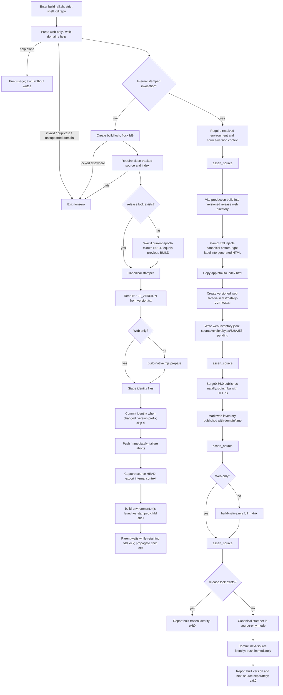
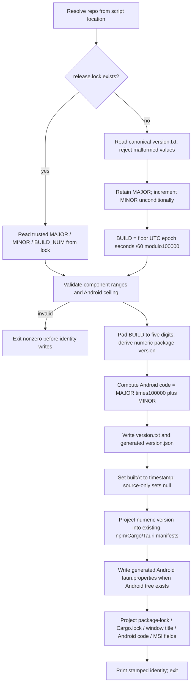
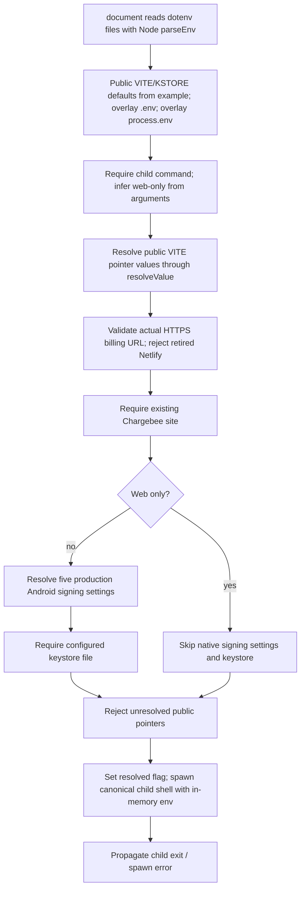
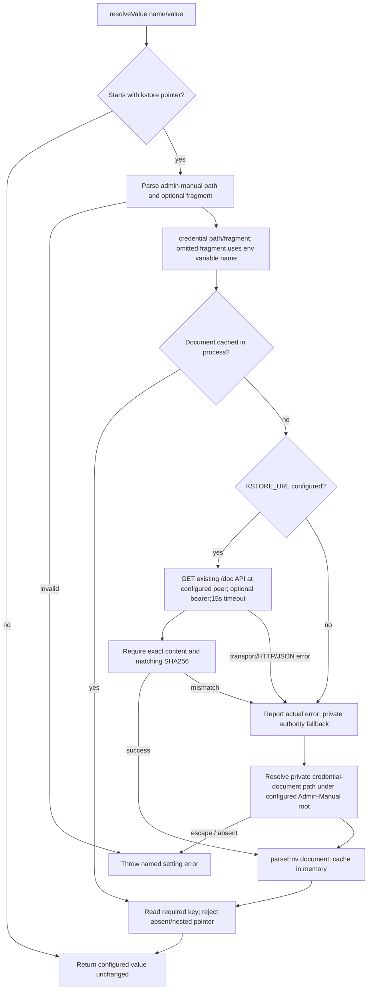
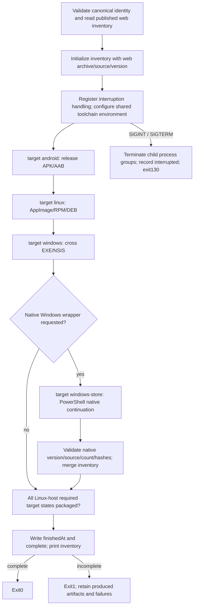
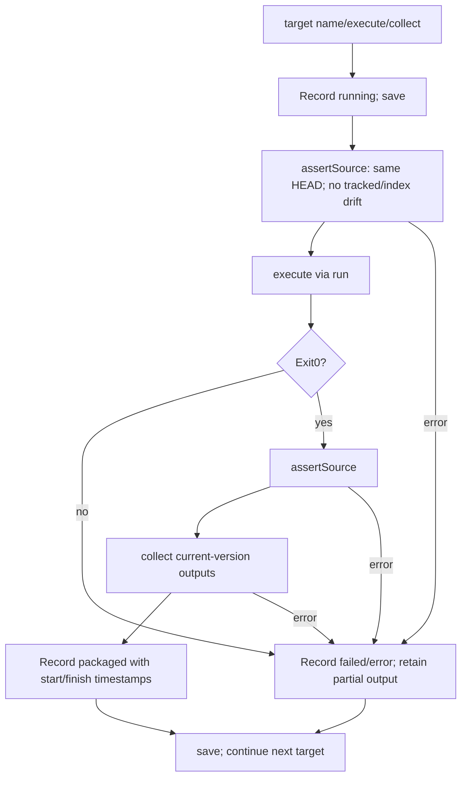
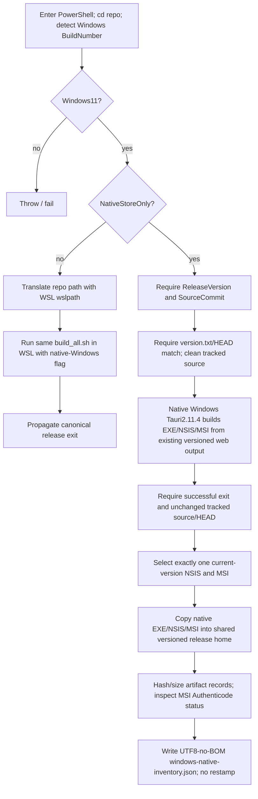

# Build-all sequence and version identity

This document maps the executable flow in `build_all.sh`, `build_all.ps1`,
`scripts/update-version.sh`, `scripts/build-environment.mjs` and
`scripts/build-native.mjs`. Product architecture: `ARCHITECTURE.md` §§29–30.
The diagrams describe implemented control flow, not a claim that every host
or product journey has been executed successfully.

## Canonical entry: build_all.sh

Every unhandled nonzero command exits through `set -euo pipefail`; there is
no ignored commit/push failure. A failed web build or publication never starts
native packaging. A failed native matrix never reaches the success advance.
`assert_source` compares current HEAD to `NATALLY_BUILD_SOURCE_COMMIT` and
requires both tracked working tree and staged index to remain unchanged.
It runs at the four boundaries shown; it is not a product acceptance test.
The parent remains alive during credential resolution/child execution so its
lock remains held across child-process descriptor handling.

`stampHtml(dir)` recursively visits generated HTML files and inserts one fixed
bottom-right `build-release-version` label immediately after the body opener.
It uses `BUILT_VERSION`, including five-digit BUILD. The initial loading page,
mounted app and HTML About/modal surfaces share the same persistent label.
This does not create a new About menu or prove a native OS dialog's contents.

## Canonical stamper: scripts/update-version.sh

The local stamper is physically tracked in this repository; building does not
import a stamper from Admin-Manual. Its lineage is the canonical organization
stamper. `version.txt` is authoritative; `version.json` is a generated mirror.
The product fields are Natally / natally-ai-studio / mba.robin.astronatally.
The Node projection block's `read` function parses JSON with explicit failure;
`write` writes the generated JSON. Existing package files are guarded for
presence. The projection block also writes `nativeExecutable`, Cargo
`default-run` plus its src/main.rs target, and Tauri mainBinaryName/frontendDist. Cargo/native numeric versions omit display padding for valid SemVer.
MSI projects BUILD into quotient/remainder by1000 to fit Windows fields:
`MAJOR.MINOR.floor(BUILD/1000).(BUILD%1000)`. MSI requires MAJOR/MINOR<=255.

### Exact version lifecycle

1. Before an agent edits executable source, run the tracked canonical stamper
   with `NATALLY_STAMP_SOURCE_ONLY=1`, then commit and push that identity before
   editing. Do not assert that the source still equals a previous built copy.
2. Every new full/web-only invocation assigns an identity automatically before
   credential/build prerequisites. MAJOR is operator-controlled; MINOR advances
   unconditionally; BUILD is recomputed from epoch minutes. If the current
   minute equals the prior BUILD, the entry waits for the next minute rather
   than inventing a non-clock BUILD.
3. Web, Android, Linux and Windows from that invocation consume the same
   `BUILT_VERSION` and recorded source commit. Helpers never independently bump.
4. After the entire selected pipeline succeeds, advance MINOR again through the
   same stamper, persist/commit/push, and mark next-source `builtAt:null`.
   Produced artifacts retain the build-time identity. A failed invocation does
   not run this success step.
5. Skipped versions, including multiple source-only versions never built, are
   acceptable. Different code snapshots with the same full displayed version
   are not. Versions are not inferred from a badge to identify source; the
   release inventory also records source commit and artifact hashes.
6. A trusted `release.lock` is the explicit existing frozen-release path shown
   above; callers are responsible for using it only for the same frozen source
   and inputs. It suppresses new counters and the post-success advance.

An epoch-derived BUILD is not a standalone unique ID: it wraps. MINOR is the
persistent discriminator. No historical duplicate label is retroactively
claimed to identify one source snapshot.

## Environment: scripts/build-environment.mjs

This build component performs no KStore writes, database migration, peer
synchronization or hosted capture. Peer URL is configuration, not a hardcoded
IP. It uses repository-contained Node code, not an external Python module or
venv. Private credential documents and keystores remain external runtime inputs;
no secret values are printed or committed. A missing/retired billing endpoint
is reported truthfully; the script never guesses a replacement service.

## Native helper: scripts/build-native.mjs

`readJson` wraps JSON parsing with a file-specific error; `json` writes metadata.
The entry requires canonical five-digit identity and matching version.txt.
`prepare()` synchronizes npm/Cargo locks, Tauri identity, window version,
Android versionCode and MSI projection. It creates the versioned release home.
Normal packaging requires the canonical flag, matching published web inventory,
and the captured source commit.

| Helper/call | Exact role and outputs |
| --- | --- |
| `run(label,command,args,cwd)` | Opens per-target log, spawns detached process with same environment; tracks child; resolves exit/error; closes log descriptor. |
| `files(dir)` | Recursively enumerates existing producer outputs; absent directory returns empty. |
| `stage(file,name,kind)` | Copies an existing producer artifact into the current release home; records bytes/SHA256 and saves inventory immediately. |
| `stageBundles(dir,extensions,label)` | Requires one producer package for each suffix matching the numeric version; calls stage with canonical padded artifact name. |
| Android execute | `npx --no-install tauri android build --target aarch64 --apk --aab`; default production release, never `--debug`. |
| Android collect | Select current stamped Gradle APK/AAB; verify APK signer against configured organization certificate; zipalign16KiB; verify AAB signature; retain APK/AAB. |
| Android symbols | Retain matching producer symbol ZIP or use NDK llvm-objcopy on that invocation's release library and zip arm64-v8a debug symbols. |
| Linux execute | `npx --no-install tauri build --bundles appimage,deb,rpm -- --locked`. |
| Linux collect | Require current-version AppImage, deb and rpm; hash/stage each. |
| Windows cross execute | `npx --no-install tauri build --runner cargo-xwin --target x86_64-pc-windows-msvc --bundles nsis -- --locked`. |
| Windows cross collect | Retain application EXE and current-version NSIS installer separately. No Linux MSI target. |
| Windows native continuation | `wslpath -w` locates tracked PowerShell wrapper; `powershell.exe -NoProfile -File ... -NativeStoreOnly -ReleaseVersion ... -SourceCommit ...`; run logs actual result. |
| Native inventory collect | Require same version/source and exactly three native artifacts; validate each SHA256, append records and retain Store-signing status. |

Producer outputs already identify their version. The stamper creates the
Cargo executable target `natally-vMAJOR_MINOR_BUILD` and matching Tauri
`mainBinaryName`; underscores are the Rust target identifier projection of the
same dotted identity. The application EXE is thus never an unversioned
standalone producer output. Public artifact names use dotted MAJOR.MINOR.BUILD.
Gradle producer archives and desktop packages also carry their version. `stage`
retains already identifiable producer outputs under the canonical public names;
it does not recover an unknown EXE by renaming it after a build. Toolchain
object/dependency files and ABI entries inside archives remain internal.

Web output is built directly at `dist/natally-vVERSION/web/`. The canonical
stamper and `prepare` set Tauri frontendDist to that exact same path.
`NATALLY_WEB_DIR` is consumed by Vite, stampHtml, app/index copy, tar and Surge.
Older release directories are preserved; there is no temporary web build swap.

## Native Windows wrapper: build_all.ps1

Absent Store signing leaves a produced unsigned MSI with its actual signing
status. Store acceptance remains unverified. Native Windows uses its installed
Windows Rust/toolchain and pinned Tauri CLI; WSL supplies the Linux/Android and
cross-Windows portions. A native Windows machine was not executed in this task.

## Retention and publication status

Root dist is no longer ignored. Release archives/packages are LFS attributed;
GitHub LFS is not an allowed destination. The existing Forgejo outage means
artifact transport is separately pending; these scripts do not contact Forgejo
or claim remote artifact retention from local file presence. Source commits are
published to the already-authorized GitHub remote.

Build completion, successful website publication and product acceptance are
separate observations. Full recording acceptance remains governed by the
preauthored rubrics. No app bugs, storage behavior, peer replication, or Store
approval are claimed fixed by this build-script task.
